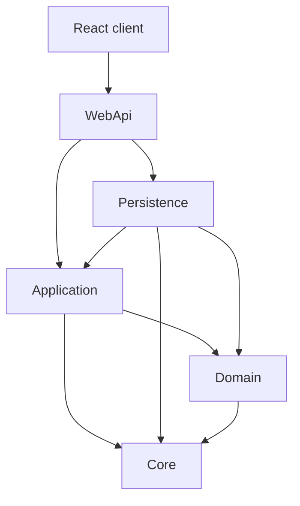
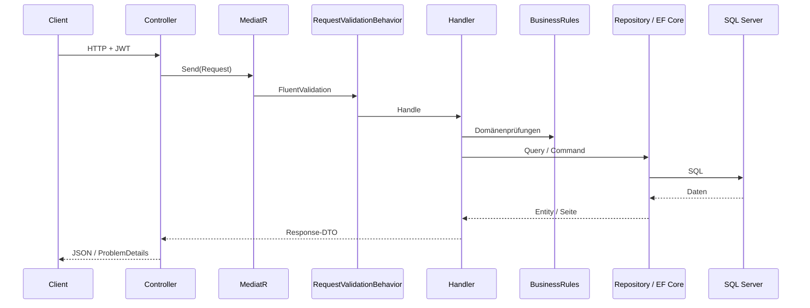
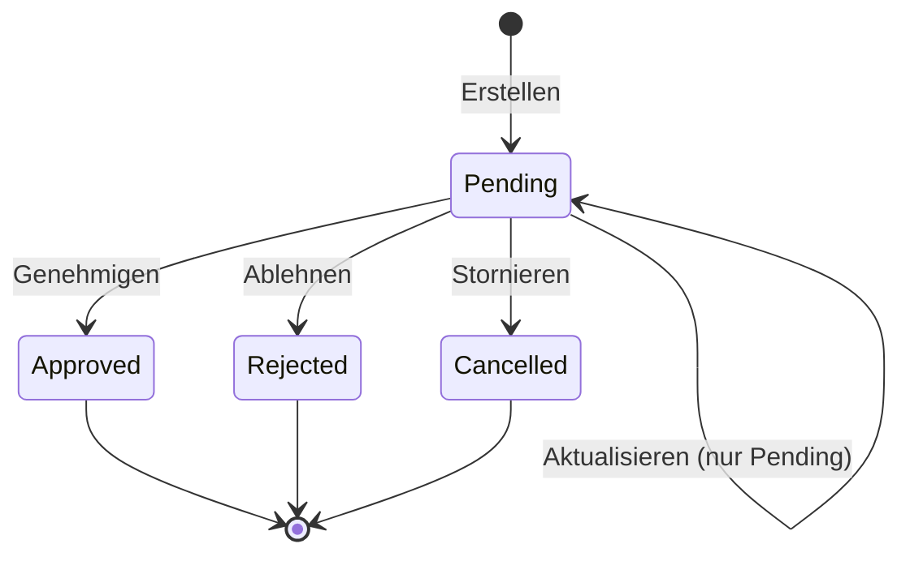

# BankApp

[English README](README.md) · [Türkçe README](README.tr.md)

BankApp ist ein **full-stack Bildungsbeispiel** für **Privat- und Firmenkreditanträge**.  
Backend: **.NET 10** Clean Architecture + CQRS (MediatR), **Modular Monolith** (Identity / Customers / Credit / Notification), Domain Events + Outbox, Idempotency-Key, Saga, SignalR.  
Frontend: **React (Vite + TypeScript)** mit **TR / EN / DE**-i18n und Live-Kreditbenachrichtigungen (SignalR).  
Lokal: **Docker Compose** (SQL Server, Redis, Seq, RabbitMQ, Vault-Lab, WebApi, Client).

**Dokumentation:** [Roadmap](docs/roadmap.de.md) · [Tech-Lernen](docs/tech-learning.de.md) · [Architekturnotizen](docs/architecture-notes.de.md) · [Verlauf](docs/history.de.md) · [Changelog](docs/changelog.de.md) · [Testnotizen](docs/test-notes.de.md) · [Infra](infra/README.md)

---

## Inhaltsverzeichnis

1. [Demo-Logins](#demo-logins)
2. [Funktionen](#funktionen)
3. [Tech-Stack](#tech-stack)
4. [Lösungsstruktur](#lösungsstruktur)
5. [Architekturdiagramme](#architekturdiagramme)
6. [Domänenmodell](#domänenmodell)
7. [Geschäftsregeln](#geschäftsregeln)
8. [API-Überblick](#api-überblick)
9. [SmartEnum](#smartenum)
10. [Daten-Seed](#daten-seed)
11. [Schnellstart](#schnellstart)
12. [Beispielanfragen](#beispielanfragen)

---

## Demo-Logins

| Rolle | E-Mail | Passwort |
|-------|--------|----------|
| Bankmitarbeiter | `staff@bank.local` (auch `staff.tr` / `.en` / `.de`) | `Staff123!` |
| Bankmanager | `manager@bank.local` | `Manager123!` |
| Kunde | `customer@bank.local` (auch `customer.tr` / `.en` / `.de`) | `Customer123!` |

Rollen: **Customer**, **BankStaff**, **BankManager** (Manager hat auch BankStaff).

---

## Funktionen

### Backend

- Privat-/Firmenkunden (TPT), Kreditarten & Untertypen, Anträge
- JWT-Auth + RBAC; öffentliche Privatkunden-Registrierung + E-Mail-Verifizierung (RabbitMQ)
- Genehmigen / Ablehnen / **Stornieren** (Statuswechsel — Storno ≠ Soft-Delete)
- **Domain Events + Transactional Outbox** (Kredit-Lebenszyklus → Queue `domain-events`)
- **Idempotency-Key** (create / approve / reject / cancel; Redis, 24h)
- **Saga / Process Manager** (`CreditApplicationSagas`; Created → Entscheidung → Onboarding-Stubs)
- **SignalR** (`/hubs/credit-applications`; Staff- + Kundengruppen; Publish nach Outbox-Consumer)
- Zahlungsplan, Dashboard-Summary, Personalverwaltung
- Profilfelder + Avatar (≤ 2 MB), Seq-Audit-Kategorien
- Kreditarten anlegen / ändern / löschen / aktiv-passiv (**BankManager**)
- Serilog → Seq, Redis-Cache, FluentValidation, ProblemDetails
- CI: GitHub Actions (Build + Unit/Integration + Client)

### Frontend (`client/`)

- Login / Registrierung / E-Mail-Bestätigung, Anträge, Kunden, Kreditarten, Personal, Profil
- Statistikleiste, FX-Ticker, Barrierefreiheits-Panel (Thema / Schrift / Kontrast)
- Datenschutz- / Cookie-Banner; Sprachumschalter TR / EN / DE
- `Idempotency-Key` (UUID) bei Kredit-Schreibanfragen
- SignalR: Antragsstatus-Toast + Listen-/Detail-Refresh

---

## Tech-Stack

| Bereich | Technologie |
|---------|-------------|
| API | .NET 10, ASP.NET Core, MediatR, FluentValidation, AutoMapper, EF Core 10 |
| Domain | AggregateRoot, Domain Events (`CreditApplication*`), Ardalis SmartEnum (**Name**) |
| DB / Cache / Logs | SQL Server, Redis, Serilog + Seq |
| Observability | OpenTelemetry (OTLP) → Collector → Tempo + Prometheus + Grafana `:3001` |
| Messaging | RabbitMQ (`email-confirmation`, `domain-events`) + Transactional Outbox |
| Idempotency | Header `Idempotency-Key` + Redis (Kredit-Schreib-APIs, 24h) |
| Saga | `CreditApplicationProcessManager` + Tabelle `CreditApplicationSagas` |
| Realtime | SignalR-Hub `/hubs/credit-applications` (JWT `access_token`) |
| Secrets (Lab) | HashiCorp Vault **dev** (`secret/bankapp`; WebApi liest Vault noch nicht) |
| Auth | JWT + Rollen-Claims (Customer / BankStaff / BankManager) |
| Client | React, Vite, TypeScript, react-i18next, react-router, `@microsoft/signalr` |
| Docs (Dev) | OpenAPI + Scalar (`/scalar/v1`) |
| Test / CI | xUnit (Application + WebApi.IntegrationTests), GitHub Actions |
| Seed | Bogus (+ fester Kreditkatalog) |
| Infra | Docker Compose (`infra/`) — Healthcheck-Servicekette |

---

## Lösungsstruktur

```
BankApp/
├── BankApp.slnx
├── README.md / README.tr.md / README.de.md
├── client/              # React-SPA
├── docs/                # Roadmap, Tech-Lernen, Architekturnotizen, Changelog, Verlauf
├── infra/               # docker-compose, .env.example, scripts/vault-seed.sh
├── tests/               # Application.UnitTests, WebApi.IntegrationTests
└── src/
    ├── WebApi/          # Host + Modules/{Identity,Customers,Credit,Notification}
    ├── Application/     # Modules/{Identity,Customers,Credit,Notification} + shared Services
    ├── Domain/          # Entities, Events, SmartEnums, CreditApplicationSaga
    ├── Persistence/     # DbContext (Outbox-Harvest), Migrations, Seed
    └── Core/            # Entity, AggregateRoot, Security, Pipelines
```

**Abhängigkeitsrichtung:** `WebApi` → `Application` / `Persistence` → `Domain` / `Core`.

---

## Architekturdiagramme

### Schichtabhängigkeiten



### Anfragefluss (CQRS)



### Lebenszyklus Kreditantrag



---

## Domänenmodell

### Kunden (TPT)

| Entity | Hinweis |
|--------|---------|
| **Customer** | Gemeinsam: Nummer, E-Mail, Telefon, Adresse, `IsActive`, Soft-Delete |
| **IndividualCustomer** | Name, Ausweis, Geburtsdatum, Geschlecht, … |
| **CorporateCustomer** | Firma, Steuer, Ansprechpartner, … |

### Kreditkatalog & Anträge

| Entity | Rolle |
|--------|-------|
| **CreditType** | Produkt (Kategorie, Risiko, Währung, Locale, aktiv) |
| **CreditSubType** | Paket (Betrags-/Laufzeitspannen, Zinssätze) |
| **CreditApplication** | Antrag + Status + Entscheidungsfelder |

### Soft-Delete vs. Aktiv

| Flag | Bedeutung |
|------|-----------|
| **`IsActive`** | Geschäftlich nutzbar für neue Vorgänge |
| **`IsDeleted`** | Technisches Soft-Delete (`DeletedDate`) |

**Storno** setzt den Status auf `Cancelled` (kein Soft-Delete).

---

## Geschäftsregeln

### Kunden

- Eindeutigkeit (Ausweis / Steuer / Register / Kundennummer / E-Mail).
- Soft-Delete nur **BankManager**; Kunde inaktiv, keine offenen Pending/Approved-Anträge.

### Kreditarten & Untertypen

- Eindeutige Codes; konsistente Min/Max-Spannen.
- Neue Anträge brauchen **aktive** Mutter-Kreditart und Untertyp.
- Kategorie-Match Privat ↔ Individual, Firma ↔ Corporate.
- Mutierende CreditType-APIs nur Manager.

### Kreditanträge

- Betrag/Laufzeit im Paketrahmen.
- Nur **Pending** aktualisierbar / genehmigbar / ablehnbar / stornierbar.

---

## API-Überblick

| Docker Dev | URL |
|------------|-----|
| WebApi | http://localhost:8080 |
| Scalar | http://localhost:8080/scalar/v1 |
| Client | http://localhost:3000 |
| Seq | http://localhost:5341 |
| RabbitMQ UI | http://localhost:15672 |
| Vault UI (Lab) | http://localhost:8200 |

Die meisten Endpunkte brauchen JWT (außer Login / öffentliche Registrierung / E-Mail-Bestätigung).  
Kredit-**Schreib**-APIs (`POST` create/approve/reject/cancel): Pflicht-Header **`Idempotency-Key`**.

| Controller | Highlights |
|------------|------------|
| **Auth** | `login`, `register`, `register-individual`, `confirm-email` |
| **IndividualCustomers** / **CorporateCustomers** | CRUD + inactive / deleted |
| **CreditTypes** | Liste; Mutation + `PUT {id}/active` (Manager) |
| **CreditSubTypes** | CRUD |
| **CreditApplications** | `approve` / `reject` / **`cancel`** (+ Idempotency-Key); `payment-plan` |
| **Dashboard** | `GET summary` |
| **StaffUsers** | Liste / anlegen / ändern (Manager) |
| **Profile** | Eigenes Profil; Avatar |

Details: Scalar-UI.

---

## SmartEnum

Werte als **Name** (z. B. `"Pending"`), nicht als int.

| Typ | Beispielwerte |
|-----|---------------|
| `CreditCategory` | Individual, Corporate |
| `CreditRiskLevel` | Low, Medium, High |
| `CreditApplicationStatus` | Pending, Approved, Rejected, Cancelled |
| `Gender` | Female, Male, PreferNotToSay |
| `PersonTitle` | Dr, Prof |
| `StaffPosition` | CreditAnalyst, RelationshipManager, BranchOfficer, RiskOfficer, OperationsSpecialist, BranchManager |

---

## Daten-Seed

Bei `Database__RunSeed` (typisch Docker / Development). Top-up bis Zielzahlen.

| Seed | Ca. Ziel |
|------|----------|
| Privatkunden | 30 (10 × tr/en/de) |
| Firmenkunden | 30 (10 × tr/en/de) |
| Kreditarten | 16 (TRY/USD/EUR-Kataloge) |
| Untertypen | Pakete je Typ |
| Anträge | 48 |
| Identity | Demo Staff / Manager / Kunden |

---

## Schnellstart

### A — Docker (empfohlen)

```bash
copy infra\.env.example infra\.env
docker compose -f infra/docker-compose.yml --env-file infra/.env up -d --build
```

Siehe [infra/README.md](infra/README.md).

### B — Lokal API + Client

**Voraussetzungen:** .NET 10 SDK, SQL Server, Node.js 20+.

```bash
dotnet ef database update --project src/Persistence/Persistence.csproj --startup-project src/WebApi/WebApi.csproj
dotnet run --project src/WebApi/WebApi.csproj
```

```bash
cd client
copy .env.example .env
npm install
npm run dev
```

Connection String und `TokenOptions__SecurityKey` über appsettings / User Secrets / Env setzen.

### Tests & CI

```bash
dotnet test tests/Application.UnitTests/Application.UnitTests.csproj
dotnet test tests/WebApi.IntegrationTests/WebApi.IntegrationTests.csproj
```

GitHub Actions (`.github/workflows/ci.yml`) führt bei Push/PR auf `main`/`master` Backend-Build, beide Testprojekte und den React-Client-Build aus.

---

## Beispielanfragen

### Login

```http
POST /api/Auth/login
Content-Type: application/json

{
  "email": "staff@bank.local",
  "password": "Staff123!"
}
```

Token: `Authorization: Bearer <token>`.

### Antrag erstellen

```http
POST /api/CreditApplications
Authorization: Bearer <token>
Content-Type: application/json

{
  "creditSubTypeId": "<guid>",
  "requestedAmount": 50000,
  "requestedTermMonths": 24,
  "monthlyIncome": 45000,
  "existingDebtAmount": 5000,
  "purpose": "Privatbedarf",
  "notes": null
}
```

### Genehmigen

```http
POST /api/CreditApplications/{id}/approve
Authorization: Bearer <token>
Content-Type: application/json

{
  "approvedAmount": 45000,
  "approvedTermMonths": 24,
  "approvedInterestRate": 2.45,
  "notes": "Bedingte Genehmigung"
}
```

### Stornieren (Pending)

```http
POST /api/CreditApplications/{id}/cancel
Authorization: Bearer <token>
Content-Type: application/json

{}
```

---

## Lizenz / Zweck

Bildungsbeispiel für Clean Architecture und full-stack Kreditworkflow.  
Vor Produktion Secrets, Connection Strings und Härtung anpassen.
