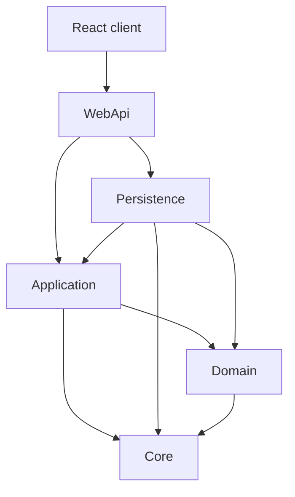
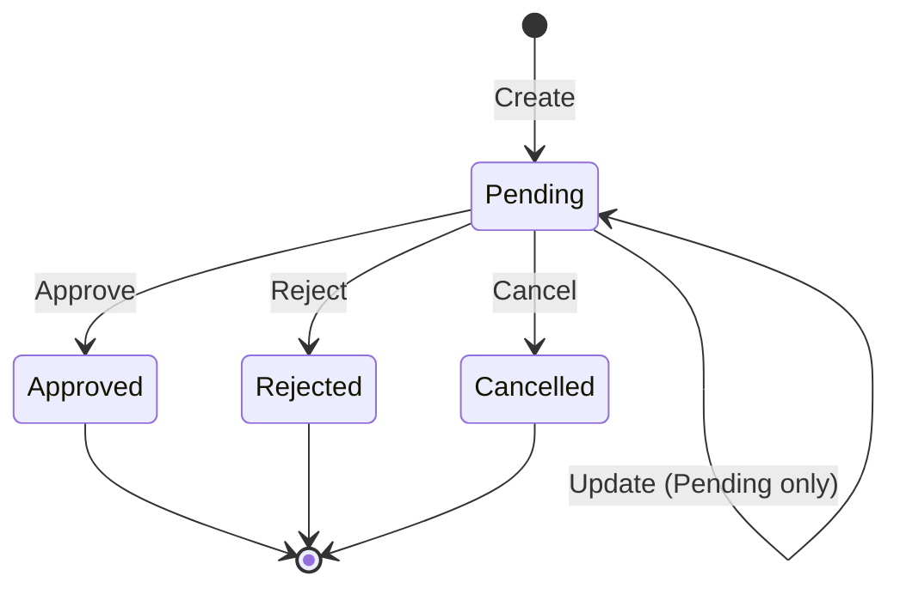

# BankApp

[Türkçe README](README.tr.md) · [Deutsche README](README.de.md)

BankApp is a **full-stack educational banking sample** for **individual and corporate credit applications**.  
Backend: **.NET 10** Clean Architecture + CQRS (MediatR), **Modular Monolith** (Identity / Customers / Credit / Notification), Domain Events + Outbox, Idempotency-Key, Saga, SignalR.  
Frontend: **React (Vite + TypeScript)** with **TR / EN / DE** i18n and live credit notifications (SignalR).  
Local stack: **Docker Compose** (SQL Server, Redis, Seq, RabbitMQ, Vault lab, WebApi, client).

**Docs:** [Roadmap](docs/roadmap.en.md) · [Tech learning](docs/tech-learning.en.md) · [Learning library (TR)](docs/learning/00-index.tr.md) · [Architecture notes](docs/architecture-notes.en.md) · [History](docs/history.en.md) · [Changelog](docs/changelog.en.md) · [Test notes](docs/test-notes.en.md) · [Infra](infra/README.md)

---

## Table of contents

1. [Demo logins](#demo-logins)
2. [Features](#features)
3. [Screenshots (EN)](#screenshots-en)
4. [Tech stack](#tech-stack)
5. [Solution structure](#solution-structure)
6. [Architecture diagrams](#architecture-diagrams)
7. [Domain model](#domain-model)
8. [Business rules](#business-rules)
9. [API overview](#api-overview)
10. [Lab tools](#lab-tools)
11. [SmartEnum](#smartenum)
12. [Data seeding](#data-seeding)
13. [Getting started](#getting-started)
14. [Example requests](#example-requests)

---

## Demo logins

| Role         | Email                                                      | Password       |
| ------------ | ---------------------------------------------------------- | -------------- |
| Bank staff   | `staff@bank.local` (also `staff.tr` / `.en` / `.de`)       | `Staff123!`    |
| Bank manager | `manager@bank.local`                                       | `Manager123!`  |
| Customer     | `customer@bank.local` (also `customer.tr` / `.en` / `.de`) | `Customer123!` |

Roles: **Customer**, **BankStaff**, **BankManager** (manager also has BankStaff).

---

## Features

### Backend

- Individual / corporate customers (TPT), credit types & sub-types, applications
- JWT auth + RBAC; public individual registration with email confirmation (RabbitMQ)
- Approve / reject / **cancel** (status change — not soft-delete for cancel)
- Editable **customer decision letters** (approve/reject templates; stored in `notes`)
- **Domain Events + Transactional Outbox** (credit lifecycle → `domain-events` queue)
- **Idempotency-Key** (create / approve / reject / cancel; Redis, 24h)
- **Saga / Process Manager** (`CreditApplicationSagas`; Created → decision → onboarding stubs)
- **SignalR** (`/hubs/credit-applications`; staff + customer groups; publish after Outbox consumer)
- **Decision letter email (lab)** — after approve/reject, queue `decision-letter` → Seq/log (no SMTP; SMS later)
- **Rate limiting** — policies `auth` / `write` / `fixed` (429); health + SignalR exempt
- **Vault lab** — JWT `SecurityKey` overlay from `secret/bankapp` (Compose); env fallback
- Payment plan (amortization) with **pluggable export** (`payment-plan/export?format=pdf`; CSV/XLSX later) + print via PDF
- Dashboard summary, staff user management, profile + avatar (≤ 2 MB)
- Credit type create / update / delete / activate-deactivate (**BankManager**)
- Serilog → Seq, Redis cache, FluentValidation, ProblemDetails
- OpenTelemetry → collector → Tempo / Prometheus / Grafana

### Frontend (`client/`)

- Login / register / email confirm, applications list & detail, customers, credit types, staff, profile
- Stats strip, FX ticker, accessibility panel (theme / font size / contrast)
- Privacy / cookie banner; locale switcher TR / EN / DE
- Idempotency-Key (UUID) on credit write requests
- SignalR: application-status toast (success / error / warning by event) + list/detail refresh
- Payment plan: collapsible installment table, **PDF download** and **print** (customer + staff)
- Staff decision forms: reloadable approve/reject message templates

### CI/CD

- GitHub Actions: restore/build WebApi, run unit + integration tests, build React client
- Docker Compose stack (`infra/`) for local multi-service runs (healthchecked chain)

### Test

- xUnit **Application.UnitTests** (domain rules, saga, handlers)
- xUnit **WebApi.IntegrationTests** (API + auth/credit flows)
- Client production build (`tsc` + Vite) in CI

---

## Screenshots (EN)

UI captures under [`docs/assets/screenshots/en/`](docs/assets/screenshots/en/) (English locale for now).  
Role walkthroughs: [Customer](docs/screenshots/customer.en.md) · [Bank staff](docs/screenshots/bank-employee.en.md) · [Bank manager](docs/screenshots/bank-manager.en.md)

### Auth, privacy & accessibility

**Login & privacy banner** — Sign-in with TR/EN/DE switcher, remember-me, demo credentials on the card, and cookie/privacy consent before using the SPA.


**Accessibility panel** — Floating controls for light/dark theme, font scale, and high contrast (persisted in the browser).


### Dashboards (by role)

**Customer** — Welcome by display name; own application counters. More: [customer gallery](docs/screenshots/customer.en.md).


**Bank staff** — Global stats, FX ticker, SignalR lifecycle toasts. More: [staff gallery](docs/screenshots/bank-employee.en.md).


**Bank manager** — Same overview with staff + credit-type admin. More: [manager gallery](docs/screenshots/bank-manager.en.md).


### Infrastructure & observability

**Docker Compose** — Full lab stack (SQL, Redis, Seq, RabbitMQ, Vault, OTel, Prometheus, Grafana, WebApi, client).


**Scalar API reference** — Interactive OpenAPI UI for WebApi (`/scalar/v1`).


**Seq** — Structured application logs (Serilog), correlatable with TraceId when OTel is on.


**Prometheus & Grafana** — Metrics scrape + dashboards/traces UI (`:9090` / `:3001`).


**RabbitMQ** — Queues for email confirmation, domain-events (Outbox consumer), and decision-letter (lab).


**Vault (lab)** — Dev-mode secrets seed (`secret/bankapp`); WebApi does not read Vault yet.


---

## Tech stack

| Area              | Technology                                                                        |
| ----------------- | --------------------------------------------------------------------------------- |
| API               | .NET 10, ASP.NET Core, MediatR, FluentValidation, AutoMapper, EF Core 10          |
| Domain            | AggregateRoot, Domain Events (`CreditApplication*`), Ardalis SmartEnum (**name**) |
| DB / cache / logs | SQL Server, Redis, Serilog + Seq                                                  |
| Observability     | OpenTelemetry (OTLP) → collector → Tempo + Prometheus + Grafana `:3001`           |
| Messaging         | RabbitMQ (`email-confirmation`, `domain-events`, `decision-letter`) + Outbox      |
| Idempotency       | Header `Idempotency-Key` + Redis (credit write APIs, 24h)                         |
| Saga              | `CreditApplicationProcessManager` + table `CreditApplicationSagas`                |
| Realtime          | SignalR hub `/hubs/credit-applications` (JWT `access_token`)                      |
| Secrets (lab)     | HashiCorp Vault **dev** (`secret/bankapp`; WebApi does not read Vault yet)        |
| Auth              | JWT + role claims (Customer / BankStaff / BankManager)                            |
| Client            | React, Vite, TypeScript, react-i18next, react-router, `@microsoft/signalr`        |
| Docs (Dev)        | OpenAPI + Scalar (`/scalar/v1`)                                                   |
| Test / CI         | xUnit (Application + WebApi.IntegrationTests), GitHub Actions                     |
| Seed              | Bogus (+ fixed credit catalog)                                                    |
| Infra             | Docker Compose (`infra/`) — healthchecked service chain                           |

---

## Solution structure

```
BankApp/
├── BankApp.slnx
├── README.md / README.tr.md / README.de.md
├── client/              # React SPA
├── docs/                # roadmap, tech learning, architecture notes, changelog, history
├── infra/               # docker-compose, .env.example, scripts/vault-seed.sh
├── tests/               # Application.UnitTests, WebApi.IntegrationTests
└── src/
    ├── WebApi/          # Host + Modules/{Identity,Customers,Credit,Notification}
    ├── Application/     # Modules/{Identity,Customers,Credit,Notification} + shared Services
    ├── Domain/          # Entities, Events, SmartEnums, CreditApplicationSaga
    ├── Persistence/     # DbContext (outbox harvest), migrations, repositories, seed
    └── Core/            # Entity, AggregateRoot, paging, security helpers, pipelines
```

**Dependency direction:** `WebApi` → `Application` / `Persistence` → `Domain` / `Core`.

---

## Architecture diagrams

### Layer dependencies



### Request flow (CQRS)


### Credit application lifecycle



---

## Domain model

### Customers (TPT)

| Entity                 | Notes                                                          |
| ---------------------- | -------------------------------------------------------------- |
| **Customer**           | Shared: number, email, phone, address, `IsActive`, soft-delete |
| **IndividualCustomer** | Name, national id, DOB, gender, …                              |
| **CorporateCustomer**  | Company, tax, authorized person, …                             |

### Credit catalog & applications

| Entity                | Role                                               |
| --------------------- | -------------------------------------------------- |
| **CreditType**        | Product (category, risk, currency, locale, active) |
| **CreditSubType**     | Package (amount/term ranges, rates)                |
| **CreditApplication** | Request + status + decision fields                 |

### Soft delete vs active

| Flag            | Meaning                               |
| --------------- | ------------------------------------- |
| **`IsActive`**  | Business: usable for new operations   |
| **`IsDeleted`** | Technical soft delete (`DeletedDate`) |

Application **cancel** sets status to `Cancelled` via dedicated command (not soft-delete).

---

## Business rules

### Customers

- Unique national id / tax / registration / customer number / email (per rules).
- Soft delete of customers: **BankManager** only; customer must be inactive and have no open Pending/Approved applications.

### Credit types & sub-types

- Unique codes; amount/term range consistency.
- New applications require **active** parent credit type and sub-type.
- Category match: individual ↔ Individual, corporate ↔ Corporate.
- Manager-only mutating APIs for credit types (create / update / delete / set active).

### Credit applications

- Amount/term within sub-type package (and packaging constraints where applied).
- Only **Pending** can be updated, approved, rejected, or cancelled.

---

## API overview

| Service (Docker lab)        | URL / endpoint                            | Lab credentials / notes                                      |
| --------------------------- | ----------------------------------------- | ------------------------------------------------------------ |
| WebApi                      | http://localhost:8080                     | JWT after login (see [Demo logins](#demo-logins))            |
| Scalar                      | http://localhost:8080/scalar/v1           | Dev OpenAPI UI                                               |
| Client                      | http://localhost:3000                     | Demo users on login card                                     |
| SQL Server                  | `localhost,11433`                         | `sa` / `MSSQL_SA_PASSWORD` (default in `.env.example`: `1q2w3e4r!`) |
| Redis                       | `localhost:6379`                          | No password (lab)                                            |
| Redis Insight (UI)          | http://localhost:5540                     | No login; add DB host **`redis`**, port **6379** (Compose DNS) |
| Seq (logs)                  | http://localhost:5341                     | No login (lab; open UI directly)                             |
| Grafana (metrics/traces UI) | http://localhost:3001                     | `admin` / `admin` (`GRAFANA_ADMIN_*`)                        |
| Prometheus                  | http://localhost:9090                     | No login (lab)                                               |
| OTLP gRPC (collector)       | `localhost:4317`                          | App → collector (not a browser UI)                           |
| RabbitMQ UI                 | http://localhost:15672                    | `guest` / `guest`                                            |
| Vault UI (lab)              | http://localhost:8200                     | Method **Token** = `VAULT_DEV_ROOT_TOKEN_ID` (default `bankapp-vault-root-token`); KV `secret/bankapp` |

Most endpoints require JWT (`Authorization: Bearer …`) except login / public register / confirm-email.  
Credit **writes** (`POST` create/approve/reject/cancel): required header **`Idempotency-Key`**.

| Controller                                       | Highlights                                                                                                |
| ------------------------------------------------ | --------------------------------------------------------------------------------------------------------- |
| **Auth**                                         | `POST login`, `register`, `register-individual`, `confirm-email`                                          |
| **IndividualCustomers** / **CorporateCustomers** | CRUD + inactive / deleted lists                                                                           |
| **CreditTypes**                                  | List/get; mutate + `PUT {id}/active` (manager)                                                            |
| **CreditSubTypes**                               | CRUD                                                                                                      |
| **CreditApplications**                           | `approve` / `reject` / **`cancel`** (+ Idempotency-Key); `payment-plan`; `payment-plan/export?format=pdf` |
| **Dashboard**                                    | `GET summary`                                                                                             |
| **StaffUsers**                                   | List / create / update (manager)                                                                          |
| **Profile**                                      | Get mine; update staff profile; upload avatar                                                             |

Interactive details: Scalar UI.

## Lab tools

How to watch the stack (Scalar, Seq, Redis Insight, RabbitMQ UI, Grafana, Vault, SQL client, Docker) — setup, Compose DNS (`redis` vs `localhost`), cautions, and best practices → **[docs/learning/24-lab-tools.tr.md](docs/learning/24-lab-tools.tr.md)** (Turkish chapter; URLs match this README).

Short debug chain: Scalar request → Redis Insight / RabbitMQ → Seq logs → (optional) Grafana traces.

---

## SmartEnum

Stored and serialized by **name** (e.g. `"Pending"`), not integer ordinals.

| Type                      | Values (examples)                                                                                   |
| ------------------------- | --------------------------------------------------------------------------------------------------- |
| `CreditCategory`          | Individual, Corporate                                                                               |
| `CreditRiskLevel`         | Low, Medium, High                                                                                   |
| `CreditApplicationStatus` | Pending, Approved, Rejected, Cancelled                                                              |
| `Gender`                  | Female, Male, PreferNotToSay                                                                        |
| `PersonTitle`             | Dr, Prof                                                                                            |
| `StaffPosition`           | CreditAnalyst, RelationshipManager, BranchOfficer, RiskOfficer, OperationsSpecialist, BranchManager |

---

## Data seeding

Runs when configured (`Database__RunSeed`, typical in Docker / Development). Top-up strategy: fill up to targets if short.

| Seed                 | Approx. target                    |
| -------------------- | --------------------------------- |
| Individual customers | 30 (10 × tr/en/de)                |
| Corporate customers  | 30 (10 × tr/en/de)                |
| Credit types         | 16 (locale catalogs TRY/USD/EUR)  |
| Credit sub-types     | Per type (packaged amounts/terms) |
| Credit applications  | 48                                |
| Identity             | Demo staff / manager / customers  |

---

## Getting started

### Option A — Docker (recommended)

```bash
# from repo root
copy infra\.env.example infra\.env
docker compose -f infra/docker-compose.yml --env-file infra/.env up -d --build
```

See [infra/README.md](infra/README.md) for volumes, ports, and teardown.

### Option B — API + client locally

**Prerequisites:** .NET 10 SDK, SQL Server (or Docker SQL), Node.js 20+, Redis/Seq optional.

```bash
dotnet ef database update --project src/Persistence/Persistence.csproj --startup-project src/WebApi/WebApi.csproj
dotnet run --project src/WebApi/WebApi.csproj
```

```bash
cd client
copy .env.example .env
npm install
npm run dev
```

Configure `ConnectionStrings__BankingConnectionString` and JWT `TokenOptions__SecurityKey` via `appsettings` / User Secrets / env.

### Tests & CI

```bash
dotnet test tests/Application.UnitTests/Application.UnitTests.csproj
dotnet test tests/WebApi.IntegrationTests/WebApi.IntegrationTests.csproj
```

GitHub Actions (`.github/workflows/ci.yml`) runs backend build + both test projects and the React client build on push/PR to `main`/`master`.

---

## Example requests

### Login

```http
POST /api/Auth/login
Content-Type: application/json

{
  "email": "staff@bank.local",
  "password": "Staff123!"
}
```

Use returned access token as `Authorization: Bearer <token>`.

### Create credit application

```http
POST /api/CreditApplications
Authorization: Bearer <token>
Content-Type: application/json

{
  "creditSubTypeId": "<guid>",
  "requestedAmount": 50000,
  "requestedTermMonths": 24,
  "monthlyIncome": 45000,
  "existingDebtAmount": 5000,
  "purpose": "Personal expenses",
  "notes": null
}
```

### Approve

```http
POST /api/CreditApplications/{id}/approve
Authorization: Bearer <token>
Content-Type: application/json

{
  "approvedAmount": 45000,
  "approvedTermMonths": 24,
  "approvedInterestRate": 2.45,
  "notes": "Approved with conditions"
}
```

### Cancel (Pending)

```http
POST /api/CreditApplications/{id}/cancel
Authorization: Bearer <token>
Content-Type: application/json

{}
```

---

## License / purpose

Educational Clean Architecture + full-stack credit workflow sample.  
Adapt connection strings, secrets, and hardening before any production use.
