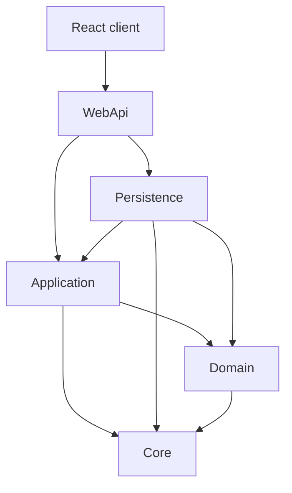
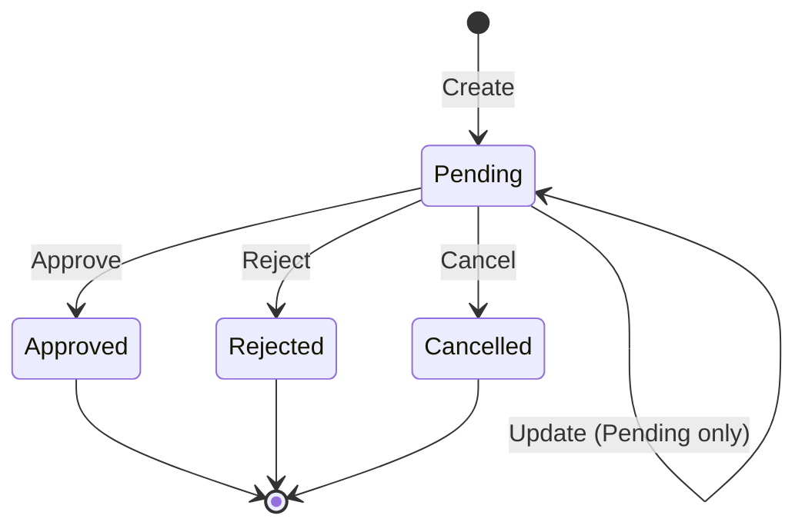

# BankApp

[Türkçe README](README.tr.md) · [Deutsche README](README.de.md)

BankApp is a **full-stack educational banking sample** for **individual and corporate credit applications**.  
Backend: **.NET 10** Clean Architecture + CQRS. Frontend: **React (Vite + TypeScript)** with **TR / EN / DE** i18n. Local stack: **Docker Compose** (SQL Server, Redis, Seq, WebApi, client).

**Docs:** [Roadmap](docs/roadmap.en.md) · [History](docs/history.en.md) · [Changelog](docs/changelog.en.md) · [Test notes](docs/test-notes.en.md) · [Infra](infra/README.md)

---

## Table of contents

1. [Demo logins](#demo-logins)
2. [Features](#features)
3. [Tech stack](#tech-stack)
4. [Solution structure](#solution-structure)
5. [Architecture diagrams](#architecture-diagrams)
6. [Domain model](#domain-model)
7. [Business rules](#business-rules)
8. [API overview](#api-overview)
9. [SmartEnum](#smartenum)
10. [Data seeding](#data-seeding)
11. [Getting started](#getting-started)
12. [Example requests](#example-requests)

---

## Demo logins

| Role | Email | Password |
|------|-------|----------|
| Bank staff | `staff@bank.local` (also `staff.tr` / `.en` / `.de`) | `Staff123!` |
| Bank manager | `manager@bank.local` | `Manager123!` |
| Customer | `customer@bank.local` (also `customer.tr` / `.en` / `.de`) | `Customer123!` |

Roles: **Customer**, **BankStaff**, **BankManager** (manager also has BankStaff).

---

## Features

### Backend

- Individual / corporate customers (TPT), credit types & sub-types, applications
- JWT auth + RBAC; public individual registration
- Approve / reject / **cancel** (status change — not soft-delete for cancel)
- Payment plan (amortization), dashboard summary, staff user management
- Profile fields + avatar upload (≤ 2 MB), Seq audit categories
- Credit type create / update / delete / activate-deactivate (**BankManager**)
- Serilog → Seq, Redis cache, FluentValidation, ProblemDetails

### Frontend (`client/`)

- Login / register, applications list & detail, customers, credit types, staff, profile
- Stats strip, FX ticker, accessibility panel (theme / font size / contrast)
- Locale switcher TR / EN / DE

---

## Tech stack

| Area | Technology |
|------|------------|
| API | .NET 10, ASP.NET Core, MediatR, FluentValidation, AutoMapper, EF Core 10 |
| DB / cache / logs | SQL Server, Redis, Serilog + Seq |
| Domain enums | Ardalis SmartEnum (stored/exchanged by **name**) |
| Auth | JWT + role claims |
| Client | React, Vite, TypeScript, react-i18next, react-router |
| Docs (Dev) | OpenAPI + Scalar (`/scalar/v1`) |
| Seed | Bogus (+ fixed credit catalog) |
| Infra | Docker Compose (`infra/`) |

---

## Solution structure

```
BankApp/
├── BankApp.slnx
├── README.md / README.tr.md / README.de.md
├── client/              # React SPA
├── docs/                # roadmap, changelog, history, test notes
├── infra/               # docker-compose, .env.example
└── src/
    ├── WebApi/          # HTTP host, controllers, DI, static uploads
    ├── Application/     # CQRS features, validators, rules, mappings
    ├── Domain/          # Entities, SmartEnums
    ├── Persistence/     # DbContext, migrations, repositories, seed
    └── Core/            # Shared Entity, paging, security helpers, pipelines
```

**Dependency direction:** `WebApi` → `Application` / `Persistence` → `Domain` / `Core`.

---

## Architecture diagrams

### Layer dependencies



### Request flow (CQRS)


### Credit application lifecycle



---

## Domain model

### Customers (TPT)

| Entity | Notes |
|--------|--------|
| **Customer** | Shared: number, email, phone, address, `IsActive`, soft-delete |
| **IndividualCustomer** | Name, national id, DOB, gender, … |
| **CorporateCustomer** | Company, tax, authorized person, … |

### Credit catalog & applications

| Entity | Role |
|--------|------|
| **CreditType** | Product (category, risk, currency, locale, active) |
| **CreditSubType** | Package (amount/term ranges, rates) |
| **CreditApplication** | Request + status + decision fields |

### Soft delete vs active

| Flag | Meaning |
|------|---------|
| **`IsActive`** | Business: usable for new operations |
| **`IsDeleted`** | Technical soft delete (`DeletedDate`) |

Application **cancel** sets status to `Cancelled` via dedicated command (not soft-delete).

---

## Business rules

### Customers

- Unique national id / tax / registration / customer number / email (per rules).
- Soft delete of customers: **BankManager** only; customer must be inactive and have no open Pending/Approved applications.

### Credit types & sub-types

- Unique codes; amount/term range consistency.
- New applications require **active** parent credit type and sub-type.
- Category match: individual ↔ Individual, corporate ↔ Corporate.
- Manager-only mutating APIs for credit types (create / update / delete / set active).

### Credit applications

- Amount/term within sub-type package (and packaging constraints where applied).
- Only **Pending** can be updated, approved, rejected, or cancelled.

---

## API overview

| Base (Docker Dev) | URL |
|-------------------|-----|
| WebApi | http://localhost:8080 |
| Scalar | http://localhost:8080/scalar/v1 |
| Client | http://localhost:3000 |
| Seq | http://localhost:5341 |

Most endpoints require JWT (`Authorization: Bearer …`) except login / public register.

| Controller | Highlights |
|------------|------------|
| **Auth** | `POST login`, `register`, `register-individual` |
| **IndividualCustomers** / **CorporateCustomers** | CRUD + inactive / deleted lists |
| **CreditTypes** | List/get; mutate + `PUT {id}/active` (manager) |
| **CreditSubTypes** | CRUD |
| **CreditApplications** | CRUD-ish; `approve` / `reject` / **`cancel`**; `payment-plan` |
| **Dashboard** | `GET summary` |
| **StaffUsers** | List / create / update (manager) |
| **Profile** | Get mine; update staff profile; upload avatar |

Interactive details: Scalar UI.

---

## SmartEnum

Stored and serialized by **name** (e.g. `"Pending"`), not integer ordinals.

| Type | Values (examples) |
|------|-------------------|
| `CreditCategory` | Individual, Corporate |
| `CreditRiskLevel` | Low, Medium, High |
| `CreditApplicationStatus` | Pending, Approved, Rejected, Cancelled |
| `Gender` | Female, Male, PreferNotToSay |
| `PersonTitle` | Dr, Prof |
| `StaffPosition` | CreditAnalyst, RelationshipManager, BranchOfficer, RiskOfficer, OperationsSpecialist, BranchManager |

---

## Data seeding

Runs when configured (`Database__RunSeed`, typical in Docker / Development). Top-up strategy: fill up to targets if short.

| Seed | Approx. target |
|------|----------------|
| Individual customers | 30 (10 × tr/en/de) |
| Corporate customers | 30 (10 × tr/en/de) |
| Credit types | 16 (locale catalogs TRY/USD/EUR) |
| Credit sub-types | Per type (packaged amounts/terms) |
| Credit applications | 48 |
| Identity | Demo staff / manager / customers |

---

## Getting started

### Option A — Docker (recommended)

```bash
# from repo root
copy infra\.env.example infra\.env
docker compose -f infra/docker-compose.yml --env-file infra/.env up -d --build
```

See [infra/README.md](infra/README.md) for volumes, ports, and teardown.

### Option B — API + client locally

**Prerequisites:** .NET 10 SDK, SQL Server (or Docker SQL), Node.js 20+, Redis/Seq optional.

```bash
dotnet ef database update --project src/Persistence/Persistence.csproj --startup-project src/WebApi/WebApi.csproj
dotnet run --project src/WebApi/WebApi.csproj
```

```bash
cd client
copy .env.example .env
npm install
npm run dev
```

Configure `ConnectionStrings__BankingConnectionString` and JWT `TokenOptions__SecurityKey` via `appsettings` / User Secrets / env.

### Tests & CI

```bash
dotnet test tests/Application.UnitTests/Application.UnitTests.csproj
dotnet test tests/WebApi.IntegrationTests/WebApi.IntegrationTests.csproj
```

GitHub Actions (`.github/workflows/ci.yml`) runs backend build + both test projects and the React client build on push/PR to `main`/`master`.

---

## Example requests

### Login

```http
POST /api/Auth/login
Content-Type: application/json

{
  "email": "staff@bank.local",
  "password": "Staff123!"
}
```

Use returned access token as `Authorization: Bearer <token>`.

### Create credit application

```http
POST /api/CreditApplications
Authorization: Bearer <token>
Content-Type: application/json

{
  "creditSubTypeId": "<guid>",
  "requestedAmount": 50000,
  "requestedTermMonths": 24,
  "monthlyIncome": 45000,
  "existingDebtAmount": 5000,
  "purpose": "Personal expenses",
  "notes": null
}
```

### Approve

```http
POST /api/CreditApplications/{id}/approve
Authorization: Bearer <token>
Content-Type: application/json

{
  "approvedAmount": 45000,
  "approvedTermMonths": 24,
  "approvedInterestRate": 2.45,
  "notes": "Approved with conditions"
}
```

### Cancel (Pending)

```http
POST /api/CreditApplications/{id}/cancel
Authorization: Bearer <token>
Content-Type: application/json

{}
```

---

## License / purpose

Educational Clean Architecture + full-stack credit workflow sample.  
Adapt connection strings, secrets, and hardening before any production use.
