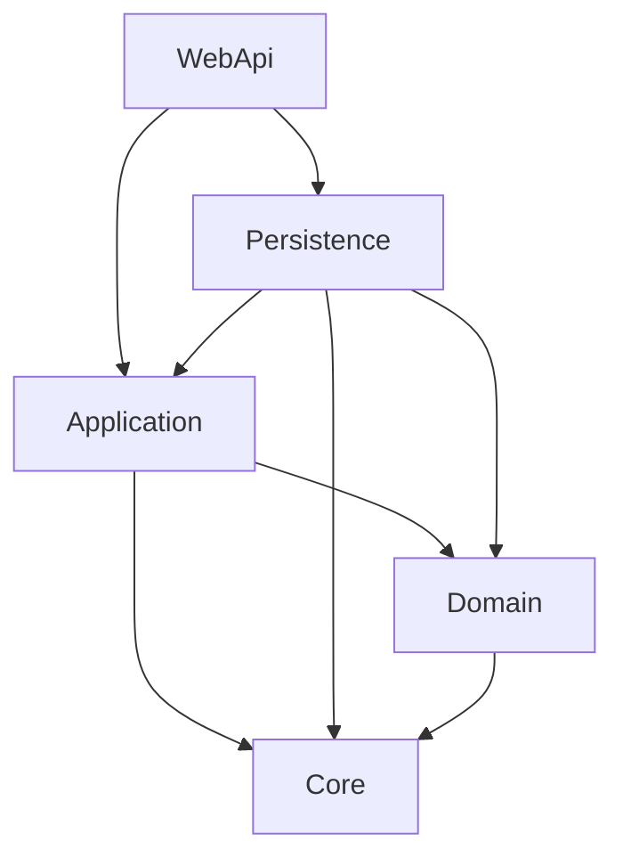
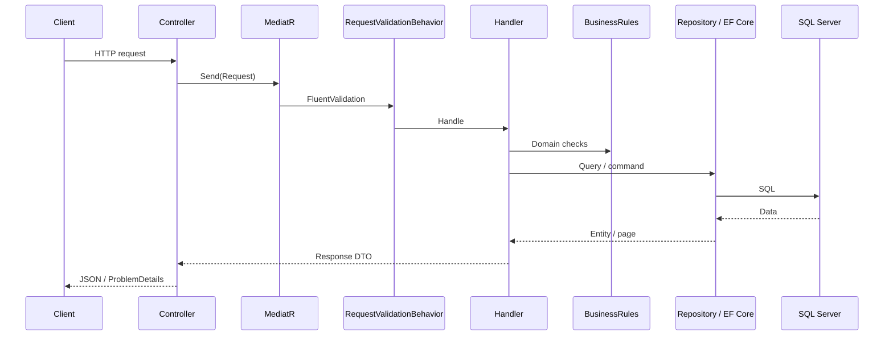
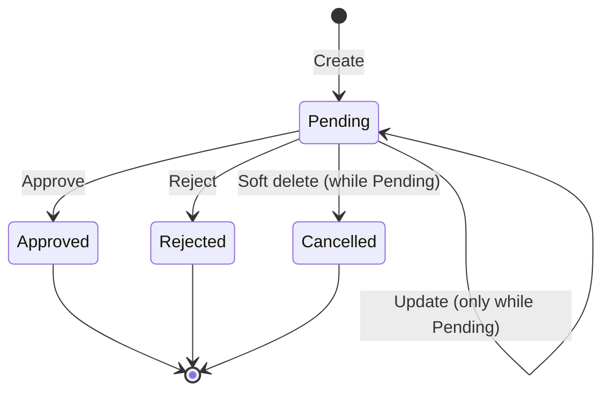

# BankApp

[Türkçe README](README.tr.md)

BankApp is a **.NET 10** banking API built with **Clean Architecture** and **CQRS**. It manages individual/corporate customers and a full credit-lending flow: credit types, sub-types, applications, approve/reject decisions, soft delete, validation, and development-time Bogus seeding.

---

## Table of contents

1. [Overview](#overview)
2. [Tech stack](#tech-stack)
3. [Solution structure](#solution-structure)
4. [Architecture diagrams](#architecture-diagrams)
5. [Domain model & ER diagram](#domain-model--er-diagram)
6. [Business rules](#business-rules)
7. [API endpoints](#api-endpoints)
8. [Cross-cutting concerns](#cross-cutting-concerns)
9. [SmartEnum](#smartenum)
10. [Data seeding](#data-seeding)
11. [Getting started](#getting-started)
12. [Example requests](#example-requests)

---

## Overview

| Area | What the API does |
|------|-------------------|
| **Individual customers** | CRUD, list active / inactive / soft-deleted |
| **Corporate customers** | CRUD, list active / inactive / soft-deleted |
| **Credit types** | Catalog products (Individual / Corporate category, risk level) |
| **Credit sub-types** | Product packages (amount/term ranges, rates, fees) |
| **Credit applications** | Create/update/list/filter, approve, reject, soft delete |

**Key design choices**

- Controllers stay thin and only dispatch MediatR requests.
- Features live under `Application/Features/{Feature}/` (Commands, Queries, Rules, Validators, Profiles).
- Persistence uses EF Core + SQL Server; inheritance for customers uses **TPT**.
- Soft delete (`IsDeleted` + `DeletedDate`) is separate from business activity (`IsActive`).
- Enumerations that matter in JSON/DB are **Ardalis SmartEnum** stored by **name** (e.g. `"Pending"`), not integer ordinals.

---

## Tech stack

| Layer / concern | Technology |
|-----------------|------------|
| Runtime | .NET 10 (`net10.0`) |
| API | ASP.NET Core Controllers |
| CQRS / messaging | MediatR |
| Validation | FluentValidation (+ `RequestValidationBehavior`) |
| Mapping | AutoMapper |
| ORM | Entity Framework Core 10 |
| Database | SQL Server |
| Domain enums | Ardalis.SmartEnum (+ System.Text.Json name converter) |
| API docs (Dev) | OpenAPI + Scalar (`/scalar/v1`) |
| Seed data (Dev) | Bogus |
| Errors | Custom exception middleware → RFC 7807 ProblemDetails |
| Infra extras | CORS, response compression, fixed-window rate limiting |

---

## Solution structure

```
BankApp/
├── BankApp.slnx
├── README.md
├── README.tr.md
└── src/
    ├── WebApi/          # HTTP host, controllers, DI wiring, Scalar
    ├── Application/     # Features (CQRS), validators, business rules, mappings
    ├── Domain/          # Entities, SmartEnums
    ├── Persistence/     # DbContext, configurations, repositories, migrations, seed
    └── Core/            # Shared abstractions: Entity, repositories, paging, pipelines, exceptions
```

| Project | Responsibility |
|---------|----------------|
| **WebApi** | Controllers, middleware pipeline, CORS/rate limit/compression, OpenAPI/Scalar |
| **Application** | Use cases via MediatR handlers; FluentValidation; AutoMapper profiles; business rules |
| **Domain** | Entities and SmartEnums; no infrastructure dependencies (except SmartEnum package) |
| **Persistence** | EF Core `BankingDbContext`, entity configs, repository implementations, migrations, Bogus seed |
| **Core** | `Entity` base, generic repository contracts/base, page request/response, validation behavior, exception types & middleware |

**Dependency direction:** `WebApi` → `Application` / `Persistence` → `Domain` / `Core`. Domain does not reference Persistence or WebApi.

---

## Architecture diagrams

### Layer dependencies



### Request flow (CQRS)



### Credit application lifecycle



---

## Domain model & ER diagram

### Customer hierarchy (TPT)

`Customer` is abstract (shared fields). `IndividualCustomer` and `CorporateCustomer` map to separate tables (Table-Per-Type).

| Entity | Notable fields |
|--------|----------------|
| **Customer** | `CustomerNumber`, `Email`, `PhoneNumber`, `Address`, `IsActive`, audit + `IsDeleted` |
| **IndividualCustomer** | `FirstName`, `LastName`, `NationalId`, DOB, gender, parents |
| **CorporateCustomer** | `CompanyName`, `TaxNumber`, `TaxOffice`, registration no., authorized person, sector fields |

### Credit catalog & applications

| Entity | Role |
|--------|------|
| **CreditType** | Top-level product: `Category` (Individual/Corporate), `RiskLevel`, currency, collateral/guarantor flags |
| **CreditSubType** | Package under a type: min/max amount & term, interest & fee rates |
| **CreditApplication** | Customer applies for a sub-type; status + decision fields |

### ER diagram

```mermaid
erDiagram
    Customer ||--o{ CreditApplication : places
    IndividualCustomer |o--|| Customer : inherits
    CorporateCustomer |o--|| Customer : inherits
    CreditType ||--o{ CreditSubType : contains
    CreditSubType ||--o{ CreditApplication : used_by

    Customer {
        guid Id PK
        string CustomerNumber
        string Email
        bool IsActive
        bool IsDeleted
    }

    IndividualCustomer {
        guid Id PK_FK
        string FirstName
        string LastName
        string NationalId
    }

    CorporateCustomer {
        guid Id PK_FK
        string CompanyName
        string TaxNumber
    }

    CreditType {
        guid Id PK
        string Code UK
        string Category
        string RiskLevel
        bool IsActive
    }

    CreditSubType {
        guid Id PK
        guid CreditTypeId FK
        string Code UK
        decimal MinAmount
        decimal MaxAmount
        int MinTermMonths
        int MaxTermMonths
    }

    CreditApplication {
        guid Id PK
        string ApplicationNumber UK
        guid CustomerId FK
        guid CreditSubTypeId FK
        string Status
        decimal RequestedAmount
        int RequestedTermMonths
    }
```

### Soft delete vs active flag

| Flag | Meaning |
|------|---------|
| **`IsActive`** | Business: customer/product can be used in new operations |
| **`IsDeleted`** | Technical soft delete; record kept with `DeletedDate` |

Deleting a customer or credit entity typically soft-deletes and may also set `IsActive = false`. Dedicated list endpoints expose inactive and deleted customers.

---

## Business rules

Implemented mainly under `Application/Features/*/Rules`.

### Customers

- Unique `NationalId` / `TaxNumber` / `CompanyRegistrationNumber` / `CustomerNumber` / `Email` (per feature rules).
- Soft delete keeps history; inactive/deleted lists for customers.

### Credit types & sub-types

- Unique `Code`.
- Sub-type amount range: `MinAmount` ≤ `MaxAmount`.
- Sub-type term range: `MinTermMonths` ≤ `MaxTermMonths`.
- Sub-type must reference an existing credit type.

### Credit applications

- Customer must exist and be **active**.
- Credit sub-type must exist and be **active**.
- **Category match:** individual customer → `CreditCategory.Individual`; corporate → `Corporate`.
- Requested amount/term must fall within the sub-type’s min/max.
- Unique `ApplicationNumber`.
- Only **Pending** applications can be updated or approved/rejected.
- Soft delete of a pending application sets status to **Cancelled**.

---

## API endpoints

Base URL (Dev): `https://localhost:7152` or `http://localhost:5086`  
Interactive docs (Dev): [Scalar](https://localhost:7152/scalar/v1)

All controllers use `api/[controller]` and fixed-window rate limiting.

### IndividualCustomers — `api/IndividualCustomers`

| Method | Path | Description |
|--------|------|-------------|
| GET | `/` | Paged active list |
| GET | `/inactive` | Paged inactive |
| GET | `/deleted` | Paged soft-deleted |
| GET | `/{id}` | By id |
| POST | `/` | Create |
| PUT | `/` | Update |
| DELETE | `/{id}` | Soft delete |

### CorporateCustomers — `api/CorporateCustomers`

Same shape as individual customers (`/`, `/inactive`, `/deleted`, `/{id}`, POST, PUT, DELETE).

### CreditTypes — `api/CreditTypes`

| Method | Path | Description |
|--------|------|-------------|
| GET | `/` | Paged list |
| GET | `/{id}` | By id |
| POST | `/` | Create |
| PUT | `/` | Update |
| DELETE | `/{id}` | Soft delete |

### CreditSubTypes — `api/CreditSubTypes`

| Method | Path | Description |
|--------|------|-------------|
| GET | `/` | Paged list (optional `creditTypeId`) |
| GET | `/{id}` | By id |
| POST | `/` | Create |
| PUT | `/` | Update |
| DELETE | `/{id}` | Soft delete |

### CreditApplications — `api/CreditApplications`

| Method | Path | Description |
|--------|------|-------------|
| GET | `/` | Paged list; query: `customerId`, `status` (name, e.g. `Pending`) |
| GET | `/{id}` | By id |
| POST | `/` | Create (starts as Pending) |
| PUT | `/` | Update (Pending only) |
| POST | `/{id}/approve` | Approve + decision fields |
| POST | `/{id}/reject` | Reject + reason |
| DELETE | `/{id}` | Soft delete (Pending → Cancelled) |

Paging query parameters typically use `PageRequest.PageIndex` and `PageRequest.PageSize`.

---

## Cross-cutting concerns

| Concern | Behavior |
|---------|----------|
| **Validation** | FluentValidation runs via MediatR pipeline before the handler |
| **Business exceptions** | `BusinessException` → ProblemDetails from exception middleware |
| **CORS** | Policy from `Cors:AllowedOrigins` (empty = allow any in current setup) |
| **Rate limiting** | Fixed window; defaults `PermitLimit=100`, `WindowSeconds=60` |
| **Compression** | Brotli + Gzip |
| **OpenAPI / Scalar** | Mapped in Development |

---

## SmartEnum

Stored and exchanged as **names**, not ints.

| Type | Values |
|------|--------|
| `CreditCategory` | `Individual`, `Corporate` |
| `CreditRiskLevel` | `Low`, `Medium`, `High` |
| `CreditApplicationStatus` | `Pending`, `Approved`, `Rejected`, `Cancelled` |

- **JSON:** `SmartEnumNameConverter` → `"category": "Individual"`.
- **SQL:** `nvarchar` columns via EF `HasConversion` (Name ↔ `FromName`).
- Migration `ConvertCreditEnumsToSmartEnumNames` converts legacy integer columns to names when upgrading.

---

## Data seeding

Runs automatically in **Development** on startup (`BankingDbContextSeed.SeedAsync`).

Uses a **top-up** strategy: if fewer than the target count exist, only the missing rows are inserted.

| Seed | Target | Notes |
|------|--------|------|
| Individual customers | 20 | Bogus (`tr` locale) |
| Corporate customers | 20 | Bogus (`tr`) |
| Credit types | 6 | Fixed catalog (3 individual + 3 corporate) |
| Credit sub-types | 2 per type | Bogus amounts/rates/terms |
| Credit applications | 30 | Category-matched customers ↔ sub-types; mixed statuses |

---

## Getting started

### Prerequisites

- .NET 10 SDK
- SQL Server (local or Docker)
- Visual Studio / VS Code / Rider (optional)

### Configure connection string

Edit `src/WebApi/appsettings.json` (or User Secrets / environment variables):

```json
"ConnectionStrings": {
  "BankingConnectionString": "Data Source=...;Initial Catalog=BankAppDb;..."
}
```

### Migrations

From Package Manager Console (startup project: **WebApi**, default project: **Persistence**), or CLI:

```bash
dotnet ef database update --project src/Persistence/Persistence.csproj --startup-project src/WebApi/WebApi.csproj
```

### Run

```bash
dotnet run --project src/WebApi/WebApi.csproj
```

- API: `https://localhost:7152`
- Scalar UI: `https://localhost:7152/scalar/v1`

On first Development run, seed data is applied after the database is available.

---

## Example requests

### Create credit type

```http
POST /api/CreditTypes
Content-Type: application/json

{
  "name": "Personal Loan",
  "code": "CT-IND-100",
  "category": "Individual",
  "description": "General purpose",
  "currencyCode": "TRY",
  "riskLevel": "Medium",
  "requiresCollateral": false,
  "requiresGuarantor": false,
  "isActive": true
}
```

### Create credit application

```http
POST /api/CreditApplications
Content-Type: application/json

{
  "applicationNumber": "APP-00010001",
  "customerId": "<guid>",
  "creditSubTypeId": "<guid>",
  "requestedAmount": 50000,
  "requestedTermMonths": 24,
  "monthlyIncome": 45000,
  "existingDebtAmount": 5000,
  "purpose": "İhtiyaç",
  "notes": null
}
```

### Approve

```http
POST /api/CreditApplications/{id}/approve
Content-Type: application/json

{
  "approvedAmount": 45000,
  "approvedTermMonths": 24,
  "approvedInterestRate": 2.45,
  "decisionBy": "Credit Officer",
  "notes": "Approved with conditions"
}
```

### List applications by status

```http
GET /api/CreditApplications?PageRequest.PageIndex=0&PageRequest.PageSize=10&status=Pending
```

---

## License / purpose

Educational Clean Architecture sample for banking-style CRUD and credit workflow. Adapt connection strings, secrets, and hardening before any production use.
