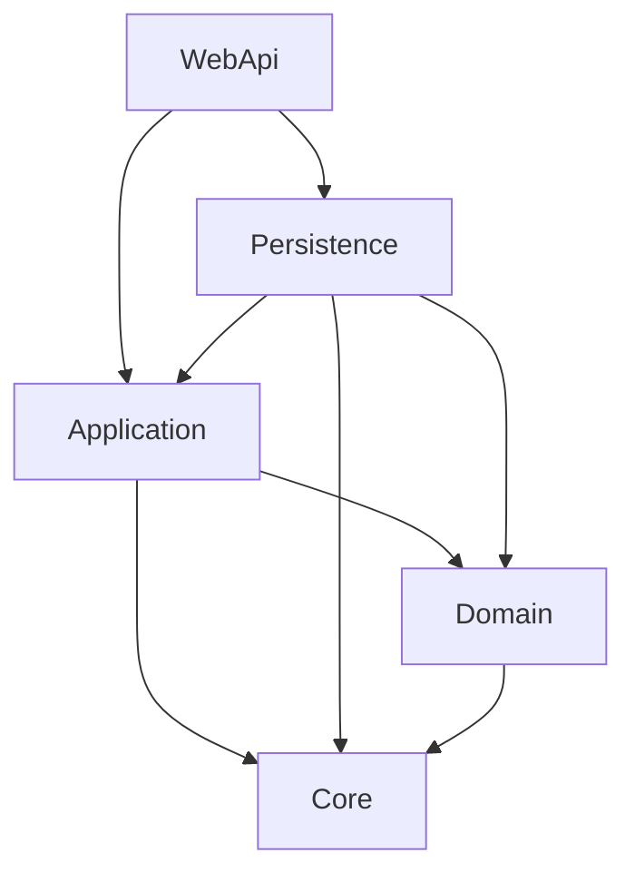
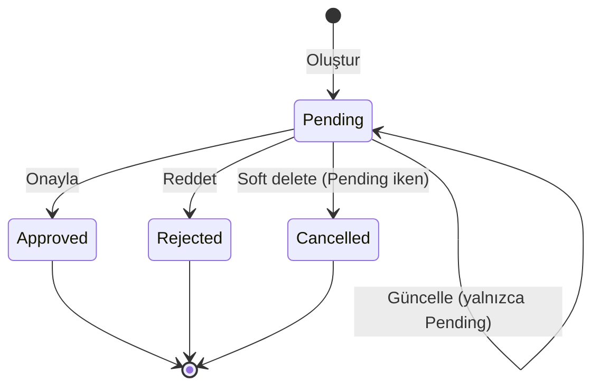

# BankApp

[English README](README.md)

BankApp, **Clean Architecture** ve **CQRS** ile geliştirilmiş bir **.NET 10** bankacılık API’sidir. Bireysel/kurumsal müşteri yönetimi ile kredi ürün kataloğu ve başvuru süreçlerini (tip, alt tip, başvuru, onay/red, soft delete, validasyon, Development ortamında Bogus seed) kapsar.

---

## İçindekiler

1. [Genel bakış](#genel-bakış)
2. [Teknoloji yığını](#teknoloji-yığını)
3. [Çözüm yapısı](#çözüm-yapısı)
4. [Mimari diyagramlar](#mimari-diyagramlar)
5. [Alan modeli ve ER diyagramı](#alan-modeli-ve-er-diyagramı)
6. [İş kuralları](#iş-kuralları)
7. [API uç noktaları](#api-uç-noktaları)
8. [Kesişen kaygılar (cross-cutting)](#kesişen-kaygılar-cross-cutting)
9. [SmartEnum](#smartenum)
10. [Veri seed](#veri-seed)
11. [Kurulum ve çalıştırma](#kurulum-ve-çalıştırma)
12. [Örnek istekler](#örnek-istekler)

---

## Genel bakış

| Alan | API’nin yaptığı iş |
|------|---------------------|
| **Bireysel müşteriler** | CRUD, aktif / pasif / soft-deleted listeleme |
| **Kurumsal müşteriler** | CRUD, aktif / pasif / soft-deleted listeleme |
| **Kredi tipleri** | Ürün kataloğu (Individual / Corporate kategori, risk seviyesi) |
| **Kredi alt tipleri** | Paketler (tutar/vade aralığı, faiz ve ücretler) |
| **Kredi başvuruları** | Oluşturma/güncelleme/liste/filtre, onay, red, soft delete |

**Önemli tasarım kararları**

- Controller’lar ince kalır; yalnızca MediatR isteği gönderir.
- Use-case’ler `Application/Features/{Feature}/` altında toplanır (Commands, Queries, Rules, Validators, Profiles).
- Persistence: EF Core + SQL Server; müşteri kalıtımı **TPT**.
- Soft delete (`IsDeleted` + `DeletedDate`) ile iş durumu (`IsActive`) birbirinden ayrıdır.
- JSON/DB’de anlamlı olan enum’lar **Ardalis SmartEnum** ile **isim** olarak saklanır (`"Pending"`), sayısal sıra değil.

---

## Teknoloji yığını

| Katman / konu | Teknoloji |
|---------------|-----------|
| Runtime | .NET 10 (`net10.0`) |
| API | ASP.NET Core Controllers |
| CQRS / mesajlaşma | MediatR |
| Validasyon | FluentValidation (+ `RequestValidationBehavior`) |
| Mapping | AutoMapper |
| ORM | Entity Framework Core 10 |
| Veritabanı | SQL Server |
| Domain enum’ları | Ardalis.SmartEnum (+ System.Text.Json name converter) |
| API dokümantasyonu (Dev) | OpenAPI + Scalar (`/scalar/v1`) |
| Seed (Dev) | Bogus |
| Hatalar | Özel exception middleware → RFC 7807 ProblemDetails |
| Altyapı ekleri | CORS, response compression, sabit pencereli rate limiting |

---

## Çözüm yapısı

```
BankApp/
├── BankApp.slnx
├── README.md
├── README.tr.md
└── src/
    ├── WebApi/          # HTTP host, controller’lar, DI, Scalar
    ├── Application/     # Feature’lar (CQRS), validator, iş kuralları, mapping
    ├── Domain/          # Entity’ler, SmartEnum’lar
    ├── Persistence/     # DbContext, configuration, repository, migration, seed
    └── Core/            # Ortak soyutlamalar: Entity, repository, paging, pipeline, exception
```

| Proje | Sorumluluk |
|-------|------------|
| **WebApi** | Controller’lar, middleware pipeline, CORS/rate limit/compression, OpenAPI/Scalar |
| **Application** | MediatR handler’lar; FluentValidation; AutoMapper; business rules |
| **Domain** | Entity ve SmartEnum’lar; altyapı bağımlılığı yok (SmartEnum paketi hariç) |
| **Persistence** | EF Core `BankingDbContext`, entity config, repository implementasyonları, migration, Bogus seed |
| **Core** | `Entity` tabanı, generic repository, sayfalama, validation behavior, exception tipleri ve middleware |

**Bağımlılık yönü:** `WebApi` → `Application` / `Persistence` → `Domain` / `Core`. Domain, Persistence veya WebApi’ye referans vermez.

---

## Mimari diyagramlar

### Katman bağımlılıkları



### İstek akışı (CQRS)


### Kredi başvurusu yaşam döngüsü



---

## Alan modeli ve ER diyagramı

### Müşteri hiyerarşisi (TPT)

`Customer` soyuttur (ortak alanlar). `IndividualCustomer` ve `CorporateCustomer` ayrı tablolara map edilir (Table-Per-Type).

| Entity | Öne çıkan alanlar |
|--------|-------------------|
| **Customer** | `CustomerNumber`, `Email`, `PhoneNumber`, `Address`, `IsActive`, audit + `IsDeleted` |
| **IndividualCustomer** | `FirstName`, `LastName`, `NationalId`, doğum tarihi, cinsiyet, anne/baba adı |
| **CorporateCustomer** | `CompanyName`, `TaxNumber`, `TaxOffice`, sicil no., yetkili kişi, sektör alanları |

### Kredi kataloğu ve başvurular

| Entity | Rol |
|--------|-----|
| **CreditType** | Üst ürün: `Category` (Individual/Corporate), `RiskLevel`, para birimi, teminat/kefil bayrakları |
| **CreditSubType** | Tip altındaki paket: min/max tutar & vade, faiz ve ücret oranları |
| **CreditApplication** | Müşterinin alt tipe başvurusu; durum + karar alanları |

### ER diyagramı

```mermaid
erDiagram
    Customer ||--o{ CreditApplication : basvurur
    IndividualCustomer |o--|| Customer : kalitim
    CorporateCustomer |o--|| Customer : kalitim
    CreditType ||--o{ CreditSubType : icerir
    CreditSubType ||--o{ CreditApplication : kullanilir

    Customer {
        guid Id PK
        string CustomerNumber
        string Email
        bool IsActive
        bool IsDeleted
    }

    IndividualCustomer {
        guid Id PK_FK
        string FirstName
        string LastName
        string NationalId
    }

    CorporateCustomer {
        guid Id PK_FK
        string CompanyName
        string TaxNumber
    }

    CreditType {
        guid Id PK
        string Code UK
        string Category
        string RiskLevel
        bool IsActive
    }

    CreditSubType {
        guid Id PK
        guid CreditTypeId FK
        string Code UK
        decimal MinAmount
        decimal MaxAmount
        int MinTermMonths
        int MaxTermMonths
    }

    CreditApplication {
        guid Id PK
        string ApplicationNumber UK
        guid CustomerId FK
        guid CreditSubTypeId FK
        string Status
        decimal RequestedAmount
        int RequestedTermMonths
    }
```

### Soft delete ve aktiflik

| Bayrak | Anlamı |
|--------|--------|
| **`IsActive`** | İş kuralı: müşteri/ürün yeni işlemlerde kullanılabilir mi |
| **`IsDeleted`** | Teknik soft delete; kayıt `DeletedDate` ile saklanır |

Silme genelde soft delete yapar ve çoğu senaryoda `IsActive = false` set eder. Müşteriler için inactive ve deleted liste endpoint’leri vardır.

---

## İş kuralları

Çoğunlukla `Application/Features/*/Rules` altında.

### Müşteriler

- `NationalId` / `TaxNumber` / `CompanyRegistrationNumber` / `CustomerNumber` / `Email` benzersizliği (feature kurallarına göre).
- Soft delete geçmişi korur; inactive/deleted listeleri müşterilerde mevcuttur.

### Kredi tipleri ve alt tipler

- `Code` benzersiz.
- Alt tip tutar aralığı: `MinAmount` ≤ `MaxAmount`.
- Alt tip vade aralığı: `MinTermMonths` ≤ `MaxTermMonths`.
- Alt tip mevcut bir kredi tipine bağlı olmalıdır.

### Kredi başvuruları

- Müşteri var olmalı ve **aktif** olmalı.
- Kredi alt tipi var olmalı ve **aktif** olmalı.
- **Kategori eşleşmesi:** bireysel müşteri → `CreditCategory.Individual`; kurumsal → `Corporate`.
- Talep edilen tutar/vade, alt tipin min/max aralığında olmalı.
- `ApplicationNumber` benzersiz.
- Yalnızca **Pending** başvurular güncellenebilir / onaylanabilir / reddedilebilir.
- Pending başvurunun soft delete’i durumu **Cancelled** yapar.

---

## API uç noktaları

Geliştirme taban URL: `https://localhost:7152` veya `http://localhost:5086`  
Etkileşimli dokümantasyon (Dev): [Scalar](https://localhost:7152/scalar/v1)

Tüm controller’lar `api/[controller]` rotasını ve sabit pencereli rate limiting kullanır.

### IndividualCustomers — `api/IndividualCustomers`

| Metod | Yol | Açıklama |
|-------|-----|----------|
| GET | `/` | Sayfalı aktif liste |
| GET | `/inactive` | Sayfalı pasif liste |
| GET | `/deleted` | Sayfalı soft-deleted liste |
| GET | `/{id}` | Id ile getir |
| POST | `/` | Oluştur |
| PUT | `/` | Güncelle |
| DELETE | `/{id}` | Soft delete |

### CorporateCustomers — `api/CorporateCustomers`

Bireysel müşterilerle aynı şekil (`/`, `/inactive`, `/deleted`, `/{id}`, POST, PUT, DELETE).

### CreditTypes — `api/CreditTypes`

| Metod | Yol | Açıklama |
|-------|-----|----------|
| GET | `/` | Sayfalı liste |
| GET | `/{id}` | Id ile getir |
| POST | `/` | Oluştur |
| PUT | `/` | Güncelle |
| DELETE | `/{id}` | Soft delete |

### CreditSubTypes — `api/CreditSubTypes`

| Metod | Yol | Açıklama |
|-------|-----|----------|
| GET | `/` | Sayfalı liste (opsiyonel `creditTypeId`) |
| GET | `/{id}` | Id ile getir |
| POST | `/` | Oluştur |
| PUT | `/` | Güncelle |
| DELETE | `/{id}` | Soft delete |

### CreditApplications — `api/CreditApplications`

| Metod | Yol | Açıklama |
|-------|-----|----------|
| GET | `/` | Sayfalı liste; query: `customerId`, `status` (isim, örn. `Pending`) |
| GET | `/{id}` | Id ile getir |
| POST | `/` | Oluştur (Pending başlar) |
| PUT | `/` | Güncelle (yalnızca Pending) |
| POST | `/{id}/approve` | Onay + karar alanları |
| POST | `/{id}/reject` | Red + gerekçe |
| DELETE | `/{id}` | Soft delete (Pending → Cancelled) |

Sayfalama genelde `PageRequest.PageIndex` ve `PageRequest.PageSize` query parametreleriyle yapılır.

---

## Kesişen kaygılar (cross-cutting)

| Konu | Davranış |
|------|----------|
| **Validasyon** | FluentValidation, MediatR pipeline’ında handler’dan önce çalışır |
| **İş hataları** | `BusinessException` → exception middleware ile ProblemDetails |
| **CORS** | `Cors:AllowedOrigins` politikası (boş liste = mevcut kurulumda allow any) |
| **Rate limiting** | Sabit pencere; varsayılan `PermitLimit=100`, `WindowSeconds=60` |
| **Compression** | Brotli + Gzip |
| **OpenAPI / Scalar** | Development’ta map edilir |

---

## SmartEnum

Değerler **isim** olarak saklanır ve taşınır; int değil.

| Tip | Değerler |
|-----|----------|
| `CreditCategory` | `Individual`, `Corporate` |
| `CreditRiskLevel` | `Low`, `Medium`, `High` |
| `CreditApplicationStatus` | `Pending`, `Approved`, `Rejected`, `Cancelled` |

- **JSON:** `SmartEnumNameConverter` → `"category": "Individual"`.
- **SQL:** EF `HasConversion` ile `nvarchar` (Name ↔ `FromName`).
- `ConvertCreditEnumsToSmartEnumNames` migration’ı eski int kolonları isme çevirir.

---

## Veri seed

**Development** ortamında uygulama açılışında çalışır (`BankingDbContextSeed.SeedAsync`).

**Top-up** stratejisi: hedef sayıdan az kayıt varsa yalnızca eksik olanlar eklenir.

| Seed | Hedef | Not |
|------|-------|-----|
| Bireysel müşteriler | 20 | Bogus (`tr` locale) |
| Kurumsal müşteriler | 20 | Bogus (`tr`) |
| Kredi tipleri | 6 | Sabit katalog (3 bireysel + 3 kurumsal) |
| Kredi alt tipleri | Tip başına 2 | Bogus tutar/faiz/vade |
| Kredi başvuruları | 30 | Kategori eşleşmeli müşteri ↔ alt tip; karışık status |

---

## Kurulum ve çalıştırma

### Önkoşullar

- .NET 10 SDK
- SQL Server (yerel veya Docker)
- Visual Studio / VS Code / Rider (opsiyonel)

### Connection string

`src/WebApi/appsettings.json` (veya User Secrets / ortam değişkenleri):

```json
"ConnectionStrings": {
  "BankingConnectionString": "Data Source=...;Initial Catalog=BankAppDb;..."
}
```

### Migration

Package Manager Console (startup: **WebApi**, default project: **Persistence**) veya CLI:

```bash
dotnet ef database update --project src/Persistence/Persistence.csproj --startup-project src/WebApi/WebApi.csproj
```

### Çalıştırma

```bash
dotnet run --project src/WebApi/WebApi.csproj
```

- API: `https://localhost:7152`
- Scalar UI: `https://localhost:7152/scalar/v1`

İlk Development çalıştırmada veritabanı hazırsa seed uygulanır.

---

## Örnek istekler

### Kredi tipi oluşturma

```http
POST /api/CreditTypes
Content-Type: application/json

{
  "name": "İhtiyaç Kredisi",
  "code": "CT-IND-100",
  "category": "Individual",
  "description": "Genel amaçlı",
  "currencyCode": "TRY",
  "riskLevel": "Medium",
  "requiresCollateral": false,
  "requiresGuarantor": false,
  "isActive": true
}
```

### Kredi başvurusu oluşturma

```http
POST /api/CreditApplications
Content-Type: application/json

{
  "applicationNumber": "APP-00010001",
  "customerId": "<guid>",
  "creditSubTypeId": "<guid>",
  "requestedAmount": 50000,
  "requestedTermMonths": 24,
  "monthlyIncome": 45000,
  "existingDebtAmount": 5000,
  "purpose": "İhtiyaç",
  "notes": null
}
```

### Onaylama

```http
POST /api/CreditApplications/{id}/approve
Content-Type: application/json

{
  "approvedAmount": 45000,
  "approvedTermMonths": 24,
  "approvedInterestRate": 2.45,
  "decisionBy": "Kredi Uzmanı",
  "notes": "Koşullu onay"
}
```

### Status’e göre başvuru listesi

```http
GET /api/CreditApplications?PageRequest.PageIndex=0&PageRequest.PageSize=10&status=Pending
```

---

## Lisans / amaç

Eğitim amaçlı Clean Architecture örneği (bankacılık CRUD + kredi akışı). Üretim öncesi connection string, secret ve güvenlik sertleştirmesini uyarlayın.
