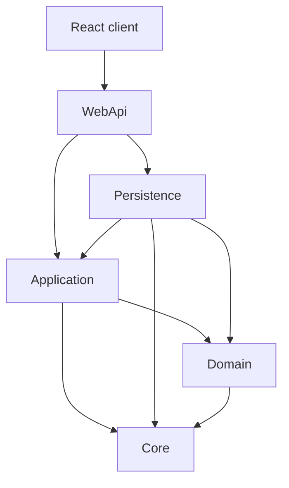
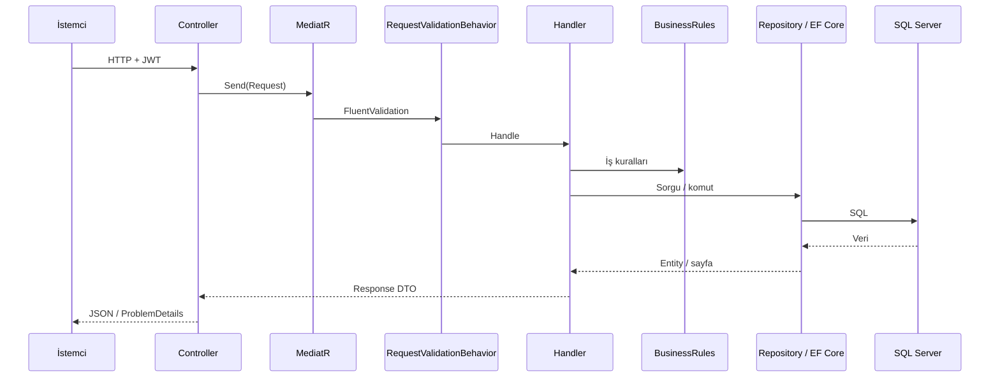
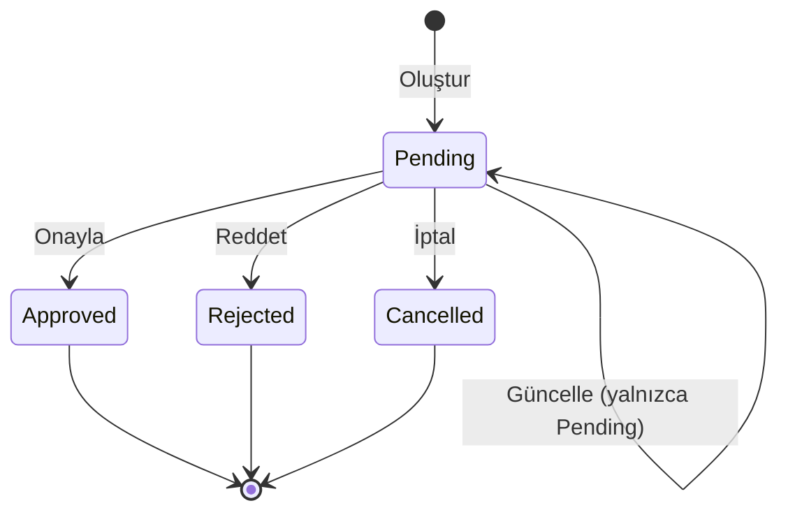

# BankApp

[English README](README.md) · [Deutsche README](README.de.md)

BankApp, **bireysel ve kurumsal kredi başvuruları** için eğitim amaçlı **full-stack** bir bankacılık örneğidir.  
Backend: **.NET 10** Clean Architecture + CQRS (MediatR), **Modular Monolith** (Identity / Customers / Credit / Notification), Domain Events + Outbox, Idempotency-Key, Saga, SignalR.  
Frontend: **React (Vite + TypeScript)**, **TR / EN / DE** i18n, anlık kredi bildirimleri (SignalR).  
Yerel yığın: **Docker Compose** (SQL Server, Redis, Seq, RabbitMQ, Vault lab, WebApi, client).

**Dokümanlar:** [Yol haritası](docs/roadmap.tr.md) · [Tech öğrenme](docs/tech-learning.tr.md) · [Öğrenme kitaplığı](docs/learning/00-index.tr.md) · [Mimari notlar](docs/architecture-notes.tr.md) · [Geçmiş](docs/history.tr.md) · [Changelog](docs/changelog.tr.md) · [Test notları](docs/test-notes.tr.md) · [Altyapı](infra/README.md)

---

## İçindekiler

1. [Demo girişler](#demo-girişler)
2. [Özellikler](#özellikler)
3. [Ekran görüntüleri (EN)](#ekran-görüntüleri-en)
4. [Teknoloji yığını](#teknoloji-yığını)
5. [Çözüm yapısı](#çözüm-yapısı)
6. [Mimari diyagramlar](#mimari-diyagramlar)
7. [Alan modeli](#alan-modeli)
8. [İş kuralları](#iş-kuralları)
9. [API özeti](#api-özeti)
10. [Lab araçları](#lab-araçları)
11. [SmartEnum](#smartenum)
12. [Veri seed](#veri-seed)
13. [Kurulum](#kurulum)
14. [Örnek istekler](#örnek-istekler)

---

## Demo girişler

| Rol | E-posta | Şifre |
|-----|---------|-------|
| Banka personeli | `staff@bank.local` (ayrıca `staff.tr` / `.en` / `.de`) | `Staff123!` |
| Banka yöneticisi | `manager@bank.local` | `Manager123!` |
| Müşteri | `customer@bank.local` (ayrıca `customer.tr` / `.en` / `.de`) | `Customer123!` |

Roller: **Customer**, **BankStaff**, **BankManager** (yönetici aynı zamanda BankStaff).

---

## Özellikler

### Backend

- Bireysel / kurumsal müşteri (TPT), kredi tipi & alt tip, başvuru
- JWT + RBAC; kamuya açık bireysel kayıt + e-posta doğrulama (RabbitMQ)
- Onay / red / **iptal** (durum değişimi — iptal soft-delete değildir)
- Düzenlenebilir **müşteri karar mektubu** (onay/red şablonları; `notes` alanında saklanır)
- **Domain Events + Transactional Outbox** (kredi yaşam döngüsü → kuyruk `domain-events`)
- **Idempotency-Key** (create / approve / reject / cancel; Redis, 24 saat)
- **Saga / Process Manager** (`CreditApplicationSagas`; Created → karar → onboarding stub’ları)
- **SignalR** (`/hubs/credit-applications`; staff + müşteri grupları; Outbox consumer sonrası yayın)
- **Karar mektubu e-posta / SMS (lab)** — onay/red sonrası `decision-letter` + `decision-letter-sms` → Seq/log (SMTP/SMS gateway yok)
- **Rate limiting** — `auth` / `write` / `fixed` politikaları (429); health + SignalR muaf
- **Vault lab** — JWT `SecurityKey` `secret/bankapp` overlay (Compose); env fallback
- Ödeme planı (amortisman) + **genişletilebilir export** (`payment-plan/export?format=pdf`; ileride CSV/XLSX) ve yazdırma
- Dashboard özeti, personel yönetimi, profil + avatar (≤ 2 MB)
- Kredi tipi oluşturma / güncelleme / silme / aktif-pasif (**BankManager**)
- Serilog → Seq, Redis önbellek, FluentValidation, ProblemDetails
- OpenTelemetry → collector → Tempo / Prometheus / Grafana

### Frontend (`client/`)

- Giriş / kayıt / e-posta onay, başvurular, müşteriler, kredi türleri, personel, profil
- İstatistik şeridi, döviz ticker, erişilebilirlik paneli (tema / yazı / kontrast)
- Datenschutz / çerez bandı; dil seçici TR / EN / DE
- Kredi yazma isteklerinde `Idempotency-Key` (UUID)
- SignalR: başvuru durumu toast (olaya göre success / error / warning) + liste/detay yenileme
- Ödeme planı: açılır taksit listesi, **PDF indir** ve **yazdır** (müşteri + personel)
- Personel karar formları: yenilenebilir onay/red mesaj şablonları

### CI/CD

- GitHub Actions: WebApi restore/build, unit + integration testler, React client build
- Docker Compose (`infra/`) ile yerel çoklu servis (healthcheck zinciri)

### Test

- xUnit **Application.UnitTests** (domain kuralları, saga, handler’lar)
- xUnit **WebApi.IntegrationTests** (API + auth/kredi akışları)
- CI’da client production build (`tsc` + Vite)

---

## Ekran görüntüleri (EN)

Yakalar [`docs/assets/screenshots/en/`](docs/assets/screenshots/en/) altında (şimdilik yalnızca İngilizce UI).  
Rol galerileri: [Müşteri](docs/screenshots/customer.en.md) · [Personel](docs/screenshots/bank-employee.en.md) · [Yönetici](docs/screenshots/bank-manager.en.md)

### Auth, gizlilik ve erişilebilirlik

**Giriş ve gizlilik bandı** — TR/EN/DE dil seçici, beni hatırla, kart üzerinde demo kimlik bilgileri; SPA kullanımından önce çerez/gizlilik onayı.


**Erişilebilirlik paneli** — Açık/koyu tema, yazı boyutu ve yüksek kontrast (tarayıcıda saklanır).


### Dashboard’lar (role göre)

**Müşteri** — Görünen adla karşılama; kendi başvuru sayaçları. Devamı: [müşteri galerisi](docs/screenshots/customer.en.md).


**Banka personeli** — Genel istatistikler, döviz ticker, SignalR yaşam döngüsü toast’ları. Devamı: [personel galerisi](docs/screenshots/bank-employee.en.md).


**Banka yöneticisi** — Personel + kredi tipi yönetimiyle aynı özet. Devamı: [yönetici galerisi](docs/screenshots/bank-manager.en.md).


### Altyapı ve gözlemlenebilirlik

**Docker Compose** — Tam lab yığını (SQL, Redis, Seq, RabbitMQ, Vault, OTel, Prometheus, Grafana, WebApi, client).


**Scalar API referansı** — WebApi için etkileşimli OpenAPI UI (`/scalar/v1`).


**Seq** — Yapılandırılmış uygulama logları (Serilog); OTel açıksa TraceId ile ilişkilendirilebilir.


**Prometheus ve Grafana** — Metrik scrape + dashboard/trace UI (`:9090` / `:3001`).


**RabbitMQ** — E-posta onay, domain-events (Outbox), decision-letter ve decision-letter-sms (lab) kuyrukları.


**Vault (lab)** — Dev-mode secrets seed (`secret/bankapp`); WebApi henüz Vault okumaz.


---

## Teknoloji yığını

| Alan | Teknoloji |
|------|-----------|
| API | .NET 10, ASP.NET Core, MediatR, FluentValidation, AutoMapper, EF Core 10 |
| Domain | AggregateRoot, Domain Events (`CreditApplication*`), Ardalis SmartEnum (**isim**) |
| DB / önbellek / log | SQL Server, Redis, Serilog + Seq |
| Observability | OpenTelemetry (OTLP) → collector → Tempo + Prometheus + Grafana `:3001` |
| Messaging | RabbitMQ (`email-confirmation`, `domain-events`, `decision-letter`, `decision-letter-sms`) + Outbox |
| Idempotency | Header `Idempotency-Key` + Redis (kredi yazma API’leri, 24 saat) |
| Saga | `CreditApplicationProcessManager` + tablo `CreditApplicationSagas` |
| Realtime | SignalR hub `/hubs/credit-applications` (JWT `access_token`) |
| Secrets (lab) | HashiCorp Vault **dev** (`secret/bankapp`; WebApi henüz Vault okumaz) |
| Auth | JWT + rol claim’leri (Customer / BankStaff / BankManager) |
| Client | React, Vite, TypeScript, react-i18next, react-router, `@microsoft/signalr` |
| Dokümantasyon (Dev) | OpenAPI + Scalar (`/scalar/v1`) |
| Test / CI | xUnit (Application + WebApi.IntegrationTests), GitHub Actions |
| Seed | Bogus (+ sabit kredi kataloğu) |
| Altyapı | Docker Compose (`infra/`) — healthcheck’li servis zinciri |

---

## Çözüm yapısı

```
BankApp/
├── BankApp.slnx
├── README.md / README.tr.md / README.de.md
├── client/              # React SPA
├── docs/                # yol haritası, tech öğrenme, mimari notlar, changelog, geçmiş
├── infra/               # docker-compose, .env.example, scripts/vault-seed.sh
├── tests/               # Application.UnitTests, WebApi.IntegrationTests
└── src/
    ├── WebApi/          # Host + Modules/{Identity,Customers,Credit,Notification}
    ├── Application/     # Modules/{Identity,Customers,Credit,Notification} + shared Services
    ├── Domain/          # Entities, Events, SmartEnums, CreditApplicationSaga
    ├── Persistence/     # DbContext (outbox harvest), migrations, seed
    └── Core/            # Entity, AggregateRoot, security, pipelines
```

**Bağımlılık yönü:** `WebApi` → `Application` / `Persistence` → `Domain` / `Core`.

---

## Mimari diyagramlar

### Katman bağımlılıkları



### İstek akışı (CQRS)



### Kredi başvurusu yaşam döngüsü



---

## Alan modeli

### Müşteriler (TPT)

| Entity | Not |
|--------|-----|
| **Customer** | Ortak: numara, e-posta, telefon, adres, `IsActive`, soft-delete |
| **IndividualCustomer** | Ad, TCKN, doğum tarihi, cinsiyet, … |
| **CorporateCustomer** | Şirket, vergi, yetkili kişi, … |

### Kredi kataloğu ve başvurular

| Entity | Rol |
|--------|-----|
| **CreditType** | Ürün (kategori, risk, para birimi, locale, aktif) |
| **CreditSubType** | Paket (tutar/vade aralığı, oranlar) |
| **CreditApplication** | Talep + durum + karar alanları |

### Soft delete ve aktiflik

| Bayrak | Anlam |
|--------|-------|
| **`IsActive`** | İş: yeni işlemlerde kullanılabilir mi |
| **`IsDeleted`** | Teknik soft delete (`DeletedDate`) |

Başvuru **iptali** `Cancelled` durumuna özel komutla geçer (soft-delete değil).

---

## İş kuralları

### Müşteriler

- Benzersizlik kuralları (TCKN / vergi / sicil / müşteri no / e-posta).
- Soft delete: yalnızca **BankManager**; müşteri pasif olmalı ve açık Pending/Approved başvurusu olmamalı.

### Kredi tipleri ve alt tipler

- Kod benzersizliği; tutar/vade aralığı tutarlılığı.
- Yeni başvuru için üst tip ve alt tip **aktif** olmalı.
- Kategori eşleşmesi bireysel ↔ Individual, kurumsal ↔ Corporate.
- Kredi tipi mutasyonları yalnızca yönetici.

### Kredi başvuruları

- Tutar/vade paket aralığında (ve paket kısıtları).
- Yalnızca **Pending** güncellenebilir / onaylanabilir / reddedilebilir / iptal edilebilir.

---

## API özeti

| Servis (Docker lab) | URL / uç | Lab kimlik / not |
|---------------------|----------|------------------|
| WebApi | http://localhost:8080 | Login sonrası JWT ([Demo girişler](#demo-girişler)) |
| Scalar | http://localhost:8080/scalar/v1 | Dev OpenAPI UI |
| Client | http://localhost:3000 | Demo hesaplar giriş kartında |
| SQL Server | `localhost,11433` | `sa` / `MSSQL_SA_PASSWORD` (`.env.example` varsayılan: `1q2w3e4r!`) |
| Redis | `localhost:6379` | Şifre yok (lab) |
| Redis Insight (UI) | http://localhost:5540 | Giriş yok; DB eklerken host **`redis`**, port **6379** (Compose DNS) |
| Seq (log) | http://localhost:5341 | Giriş yok (lab; UI doğrudan açılır) |
| Grafana (metrik/trace UI) | http://localhost:3001 | `admin` / `admin` (`GRAFANA_ADMIN_*`) |
| Prometheus | http://localhost:9090 | Giriş yok (lab) |
| OTLP gRPC (collector) | `localhost:4317` | Uygulama → collector (tarayıcı UI değil) |
| RabbitMQ UI | http://localhost:15672 | `guest` / `guest` |
| Vault UI (lab) | http://localhost:8200 | Yöntem **Token** = `VAULT_DEV_ROOT_TOKEN_ID` (varsayılan `bankapp-vault-root-token`); KV `secret/bankapp` |

Login / kamu kayıt / e-posta onay dışında çoğu endpoint JWT ister.  
Kredi **yazma** (`POST` create/approve/reject/cancel): zorunlu header **`Idempotency-Key`**.

| Controller | Öne çıkanlar |
|------------|--------------|
| **Auth** | `login`, `register`, `register-individual`, `confirm-email` |
| **IndividualCustomers** / **CorporateCustomers** | CRUD + inactive / deleted |
| **CreditTypes** | Liste; mutasyon + `PUT {id}/active` (manager) |
| **CreditSubTypes** | CRUD |
| **CreditApplications** | `approve` / `reject` / **`cancel`** (+ Idempotency-Key); `payment-plan`; `payment-plan/export?format=pdf` |
| **Dashboard** | `GET summary` |
| **StaffUsers** | Liste / oluştur / güncelle (manager) |
| **Profile** | Profilim; personel güncelleme; avatar |

Detaylar: Scalar UI.

## Lab araçları

Stack’i izlemek için (Scalar, Seq, Redis Insight, RabbitMQ UI, Grafana, Vault, SQL istemcisi, Docker): kurulum, Compose DNS (`redis` vs `localhost`), dikkat noktaları ve best practice → **[docs/learning/24-lab-tools.tr.md](docs/learning/24-lab-tools.tr.md)**.

Kısa debug zinciri: Scalar istek → Redis Insight / RabbitMQ → Seq log → (gerekirse) Grafana trace.

---

## SmartEnum

Değerler **isim** olarak saklanır (`"Pending"`), int değil.

| Tip | Örnek değerler |
|-----|----------------|
| `CreditCategory` | Individual, Corporate |
| `CreditRiskLevel` | Low, Medium, High |
| `CreditApplicationStatus` | Pending, Approved, Rejected, Cancelled |
| `Gender` | Female, Male, PreferNotToSay |
| `PersonTitle` | Dr, Prof |
| `StaffPosition` | CreditAnalyst, RelationshipManager, BranchOfficer, RiskOfficer, OperationsSpecialist, BranchManager |

---

## Veri seed

`Database__RunSeed` açıkken (Docker / Development tipik). Top-up: eksik kalanlar tamamlanır.

| Seed | Yaklaşık hedef |
|------|----------------|
| Bireysel müşteri | 30 (10 × tr/en/de) |
| Kurumsal müşteri | 30 (10 × tr/en/de) |
| Kredi tipi | 16 (TRY/USD/EUR katalogları) |
| Kredi alt tipi | Tip başına paketler |
| Başvuru | 48 |
| Identity | Demo staff / manager / customer |

---

## Kurulum

### A — Docker (önerilen)

```bash
copy infra\.env.example infra\.env
docker compose -f infra/docker-compose.yml --env-file infra/.env up -d --build
```

Ayrıntılar: [infra/README.md](infra/README.md).

### B — Yerel API + client

**Önkoşul:** .NET 10 SDK, SQL Server, Node.js 20+.

```bash
dotnet ef database update --project src/Persistence/Persistence.csproj --startup-project src/WebApi/WebApi.csproj
dotnet run --project src/WebApi/WebApi.csproj
```

```bash
cd client
copy .env.example .env
npm install
npm run dev
```

Connection string ve `TokenOptions__SecurityKey` için `appsettings` / User Secrets / ortam değişkenleri kullanın.

### Testler ve CI

```bash
dotnet test tests/Application.UnitTests/Application.UnitTests.csproj
dotnet test tests/WebApi.IntegrationTests/WebApi.IntegrationTests.csproj
```

GitHub Actions (`.github/workflows/ci.yml`) `main`/`master` push/PR’da backend build + her iki test projesi ve React client build çalıştırır.

---

## Örnek istekler

### Giriş

```http
POST /api/Auth/login
Content-Type: application/json

{
  "email": "staff@bank.local",
  "password": "Staff123!"
}
```

Token: `Authorization: Bearer <token>`.

### Başvuru oluşturma

```http
POST /api/CreditApplications
Authorization: Bearer <token>
Content-Type: application/json

{
  "creditSubTypeId": "<guid>",
  "requestedAmount": 50000,
  "requestedTermMonths": 24,
  "monthlyIncome": 45000,
  "existingDebtAmount": 5000,
  "purpose": "İhtiyaç",
  "notes": null
}
```

### Onay

```http
POST /api/CreditApplications/{id}/approve
Authorization: Bearer <token>
Content-Type: application/json

{
  "approvedAmount": 45000,
  "approvedTermMonths": 24,
  "approvedInterestRate": 2.45,
  "notes": "Koşullu onay"
}
```

### İptal (Pending)

```http
POST /api/CreditApplications/{id}/cancel
Authorization: Bearer <token>
Content-Type: application/json

{}
```

---

## Lisans / amaç

Eğitim amaçlı Clean Architecture + full-stack kredi iş akışı örneği.  
Üretim öncesi secret, connection string ve güvenlik sertleştirmesini uyarlayın.
