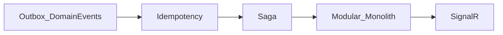

# Architektur- und Schulungsnotizen

[Türkçe](architecture-notes.tr.md) · [English](architecture-notes.en.md)

**Datum:** 2026-10-21  
**Kontext:** Bildungsprojekt BankApp — Notizen zum erneuten Nachlesen vor der nächsten Phase.

Roadmap: [roadmap.de.md](roadmap.de.md) (Phase 6).

---

## Aktueller Stack (Kurz)

Clean Architecture + CQRS (MediatR), JWT/RBAC, Redis, Serilog+Seq, RabbitMQ (E-Mail-Verifizierung), Docker Compose, React-i18n (TR/EN/DE), CI + Integrationstests.

Als Nächstes keine „fehlenden Features“, sondern **lernstarke moderne Schichten**.

---

## Gewählter Fokus

**Architekturtiefe** (nicht zuerst Plattform / Produkt-AI).

Vorerst außer Scope: OTel/Grafana-Implementierung, Keycloak, OAuth, K8s, AI-Chatbot-Code.

---

## Vorgeschlagene Technologiegruppen (Diskussionskurzfassung)

### 1) Architektur / Domain

| Idee | Lernwert |
|------|----------|
| Domain Events + Outbox | Ereignisse nach Aggregat, zuverlässige Publikation |
| Saga / Process Manager | Orchestrierung langer Kreditprozesse |
| Modular Monolith | Bounded Contexts; ein Deploy |
| Idempotency-Key | Doppelklick- / Retry-Sicherheit |
| Vertical-Slice-Härtung | CQRS produkthaft skalieren |

### 2) Daten & Suche

| Idee | Hinweis |
|------|---------|
| Elasticsearch / OpenSearch | Mitarbeiterlisten; sinnvoller nach Outbox/Read-Model |
| CDC (Debezium) → ES | Fortgeschrittene Sync |
| Abfragbare Audit-Tabelle | Ergänzung zu Seq |

### 3) Echtzeit & UX

| Idee | Hinweis |
|------|---------|
| SignalR | Antragsstatus; sichtbarer Beweis der Outbox-Events |
| Notification-Hub | In-App + E-Mail |
| BFF / TanStack Query | Moderne Client-Datenschicht |

### 4) Identität & Sicherheit

| Idee | Hinweis |
|------|---------|
| Zuerst Keycloak / OIDC, dann Social-OAuth | Enterprise-Auth |
| Refresh-Token + Rotation | Produktionsnahes JWT |
| Secrets, Rate-Limits | Härtung |

### 5) Observability & Plattform

| Idee | Hinweis |
|------|---------|
| OpenTelemetry → Prometheus + Grafana | Neben Seq |
| .NET Aspire | Lokale Orchestrierung |
| k3d/kind + Helm + ArgoCD | GitOps-Lab |
| Feature Flags, Pact | Progressive Delivery / Contract Tests |

### 6) AI (zurückhaltend)

| Idee | Hinweis |
|------|---------|
| Support-Chatbot (RAG + Tools) | Produkt-FAQ + Antragssuche |
| Semantic Kernel / Extensions.AI | .NET-AI-Integration |

### 7) Bank-Domänenszenarien

Kredit-Scorecard, Vertrags-PDF, Raten/Verzug, IBAN/Transfer (idempotent), Fraud-Alert, Multi-Tenant-Filiale — machen Technik greifbar.

---

## Kommentar zur bestehenden „Später“-Liste

- **Elasticsearch** — gut; Outbox/Event-Geschichte zuerst ist pädagogischer.
- **Admin-Tailwind-Dashboard** — visuell; geringer Architekturlernwert.
- **K8s/ArgoCD** — schwer vor Modularisierung des Monolithen.
- **OTel/Grafana** — stark neben Seq; natürlich nach Phase 6.
- **OAuth + Keycloak** — zuerst Keycloak/OIDC, dann Social Login.
- **Chatbot** — lieber RAG + Tools als separates Lab, nicht nur UI-Chat.

---

## Phase 6 — gewählte Reihenfolge

1. Domain Events + Transactional Outbox (RabbitMQ) — **umgesetzt** (2026-10-21): `AggregateRoot`, `OutboxMessages`, Dispatcher + Seq/Log-Consumer; Kredit create/approve/reject/cancel Events
2. Idempotency-Key (kritische Schreib-APIs) — **umgesetzt** (2026-10-21): Header `Idempotency-Key`, Redis 24h, create/approve/reject/cancel; gleicher Key Replay / anderer Body → 409
3. Saga / Process Manager (Kreditantrags-Lebenszyklus) — **umgesetzt** (2026-10-22): `CreditApplicationSagas`, orchestrierender Process Manager (AwaitingDecision → Onboarding → Completed / Terminated / Compensated)
4. Modular Monolith (Customer / Credit / Identity / Notification)
5. SignalR-Benachrichtigungen (getrieben von Outbox-Events)

Breitere Schulungsreihenfolge (außerhalb Phase 6): Outbox → SignalR → OTel → Keycloak → ES/Modul → AI RAG.

---

## Lab — Idempotency-Key

1. Scalar/curl: `POST /api/CreditApplications` mit Header `Idempotency-Key: <uuid>` und Body.
2. **Gleicher** Key + **gleicher** Body erneut → gleiche `id`; Seq: `Idempotency replay`; eine `CreditApplicationCreated`-Outbox-Zeile für diese Id.
3. Gleicher Key + **anderer** Betrag → `409 Conflict`.
4. Ohne Key → `400`.

## Lab — HashiCorp Vault (Compose)

- UI: http://localhost:8200 — Token aus `.env` → `VAULT_DEV_ROOT_TOKEN_ID`
- KV-Pfad: `secret/bankapp` (`jwt_security_key`, `mssql_sa_password`, `rabbitmq_password`)
- Seed: Compose `vault-seed` oder `infra/scripts/vault-seed.sh`
- **Hinweis:** WebApi liest weiterhin `.env`; Vault ist ein Neben-Lab (SDK später)

## Lab — Saga / Process Manager

1. Antrag anlegen → SQL-Zeile in `CreditApplicationSagas` mit `AwaitingDecision` (Seq: `Saga started`).
2. Genehmigen → Schritte `RiskChecked` → `ContractPrepared` → `CustomerNotified` → `Completed` + `ContractReference` (Seq-Steplog).
3. Anderen Antrag ablehnen oder stornieren → `Terminated` (kein Onboarding).

## Vor dem Codieren erneut lesen

Nächste Schritte: **Modular Monolith**, dann **SignalR** (getrieben von Outbox-Events). Optional: **Vault → WebApi Secret-Load**.
