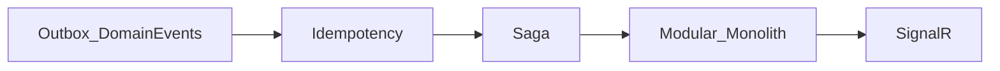

# Architecture and training discussion notes

[Türkçe](architecture-notes.tr.md) · [Deutsch](architecture-notes.de.md)

**Date:** 2026-10-21  
**Context:** Educational BankApp — notes to revisit before starting the next phase.

Roadmap: [roadmap.en.md](roadmap.en.md) (Phase 6).

---

## Current stack (summary)

Clean Architecture + CQRS (MediatR), JWT/RBAC, Redis, Serilog+Seq, RabbitMQ (email verification), Docker Compose, React i18n (TR/EN/DE), CI + integration tests.

Next steps are not “missing features” but **high-learning modern layers**.

---

## Chosen focus

**Architectural deepening** (not platform / product-AI first).

Out of scope for now: implementing OTel/Grafana, Keycloak, OAuth, K8s, AI chatbot code.

---

## Suggested technology groups (discussion summary)

### 1) Architecture / domain

| Idea | Learning value |
|------|----------------|
| Domain Events + Outbox | Post-aggregate events, reliable publish |
| Saga / Process Manager | Long-running credit orchestration |
| Modular Monolith | Bounded contexts; single deploy |
| Idempotency-Key | Double-submit / retry safety |
| Vertical slice hardening | Scaling CQRS like a product |

### 2) Data & search

| Idea | Note |
|------|------|
| Elasticsearch / OpenSearch | Staff lists; better after Outbox/read-model |
| CDC (Debezium) → ES | Advanced sync |
| Queryable audit table | Complement to Seq |

### 3) Real-time & UX

| Idea | Note |
|------|------|
| SignalR | Application status; visible proof of Outbox events |
| Notification hub | In-app + email |
| BFF / TanStack Query | Modern client data layer |

### 4) Identity & security

| Idea | Note |
|------|------|
| Keycloak / OIDC first, social OAuth later | Enterprise auth |
| Refresh token + rotation | Production-like JWT |
| Secrets, rate limits | Hardening |

### 5) Observability & platform

| Idea | Note |
|------|------|
| OpenTelemetry → Prometheus + Grafana | Alongside Seq |
| .NET Aspire | Local orchestration |
| k3d/kind + Helm + ArgoCD | GitOps lab |
| Feature flags, Pact | Progressive delivery / contract tests |

### 6) AI (kept modest)

| Idea | Note |
|------|------|
| Support chatbot (RAG + tools) | Product FAQ + application queries |
| Semantic Kernel / Extensions.AI | .NET AI integration |

### 7) Banking domain scenarios

Credit scorecard, contract PDF, installments/late fees, IBAN/transfer (idempotent), fraud alerts, multi-tenant branch — make technology tangible.

---

## Comments on the existing “Later” list

- **Elasticsearch** — good; Outbox/event story first is more pedagogical.
- **Admin Tailwind dashboard** — visual; low architecture learning.
- **K8s/ArgoCD** — heavy before modularizing the monolith.
- **OTel/Grafana** — strong next to Seq; natural after Phase 6.
- **OAuth + Keycloak** — Keycloak/OIDC first, social login second.
- **Chatbot** — prefer RAG + tools as a separate lab, not UI-only chat.

---

## Phase 6 — chosen order

1. Domain Events + Transactional Outbox (RabbitMQ) — **done** (2026-10-21): `AggregateRoot`, `OutboxMessages`, dispatcher + Seq/log consumer; credit create/approve/reject/cancel events
2. Idempotency-Key (critical write APIs) — **done** (2026-10-21): `Idempotency-Key` header, Redis 24h, create/approve/reject/cancel; same key replay / different body → 409
3. Saga / Process Manager (credit application lifecycle)
4. Modular Monolith (Customer / Credit / Identity / Notification)
5. SignalR notifications (driven by Outbox events)

Broader training sequence (beyond Phase 6): Outbox → SignalR → OTel → Keycloak → ES/module → AI RAG.

---

## Lab — Idempotency-Key

1. Via Scalar/curl: `POST /api/CreditApplications` with header `Idempotency-Key: <uuid>` and a body.
2. Repeat with the **same** key and **same** body → same `id`; Seq shows `Idempotency replay` on the second call; one `CreditApplicationCreated` outbox row for that id.
3. Same key + **different** amount → `409 Conflict`.
4. Missing key → `400`.

## Lab — HashiCorp Vault (Compose)

- UI: http://localhost:8200 — token from `.env` → `VAULT_DEV_ROOT_TOKEN_ID`
- KV path: `secret/bankapp` (`jwt_security_key`, `mssql_sa_password`, `rabbitmq_password`)
- Seed: Compose `vault-seed` or `infra/scripts/vault-seed.sh`
- **Note:** WebApi still reads `.env`; Vault is a side lab (SDK wiring in a later slice)

## Revisit before coding

Next code steps: **Saga / Process Manager**, then optional **Vault → WebApi secret load**. Outbox + Idempotency + Vault Compose lab are done.
