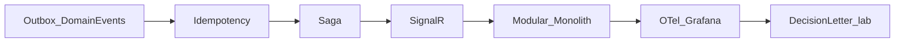

# Mimari ve eğitim tartışma notları

[English](architecture-notes.en.md) · [Deutsch](architecture-notes.de.md)

**Tarih:** 2026-10-21  
**Bağlam:** Eğitim amaçlı BankApp — sonraki fazlara geçmeden önce tekrar bakılacak notlar.

Yol haritası: [roadmap.tr.md](roadmap.tr.md) (Faz 6).  
Ayrıntılı öğrenme (neden + örnek): [tech-learning.tr.md](tech-learning.tr.md).

---

## Mevcut yığın (özet)

Clean Architecture + CQRS (MediatR), JWT/RBAC, Redis, Serilog+Seq, RabbitMQ (e-posta doğrulama), Docker Compose, React i18n (TR/EN/DE), CI + entegrasyon testleri.

Bundan sonrası “eksik feature” değil; **öğrenim değeri yüksek modern katmanlar** eklemek.

---

## Seçilen odak

**Mimari derinleşme** (platform / ürün-AI değil).

Kapsam dışı (şimdilik): Keycloak, OAuth, K8s, AI chatbot kodu. (OTel/Grafana uygulandı 2026-10-25.)

---

## Önerilen teknoloji grupları (tartışma özeti)

### 1) Mimari / domain

| Öneri | Ne öğretir |
|--------|------------|
| Domain Events + Outbox | Aggregate sonrası olay, tutarlı yayın |
| Saga / Process Manager | Uzun kredi süreci orkestrasyonu |
| Modular Monolith | Bounded context; tek deploy |
| Idempotency-Key | Çift tıklama / retry güvenliği |
| Vertical Slice sertleştirme | CQRS’i ürün gibi ölçekleme |

### 2) Veri & arama

| Öneri | Not |
|--------|-----|
| Elasticsearch / OpenSearch | Personel listeleri; Outbox/read-model sonrası daha anlamlı |
| CDC (Debezium) → ES | İleri seviye senkron |
| Sorgulanabilir audit tablosu | Seq’e ek |

### 3) Gerçek zamanlı & UX

| Öneri | Not |
|--------|-----|
| SignalR | Başvuru durumu; Outbox olaylarının görünür kanıtı |
| Notification hub | In-app + e-posta |
| BFF / TanStack Query | Modern client veri katmanı |

### 4) Kimlik & güvenlik

| Öneri | Not |
|--------|-----|
| Keycloak / OIDC önce, sosyal OAuth sonra | Enterprise auth |
| Refresh token + rotation | Üretim benzeri JWT |
| Secret yönetimi, rate limit | Hardening |

### 5) Observability & platform

| Öneri | Not |
|--------|-----|
| OpenTelemetry → Prometheus + Grafana | Seq ile yan yana |
| .NET Aspire | Local orchestration |
| k3d/kind + Helm + ArgoCD | GitOps lab |
| Feature flags, Pact | Progressive delivery / contract test |

### 6) AI (abartmadan)

| Öneri | Not |
|--------|-----|
| Destek chatbot (RAG + tool) | Ürün FAQ + başvuru sorgulama |
| Semantic Kernel / Extensions.AI | .NET AI entegrasyonu |

### 7) Banka domain senaryoları

Kredi skor kartı, sözleşme PDF, taksit/gecikme, IBAN/transfer (idempotent), fraud alert, multi-tenant şube — teknolojiyi görünür kılar.

Başvuru **evrak yükleme** (kimlik, bordro vb.): roadmap İleride; şimdilik zorunlu değil, ileride KYC/doğrulama için zorunlu yapılabilir.

---

## Mevcut “İleride” listesine yorum

- **Elasticsearch** — iyi; önce Outbox veya event hikâyesi daha pedagojik.
- **Admin Tailwind dashboard** — görsel; mimari öğrenim düşük.
- **K8s/ArgoCD** — monolit modülerleşmeden ağır.
- **OTel/Grafana** — **uygulandı** (2026-10-25); Seq yanına trace/metrik.
- **OAuth + Keycloak** — Keycloak/OIDC önce, sosyal login sonra.
- **Chatbot** — “sadece UI chat” yerine RAG + tool ayrı lab gibi düşünülmeli.

---

## Faz 6 — seçilen sıra

1. Domain Events + Transactional Outbox (RabbitMQ) — **uygulandı** (2026-10-21): `AggregateRoot`, `OutboxMessages`, dispatcher + Seq/log consumer; kredi create/approve/reject/cancel olayları
2. Idempotency-Key (kritik yazma API’leri) — **uygulandı** (2026-10-21): header `Idempotency-Key`, Redis 24 saat, create/approve/reject/cancel; aynı key replay / farklı body → 409
3. Saga / Process Manager (kredi başvuru yaşam döngüsü) — **uygulandı** (2026-10-22): `CreditApplicationSagas`, Process Manager orkestrasyonu (AwaitingDecision → Onboarding → Completed / Terminated / Compensated)
4. SignalR bildirimleri (Outbox olaylarına bağlı) — **uygulandı** (2026-10-23): hub `/hubs/credit-applications`; consumer → staff + customer grupları; React toast + liste yenileme (Modular’dan önce)
5. Modular Monolith (Identity / Customers / Credit / Notification) — **uygulandı** (2026-10-24): `Application.Modules.*` + `WebApi.Modules.*`; `AddApplicationModules` / host module kayıtları; tek deploy, tek DB
6. OpenTelemetry + Grafana / Prometheus — **uygulandı** (2026-10-25): WebApi OTLP → collector → Tempo (trace) + Prometheus (metrik) + Grafana `:3001`; Seq log kalır; `TraceId`/`SpanId` enricher
7. Karar mektubu e-posta (lab) — **uygulandı** (2026-10-27): onay/red → `decision-letter` kuyruk + Seq log; SMS yok

Daha geniş eğitim sırası: Outbox → SignalR → OTel → Decision letter → Keycloak → ES → AI RAG.

---

## Lab — Idempotency-Key

1. Scalar veya curl ile `POST /api/CreditApplications` + header `Idempotency-Key: <uuid>` + body.
2. **Aynı** key + **aynı** body’yi tekrar gönder → aynı `id`, Seq’de tek `Idempotency stored` / ikinci istek `Idempotency replay`; Outbox’ta tek `CreditApplicationCreated` (o id için).
3. Aynı key + **farklı** tutar → `409 Conflict`.
4. Key yok → `400`.

## Lab — HashiCorp Vault (Compose)

- UI: http://localhost:8200 — token: `.env` → `VAULT_DEV_ROOT_TOKEN_ID`
- KV path: `secret/bankapp` (`jwt_security_key`, `mssql_sa_password`, `rabbitmq_password`)
- Seed: Compose `vault-seed` veya `infra/scripts/vault-seed.sh`
- **Önemli:** WebApi hâlâ `.env` okur; Vault yan lab (sonraki dilimde SDK entegrasyonu)

## Lab — Saga / Process Manager

1. Başvuru oluştur → SQL `CreditApplicationSagas` satırı `AwaitingDecision` (Seq: `Saga started`).
2. Onayla → adımlar `RiskChecked` → `ContractPrepared` → `CustomerNotified` → `Completed` + `ContractReference` (Seq adım logları).
3. Ayrı başvuruyu reddet veya iptal → `Terminated` (onboarding yok).

## Lab — SignalR (kredi başvurusu)

1. WebApi + client ayakta; iki tarayıcı (veya gizli pencere): personel `staff@bank.local` + müşteri `customer@bank.local`.
2. Her iki oturumda **Başvurular** sayfası açık kalsın (hub bağlanır).
3. Personel bir başvuruyu onayla / reddet (veya müşteri oluştur / iptal et).
4. Beklenen: toast (`realtime.creditChanged`), liste yenilenir; Seq: `Domain event consumed` + `Realtime notified`.
5. Tarayıcı DevTools → Network → WS: `/hubs/credit-applications` bağlı olmalı.

## Tekrar bakılacak

Faz 6 ana dilimler + OTel tamam. İsteğe bağlı sonraki: **Keycloak**, Elasticsearch, **Vault → WebApi** (İleride listesi).
