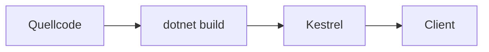

# 01 — .NET- und C#-Grundlagen

[← Inhalt](00-index.md) · [Weiter: Clean Architecture →](02-clean-architecture.md)

## Was ist das?

**.NET** ist Microsofts Plattform zum Ausführen von Anwendungen (Runtime + Bibliotheken + SDK).  
**C#** ist die Sprache, in der wir auf dieser Plattform schreiben. Das BankApp-Backend ist in **.NET 10** / **C#** geschrieben.

„SDK“ = das Toolset auf deinem Rechner, das den Befehl `dotnet` ausführt.



## Rolle in BankApp

- Die gesamte API (`WebApi`), die Geschäftslogik (`Application`), die Domäne (`Domain`) und der Datenzugriff (`Persistence`) sind C#-Projekte.
- Lösungsdatei: `BankApp.slnx` (verwaltet mehrere `.csproj`-Dateien gemeinsam).

## Wann hinzugefügt?

**Faz 1** — vom ersten Projekt tag an.

## Grundbegriffe

| Begriff | Bedeutung |
|--------|--------|
| **Solution (`.sln` / `.slnx`)** | „Lösung“, die mehrere Projekte gruppiert |
| **Project (`.csproj`)** | Eine kompilierbare Einheit (z. B. WebApi) |
| **Namespace** | Namensraum, der Klassen wie Ordner gruppiert |
| **Class / Interface** | Typdefinitionen; `interface` ist ein Vertrag, `class` die Implementierung |
| **async / await** | Warten bei I/O, ohne den Thread zu blockieren |
| **NuGet** | .NET-Paketmanager (`PackageReference`) |
| **TargetFramework** | Z. B. `net10.0` — welche .NET-Version zum Kompilieren verwendet wird |

## Befehle

```powershell
# SDK-Version anzeigen
dotnet --version

# Projekte in der Solution kompilieren
dotnet build BankApp.slnx

# Nur WebApi starten (Development)
dotnet run --project src/WebApi/WebApi.csproj

# NuGet-Pakete herunterladen (restore)
dotnet restore BankApp.slnx

# Tests ausführen
dotnet test BankApp.slnx --configuration Release
```

| Parameter / Flag | Zweck |
|--------------------|----------------|
| `--project` | Welche `.csproj` ausgeführt wird |
| `--configuration Release` | Optimiertes Produktions-Build (in CI) |
| `--no-restore` | Kein erneutes Restore, wenn CI Restore bereits separat ausführte |

## Klassen, Methoden, Pakete

- Beispiel-Projektdatei: `src/WebApi/WebApi.csproj` → `<TargetFramework>net10.0</TargetFramework>`
- Einstiegspunkt: `src/WebApi/Program.cs` — richtet den Host ein, registriert DI (Dependency Injection), fügt Middleware hinzu.
- Gemeinsame Infrastruktur: `src/Core` (Pipeline, Exception, Security-Hilfen).

Wichtige Paketideen für Einsteiger (Details in späteren Kapiteln):

- `MediatR` — Request-Routing  
- `FluentValidation` — Validierung  
- `Microsoft.EntityFrameworkCore.*` — Datenbank  

## Wo im Repo?

```
BankApp.slnx
src/WebApi/Program.cs
src/WebApi/WebApi.csproj
src/Application/Application.csproj
src/Domain/Domain.csproj
src/Persistence/Persistence.csproj
src/Core/Core.csproj
```

## Mini-Ablauf

1. `dotnet build` → C#-Quellen werden zu IL kompiliert.  
2. `dotnet run --project src/WebApi` → Der Kestrel-Webserver startet.  
3. Browser / React-Client sendet HTTP-Anfragen an die API unter `http://localhost:…`.
