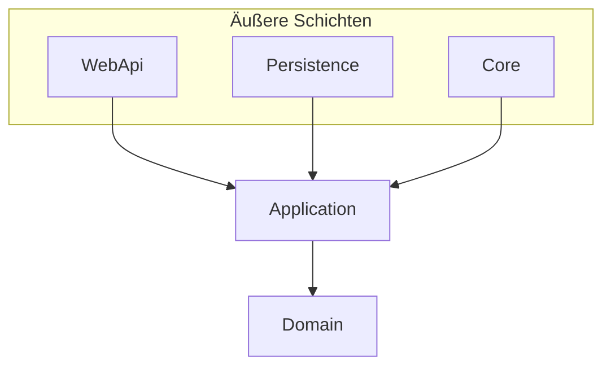

# 02 — Clean Architecture

[← Zurück](01-dotnet-csharp.md) · [Inhalt](00-index.md) · [Weiter →](03-ef-core-sql.md)

## Was ist das?

**Clean Architecture** teilt Code in Schichten: **Geschäftsregeln** liegen innen, **UI / DB / Framework** außen.  
Abhängigkeitspfeile zeigen **nach innen**: Äußere Schichten kennen innere; Innere kennen äußere nicht.



## Rolle in BankApp

BankApp-Schichten:

| Schicht | Aufgabe |
|--------|--------|
| **Domain** | Entity, enum/SmartEnum, Domain-Events — unabhängig vom Framework |
| **Application** | Use Cases (Command/Query-Handler), Regeln, DTOs |
| **Persistence** | EF Core, Repository, Seed |
| **WebApi** | HTTP, JWT, SignalR, Hosted Services |
| **Core** | Gemeinsame Pipeline / Exception / Security-Hilfen |

## Wann hinzugefügt?

**Faz 1**.

## Grundbegriffe

| Begriff | Bedeutung |
|--------|--------|
| **Dependency Inversion** | Höhere Ebenen hängen von Abstraktionen (`interface`) ab |
| **DTO** | Flaches Datenobjekt für API-Ein- und -Ausgabe |
| **Business rule** | Domänen-/Anwendungsregel wie „Nur Pending darf genehmigt werden“ |
| **Repository** | Schnittstelle, die Datenzugriff abstrahiert |

## Befehle

Clean Architecture selbst ist kein CLI; Schichten werden über Projekt-Referenzen verbunden:

```xml
<!-- Application referenziert Domain (Beispiel) -->
<ProjectReference Include="..\Domain\Domain.csproj" />
```

Falsche Richtung: `Domain` → `WebApi` Referenz **darf es nicht geben**.

## Klassen, Methoden, Pakete

- Registrierung: `ApplicationServiceRegistration.cs`, `PersistenceServiceRegistration.cs`
- In WebApi `Program.cs` verbindet `builder.Services.Add…()` die Schichten.
- Modultrennung (später): `Application/Modules/*`, `WebApi/Modules/*` → [17](17-modular-monolith.md)

## Wo im Repo?

```
src/Domain/
src/Application/
src/Persistence/
src/WebApi/
src/Core/
```

## Mini-Ablauf

**Genehmigen-Button** → `WebApi` Controller → `Application` Handler → `Domain` Aggregate-Methode → `Persistence` `SaveChanges` → (später) Outbox / SignalR.
