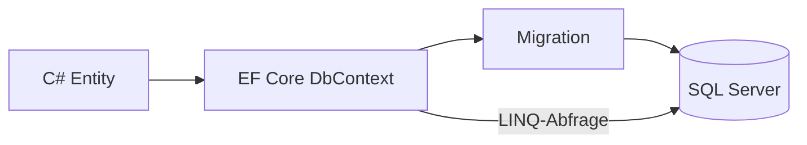
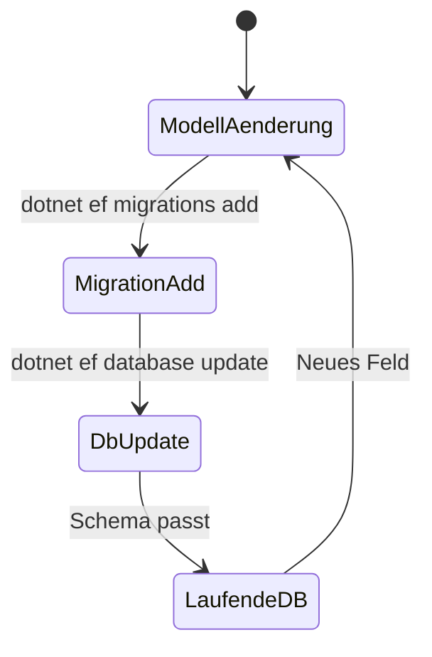

# 03 — EF Core und SQL Server

[← Zurück](02-clean-architecture.md) · [Inhalt](00-index.md) · [Weiter →](04-cqrs-mediatr.md)

## Was ist das?

**Entity Framework Core (EF Core)** ist ein ORM, das C#-Objekte SQL-Tabellen zuordnet.  
**SQL Server** ist eine relationale Datenbank. In BankApp liegt die Hauptpersistenz hier.

**Vergleich:** EF Core ist ein **Übersetzer**; C#-Entities sprechen, SQL-Tabellen hören. Migrationen sind „Wörterbuch-Updates“ bei Schemaänderungen.



## Rolle in BankApp

- Kunde, Kredittyp, Antrag, Outbox, Saga-Zeilen werden in SQL gehalten.
- **TPT** (Table Per Type): Privat- und Firmenkunde in getrennten Tabellen mit gemeinsamer Basis.
- Migration + Seed (Bogus + fester Katalog) erzeugen Lab-Daten.

## Wann hinzugefügt?

**Faz 1** (DB); SQL mit Compose **Faz 3**.

## Grundbegriffe

| Begriff | Bedeutung |
|--------|--------|
| **DbContext** | Sitzung + Change Tracking |
| **DbSet\<T\>** | Eine Entity-Sammlung (tabellenähnlich) |
| **Migration** | Versionierte Schemaänderung |
| **Include** | Verknüpfte Daten eager laden |
| **Soft delete** | Statt Löschen z. B. `DeletedDate` setzen |
| **TPT** | Getrennte Tabellen für Vererbung |



## Befehle

```powershell
# Migration hinzufügen (Persistence-Projekt / Design-time factory)
dotnet ef migrations add Name --project src/Persistence --startup-project src/WebApi

# Datenbank aktualisieren
dotnet ef database update --project src/Persistence --startup-project src/WebApi
```

| Flag | Bedeutung |
|--------|--------|
| `--project` | Projekt, in dem die Migrationen liegen |
| `--startup-project` | Host, aus dem Connection String / DI gelesen wird |

Im Docker-Lab ist der Port meist `11433` → im Container `1433` (`infra/docker-compose.yml`).

## Klassen, Methoden, Pakete

| Paket | Rolle |
|-------|-----|
| `Microsoft.EntityFrameworkCore` | Kern-API |
| `Microsoft.EntityFrameworkCore.SqlServer` | SQL-Provider |
| `Microsoft.EntityFrameworkCore.Design` / `Tools` | Migrations-CLI |

- Context: `Persistence/Contexts/BankingDbContext.cs`
- Config: `Persistence/EntityConfigurations/*`
- Repo: `Persistence/Repositories/*` implementiert `Application/Services/Repositories/*`
- Wichtige Methoden: `GetAsync`, `AddAsync`, `UpdateAsync`, `SaveChangesAsync`

## Wo im Repo?

```
src/Persistence/Contexts/BankingDbContext.cs
src/Persistence/EntityConfigurations/
src/Persistence/Repositories/
src/Domain/Entities/
infra/docker-compose.yml   # sqlserver-Dienst
```

## Mini-Ablauf

Handler ruft `ICreditApplicationRepository.GetAsync(...)` auf → EF erzeugt SQL → Zeile wird geladen → `Approve(...)` → `UpdateAsync` → `SaveChangesAsync` committet die Transaktion.

Bildschirm (Compose — SQL):


## Einstiegs-Lab

1. SQL in Compose healthy (`infra`, `compose ps`).
2. `dotnet ef database update --project src/Persistence --startup-project src/WebApi`.
3. SSMS / Azure Data Studio: `localhost,11433` → Tabelle `CreditApplications`.
4. Antrag in der UI listen → passt zur DB-Zeile?
5. `DbSet` in `BankingDbContext.cs` → Entity in `Domain/Entities`.

## Häufige Fehler

- Kein `--startup-project` — Connection/DI fehlt.  
- Host-Port `1433` statt `11433` im Lab.  
- Migration ohne `database update` — Laufzeitfehler „invalid column“.  

## Wo hilft es?

- [ ] `database update` ohne Fehler  
- [ ] Demo-Daten nach Seed  
- [ ] Handler nutzt EF-SQL, kein Pflicht-Raw-SQL  
