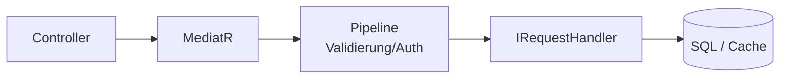
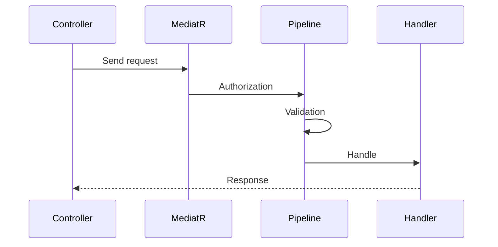

# 04 — CQRS und MediatR

[← Zurück](03-ef-core-sql.md) · [Inhalt](00-index.md) · [Weiter →](05-validation-smartenum.md)

## Was ist das?

**CQRS** (Command Query Responsibility Segregation): Trennung von **Schreib-** (Command) und **Lese-** (Query) Anfragen.  
**MediatR**: Statt dass der Controller den Handler direkt instanziiert, übergibt er „bearbeite diese Request“ an einen Vermittler.

**Vergleich:** MediatR ist der **Empfang** der Bank; der Controller sagt „Genehmigung“, der Empfang leitet nach Sicherheitscheck (Pipeline) zum Sachbearbeiter (Handler).



## Rolle in BankApp

- `ApproveCreditApplicationRequest` → Handler genehmigt.
- `GetListCreditApplicationRequest` → Handler listet auf.
- Pipeline: Validierung, Autorisierung, Logging, Caching (`IPipelineBehavior`).

## Wann hinzugefügt?

**Faz 1**.

## Grundbegriffe

| Begriff | Bedeutung |
|--------|--------|
| **IRequest\<TResponse\>** | MediatR-Request-Vertrag |
| **IRequestHandler\<,\>** | Klasse, die die Anfrage verarbeitet |
| **IPipelineBehavior** | Middleware vor/nach dem Handler |
| **Command** | Anfrage, die Zustand ändert |
| **Query** | Lesende Anfrage ohne Zustandsänderung |



## Befehle

MediatR-Paket hinzufügen (bereits im Projekt; zum Lernen):

```powershell
dotnet add src/Application package MediatR
```

Kein Laufzeit-CLI; DI-Registrierung:

```csharp
services.AddMediatR(cfg => cfg.RegisterServicesFromAssembly(...));
```

(In `ApplicationServiceRegistration` gibt es eine ähnliche Registrierung.)

## Klassen, Methoden, Pakete

| Name | Rolle |
|------|-----|
| `IMediator.Send(request)` | Leitet Request an Handler weiter |
| `ApproveCreditApplicationRequest` | Genehmigungs-Command |
| `ApproveCreditApplicationRequestHandler.Handle` | Eigentliche Arbeit |
| `RequestValidationBehavior` | Führt FluentValidation aus |
| `AuthorizationBehavior` | Prüft `ISecuredRequest`-Rollen |
| `LoggingBehavior` | Dauer- / Fehler-Log |

Paket: `MediatR` (Application + Core-Pipeline).

## Wo im Repo?

```
src/Application/Modules/**/Features/**/Commands/
src/Application/Modules/**/Features/**/Queries/
src/Core/Application/Pipelines/
src/WebApi/Modules/**/Controllers/
```

## Mini-Ablauf

`POST /api/CreditApplications/{id}/approve`  
→ Controller `mediator.Send(new Approve…Request { … })`  
→ Authorization → Validation → Logging → Handler  
→ Response-DTO.

## Einstiegs-Lab

1. Controller unter `src/WebApi/Modules` — `IMediator` prüfen.
2. Passenden Handler unter `Application/.../Commands` finden.
3. `Send` → Pipeline-Reihenfolge verfolgen.
4. POST in Scalar — Body mit Handler vergleichen.
5. Query-Handler vs. Command — keine Seiteneffekte bei Query.

## Häufige Fehler

- Geschäftslogik im Controller — in Handler verschieben.  
- `SaveChanges` in Query — gehört zum Command.  
- Pipeline-Verhalten ohne DI-Registrierung — läuft nie.  

## Wo hilft es?

- [ ] Neuer Endpoint = Request + Handler  
- [ ] Validierung/Rollen an einer Stelle  
- [ ] Controller bleiben dünn  
