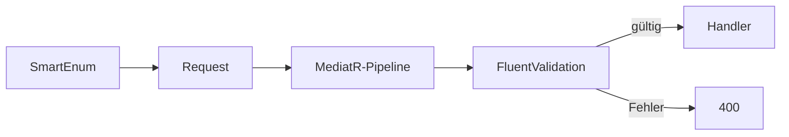

# 05 — FluentValidation und SmartEnum

[← Zurück](04-cqrs-mediatr.md) · [Inhalt](00-index.md) · [Weiter →](06-jwt-rbac.md)

## Was ist das?

**FluentValidation**: Flüssige Regeln für Request-Objekte (`RuleFor…`).  
**Ardalis SmartEnum**: Statt „magischer“ Strings/Ints typ-sichere enum-ähnliche Klassen mit Namen (`Pending`, `Approved` …).



## Rolle in BankApp

- Create-/Approve-/Reject-Validatoren lehnen falsche Beträge oder leeres Einkommen ab.
- `CreditApplicationStatus`, `CreditCategory`, `CreditRiskLevel` sind SmartEnums (in JSON meist **name**).

## Wann hinzugefügt?

**Faz 1**.

## Grundbegriffe

| Begriff | Bedeutung |
|--------|--------|
| **AbstractValidator\<T\>** | Regelsatz für T |
| **RuleFor** | Regel für eine Property |
| **When** | Bedingte Regel |
| **SmartEnum** | Klasse mit `Name` + `Value` |
| **TryFromName** | String → SmartEnum parsen |

## Befehle

```powershell
dotnet add src/Application package FluentValidation.DependencyInjectionExtensions
dotnet add src/Domain package Ardalis.SmartEnum
```

## Klassen, Methoden, Pakete

| Beispiel | Rolle |
|-------|-----|
| `CreateCreditApplicationRequestValidator` | `MonthlyIncome` NotNull / GreaterThan(0) |
| `CreditApplicationStatus.Pending` | Statuskonstante |
| `CreditCategory.TryFromName(...)` | Filter parsen |

Pakete: `FluentValidation`, `FluentValidation.DependencyInjectionExtensions`, `Ardalis.SmartEnum`, `Ardalis.SmartEnum.SystemTextJson` (WebApi).

## Wo im Repo?

```
src/Application/**/**RequestValidator.cs
src/Domain/Enums/
src/WebApi  # SmartEnum-JSON-Converter-Registrierung
```

## Mini-Ablauf

Anfrage kommt an → `RequestValidationBehavior` findet Validator → Regel scheitert → `ValidationException` → ProblemDetails 400.  
Bei Erfolg weiter zum Handler; Statusvergleich mit `CreditApplicationStatus.Pending`.
