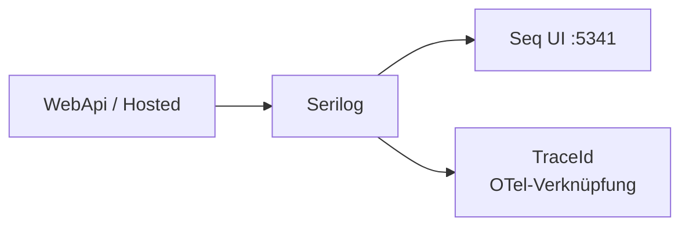
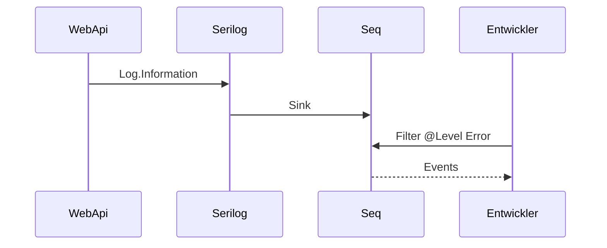

# 07 — Serilog und Seq

[← Zurück](06-jwt-rbac.md) · [Inhalt](00-index.md) · [Weiter →](08-redis.md)

Lab-Übersicht: [24 — Lab tools](24-lab-tools.md) · Compose-Wiederherstellung: [09](09-docker-compose.md)

## Was ist das?

**Serilog**: Bibliothek für strukturierte Logs.  
**Seq**: Server, der diese Logs sammelt und in der UI durchsuchbar macht (im Lab per Docker).

**Vergleich:** Serilog ist das **Küchenbuch**; Seq die **Suchmaschine** darüber.



## Rolle in BankApp

- Pipeline-Fehler, Audit (`IAuditLogger` / `SerilogAuditLogger`), Host-Lebenszyklus.
- Mit OTel kann TraceId verknüpft werden (Log ↔ Trace).
- Lab-Hinweise zu Entscheidungsschreiben / E-Mail landen ebenfalls in Seq (kein SMTP).

## Wann hinzugefügt?

**Faz 2**; Seq mit Compose **Faz 3**.

## Grundbegriffe

| Begriff | Bedeutung |
|--------|--------|
| **Sink** | Ziel der Logs (Konsole, Seq, Datei) |
| **Enricher** | Zusatzfelder wie Umgebungsname, Machine Name |
| **Structured log** | Nachricht mit Properties wie `"{UserId} login"` |
| **Audit** | Geschäftsereignis „Wer hat was getan?“ |
| **Signal** | Gespeicherte Suche / Alarm in Seq (im Lab optional) |



## Befehle

```powershell
cd infra

# Seq-Container starten (unnötig, wenn Stack schon läuft)
docker compose --env-file .env up -d seq
# Prüfen: compose ps → seq healthy; Browser http://localhost:5341 (im Lab ohne Login)
```

```powershell
# Läuft Seq / werden Logs geschrieben?
docker compose --env-file .env ps seq
docker compose --env-file .env logs --tail=50 seq
# Sink-Fehler auf WebApi-Seite:
docker compose --env-file .env logs --tail=80 webapi
```

**Seq-UI (http://localhost:5341) — was prüfen?**

1. Events-Liste — nach Login / CreditTypes GET neue Zeilen?
2. Filterbeispiele (Suchfeld oben):
   - `@Level = 'Error'` — nur Fehler
   - `Application like '%BankApp%'` — Anwendungsname
   - `RequestPath like '/api/%'` — API-Requests
   - `TraceId = '...'` — aus Grafana Tempo kopiert (wenn OTel an)
3. Event anklicken → Property-Panel (UserId, StatusCode, usw.).

```powershell
# Grober UI-Test vom Host (PowerShell)
curl -s -o NUL -w "%{http_code}`n" http://localhost:5341
# Erwartet: 200 (oder Redirect von Seq); bei Verbindungsfehler compose ps
```

### Was wird kontrolliert?

| Kontrolle | Wie | Gutes Zeichen |
|---------|-------|-------------|
| Seq healthy | `compose ps seq` | healthy |
| UI | `:5341` | Events laden |
| Sink aktiv | Login oder `/api/...` → Seq Events | Neue Zeile + Zeitstempel |
| Trace-Brücke | TraceId in Grafana → Seq-Filter | Gleiche id in Logs |

### Notfall / Wiederherstellung (Lab)

| Situation | Vorgehen |
|-------|-----|
| UI leer, API läuft | `logs webapi` — Seq-Adresse/Fehler? In Compose URL `http://seq` |
| Seq-Restart-Schleife | `logs seq`; bei kaputtem Volume Reset unten |
| Disk / alte Lab-Logs | Seq (+ Redis) Volume zurücksetzen — **destruktiv** |

```powershell
# Destruktiv: Seq (und andere mit compose -v) Lab-Daten weg; externes SQL bleibt
# docker compose --env-file .env down -v
# docker compose --env-file .env up -d --build
```

**Best practice:** Keine Passwörter / rohen JWTs / volle PII loggen. In Prod Seq-Auth + Retention. Im Lab mit Error starten, dann Information.

## Klassen, Methoden, Pakete

| Paket / Klasse | Rolle |
|---------------|-----|
| `Serilog.AspNetCore` | Host-Integration |
| `Serilog.Sinks.Seq` | Seq-Sink |
| `UseSerilogRequestLogging` | HTTP-Request-Log |
| `IAuditLogger.Log(...)` | Audit-Kategorien Auth / Credit |

## Wo im Repo?

```
src/WebApi/Program.cs          # Serilog-Bootstrap
src/Application/Services/Logging/
infra/docker-compose.yml       # seq-Dienst
infra/README.md
```

## Mini-Ablauf

Exception → LoggingBehavior / Middleware → Serilog → Event-Liste in Seq-UI.  
Mit OTel passt die TraceId derselben Anfrage in Grafana und Seq.

Bildschirm (Seq Events — strukturierte Logliste):


## Einstiegs-Lab

1. `cd infra` → `docker compose --env-file .env up -d seq webapi`.
2. `http://localhost:5341` — Events nach Traffic.
3. App-Login → neues Event.
4. Filter `@Level = 'Error'`.
5. `docker compose logs --tail=30 webapi` — Sink-Fehler?

## Häufige Fehler

- WebApi auf Host mit falscher Seq-URL — in Compose `http://seq`.  
- String-Konkatenation statt strukturierter Logs.  
- JWT/Passwort auf Information loggen — maskieren.  

## Wo hilft es?

- [ ] Event nach Login  
- [ ] Error-Filter funktioniert  
- [ ] `compose ps seq` healthy  
