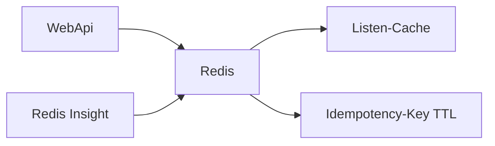

# 08 — Redis (Cache und Idempotency)

[← Zurück](07-serilog-seq.md) · [Inhalt](00-index.md) · [Weiter →](09-docker-compose.md)

## Was ist das?

**Redis**: Sehr schneller In-Memory-Key-Value-Store.  
In BankApp zwei Hauptaufgaben: **Cache** (Listen) und Speicher für **Idempotency-Key**.



## Rolle in BankApp

1. Lesevorgänge wie Kredittyp-/Untertyp-Listen beschleunigen (`ICacheRemoverRequest` invalidiert).
2. Wiederholte create/approve/reject/cancel mit gleichem `Idempotency-Key` sicher handhaben (24 h TTL).
3. Im Lab Schlüssel im Browser mit **Redis Insight** (`http://localhost:5540`).

## Wann hinzugefügt?

Cache: **Faz 2–3**. Idempotency: **Faz 6**. Redis Insight UI: Lab (Compose).

## Grundbegriffe

| Begriff | Bedeutung |
|--------|--------|
| **Key / Value** | Schlüssel und Wert |
| **TTL** | Automatische Löschzeit des Keys |
| **Cache stampede** | Plötzliche DB-Last, wenn Cache leer ist (bewusst sein) |
| **Idempotency** | Gleiche Anfrage zweimal → gleicher Effekt / Replay |
| **Redis Insight** | Offizielle Web-UI; Redis selbst hat keine eingebaute Oberfläche |

## Befehle

```powershell
cd infra
docker compose --env-file .env up -d redis redis-insight

# Optional: in Container Keys ansehen
docker compose exec redis redis-cli KEYS "*"
```

Browser: `http://localhost:5540` → **Add Redis database** → Host **`redis`**, Port **`6379`**, kein Passwort.  
(`localhost` erreicht Redis aus dem Insight-Container nicht; Compose-Dienstname verwenden.)

HTTP-Seite:

```http
POST /api/CreditApplications
Idempotency-Key: 3f2c9a...   # vom Client (UUID)
```

## Klassen, Methoden, Pakete

| Name | Rolle |
|------|-----|
| `Microsoft.Extensions.Caching.StackExchangeRedis` | IDistributedCache |
| Cache-Pipeline / `ICacheRemoverRequest` | Gruppe nach Schreiben leeren |
| Idempotency-Middleware / Filter (WebApi Credit) | Key + Body-Hash |

## Wo im Repo?

```
src/WebApi/…          # Redis-DI, Idempotency
src/Core/…            # Cache-Pipeline-Teile
infra/docker-compose.yml   # redis + redis-insight
infra/.env.example         # REDIS_INSIGHT_PORT
tests/.../IdempotencyKeyTests.cs
```

## Mini-Ablauf (Idempotency)

Erster POST + Key → Verarbeitung, Antwort nach Redis.  
Gleicher Key + gleicher Body → gespeicherte Antwort (kein zweites Outbox).  
Gleicher Key + anderer Body → **409 Conflict**.
