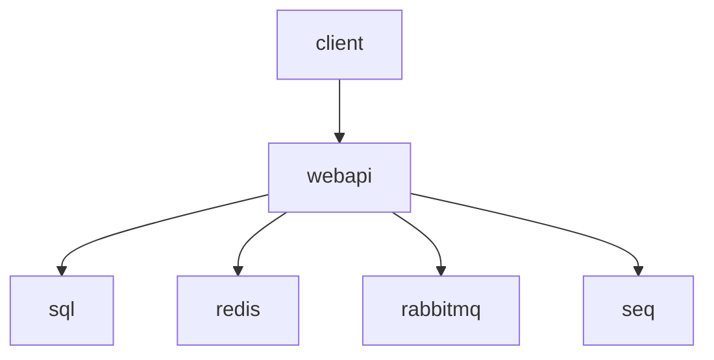

# 09 — Docker Compose

[← Zurück](08-redis.md) · [Inhalt](00-index.md) · [Weiter →](10-testing.md)

## Was ist das?

**Docker**: Verpackt die Anwendung in einen Container.  
**Compose**: Startet mehrere Container (SQL, Redis, Seq, API, Client, …) aus einer YAML-Datei.



## Rolle in BankApp

Lokaler „Lab-Prod“-Stack: DB + Cache + Log + Queue + Vault + OTel + WebApi + React nginx.

## Wann hinzugefügt?

**Faz 3**; Dienste wuchsen (RabbitMQ, Vault, OTel, Grafana …).

## Grundbegriffe

| Begriff | Bedeutung |
|--------|--------|
| **Image** | Ausführbare Vorlage |
| **Container** | Laufende Instanz eines Images |
| **Volume** | Persistenter Speicher (SQL-Daten) |
| **Healthcheck** | Ist der Dienst bereit? |
| **depends_on** | Startreihenfolge (mit health verstärkt) |
| **.env** | Compose-Variablen (Secrets nicht committen) |

## Befehle

Vor jedem Block steht **was** der Befehl macht und **worauf** du danach schauen solltest.  
Arbeitsverzeichnis immer `infra` (oder von der Root mit `-f` / `--env-file`).

### Tägliche Nutzung

```powershell
cd infra

# .env fehlt: aus Vorlage (Secrets hier; nicht committen)
copy .env.example .env

# Gesamtes Lab im Hintergrund mit Image-Build starten
docker compose --env-file .env up -d --build
# Prüfen: ps sql/redis/rabbit/webapi healthy; http://localhost:8080/health → 200
```

```powershell
# Welche Container laufen, Health-Status?
docker compose --env-file .env ps
# Erwartet: bankapp-sql / redis / rabbitmq / webapi → healthy (starting kann dauern)
```

```powershell
# WebApi-Log live (Migrate/Seed/Fehler hier)
docker compose --env-file .env logs -f webapi
# Ctrl+C beendet nur das Follow; Container läuft weiter
```

```powershell
# Letzte N Zeilen (schneller Blick)
docker compose --env-file .env logs --tail=100 webapi seq
```

```powershell
# Einzelnen Dienst neu starten (z. B. nach Redis Insight)
docker compose --env-file .env up -d redis redis-insight
```

```powershell
# Code geändert: WebApi-Image ohne Cache neu bauen + Container aktualisieren
docker compose --env-file .env build --no-cache webapi
docker compose --env-file .env up -d webapi
# Prüfen: logs -f webapi + /health
```

```powershell
# Stack stoppen; benannte Volumes BLEIBEN ( externes SQL-Volume unberührt)
docker compose --env-file .env down
```

| Flag / Argument | Zweck |
|--------------|----------------|
| `--env-file .env` | Ports/Passwörter aus Variablen |
| `-d` | Detached — blockiert Terminal nicht |
| `--build` | Image beim `up` neu bauen |
| `--no-cache` | Kein Layer-Cache (sauberer Build) |
| `logs -f` | Follow — neue Zeilen laufend |
| `logs --tail=N` | Nur letzte N Zeilen |
| `exec …` | Befehl im laufenden Container (redis-cli usw.) |

Beispiel-URLs: WebApi `:8080`, Client `:3000`, Seq `:5341`, Grafana `:3001`, Prometheus `:9090`, Redis Insight `:5540`, RabbitMQ UI `:15672`, Vault `:8200`.

### Was wird kontrolliert? (Gesundheits-Checkliste)

| Kontrolle | Befehl / URL | Gutes Zeichen |
|---------|-------------|-------------|
| Container | `compose ps` | `healthy` / `Up` |
| API live | `http://localhost:8080/health` | 200, Liveness |
| SQL bereit | sql healthy in `ps`; ADS `localhost,11433` | Verbindung ok |
| Redis | `docker compose exec redis redis-cli ping` | `PONG` |
| Log-Fluss | Seq-UI / `logs webapi` | Seed/Login-Zeilen |
| Queue | RabbitMQ UI `:15672` | Consumer verbunden |
| Metrik-Scrape | Prometheus Targets | `otel-collector` UP |

### Notfall / Wiederherstellung (Lab)

Zuerst den **weniger destruktiven** Schritt; `-v` und Volume-Löschung sind irreversibel (Lab-Daten weg).

| Situation | Was tun? | Befehl / Hinweis |
|-------|---------|-------------|
| Ein Dienst Crash-Loop | Log → nur Dienst neu starten | `logs -f <dienst>` dann `compose up -d --force-recreate <dienst>` |
| WebApi startet nicht | SQL/Redis/Rabbit **healthy**? Seed-Fehler? | `ps` → Abhängigkeiten; `logs webapi` |
| Port belegt (3000/8080/…) | In `.env` `CLIENT_PORT` / `WEBAPI_PORT` ändern | erneut `up -d` |
| Redis / Seq „schmutzig“ | Stack mit Volumes löschen (externes SQL **bleibt**) | `compose down -v` — **Seq + Redis (+ Insight) weg** |
| SQL auch zurücksetzen | Externes Volume manuell löschen | `docker volume rm sqlserver-2025-data`, Volume neu anlegen, `up` (infra/README) |
| Kaputtes Image / Cache | no-cache rebuild | `build --no-cache` + `up -d` |
| Nichts startet | Docker Desktop läuft? Disk voll? | Desktop-Neustart; `docker info` |

```powershell
# --- Destruktiv: Seq/Redis-Volumes löschen (externes SQL ausgenommen) ---
# Vorher sicher sein: Lab-Cache/Logs weg
docker compose --env-file .env down -v

# --- Noch destruktiver: SQL-Daten löschen ---
# docker volume rm sqlserver-2025-data
# Danach externes Volume wieder anlegen (infra/README Prerequisites), up -d --build
```

```powershell
# Diagnose im Container (Beispiele)
docker compose --env-file .env exec redis redis-cli ping
docker compose --env-file .env exec webapi printenv ASPNETCORE_ENVIRONMENT
```

Monitoring und Debug-Kette: [24 — Lab tools](24-lab-tools.md).

## Klassen, Methoden, Pakete

Hier keine „Klassen“; wichtige Dateien:

- `infra/docker-compose.yml`
- `infra/.env.example` → Kopie `.env`
- `src/WebApi/Dockerfile`, `client/Dockerfile`
- `DISABLE_HTTPS_REDIRECTION=true` (HTTP-Lab + Scalar)

## Wo im Repo?

```
infra/docker-compose.yml
infra/.env.example
infra/README.md
```

## Mini-Ablauf

`compose up` → SQL healthy → WebApi migrate/seed → Client nginx → Login im Browser.
