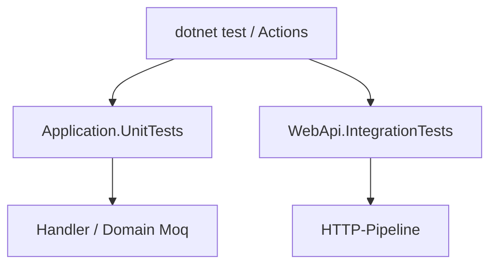

# 10 — Tests (xUnit, Moq, Integration)

[← Zurück](09-docker-compose.md) · [Inhalt](00-index.md) · [Weiter →](11-react-vite.md)

## Was ist das?

**Unit-Test**: Testet eine kleine Einheit (Handler, Regel) isoliert; Abhängigkeiten werden **gemockt**.  
**Integrationstest**: Startet die echte WebApi-Pipeline (`WebApplicationFactory`) und prüft per HTTP.



## Rolle in BankApp

- `Application.UnitTests`: Domain-Regeln, Saga, Approve-Handler, Validator …
- `WebApi.IntegrationTests`: Login, Create→Approve, Idempotency, Kunden-Cancel …
- CI führt diese bei jedem Push aus.

## Wann hinzugefügt?

Unit: **Faz 3**. Integration-Skelett → Abläufe: **Faz 5**.

## Grundbegriffe

| Begriff | Bedeutung |
|--------|--------|
| **xUnit** | Test-Framework mit `[Fact]` / `[Theory]` |
| **Moq** | `Mock<T>`, `Setup`, `Verify` |
| **FluentAssertions** | Lesbare Asserts: `Should().Be(...)` |
| **WebApplicationFactory** | Test-Host |
| **AAA** | Arrange / Act / Assert |

## Befehle

```powershell
# Alle Tests
dotnet test BankApp.slnx

# Nur Unit
dotnet test tests/Application.UnitTests/Application.UnitTests.csproj

# Nur Integration
dotnet test tests/WebApi.IntegrationTests/WebApi.IntegrationTests.csproj --configuration Release

# Filter
dotnet test --filter "FullyQualifiedName~ApproveCreditApplication"
```

| Flag | Bedeutung |
|--------|--------|
| `--filter` | Tests nach Namensmuster wählen |
| `--no-build` | Wenn Build in CI separat läuft |
| `-v normal` | Ausführlichere Ausgabe |

## Klassen, Methoden, Pakete

| Paket | Rolle |
|-------|-----|
| `xunit`, `Microsoft.NET.Test.Sdk` | Runner |
| `Moq` | Mock |
| `FluentAssertions` | Assert |
| `Microsoft.AspNetCore.Mvc.Testing` | Integration-Host |
| `Microsoft.EntityFrameworkCore.InMemory` | Leichte DB (je nach Factory) |

Beispiel: `ApproveCreditApplicationRequestHandlerTests` — `ICurrentUserService` + `IApplicationUserRepository` mock → `DecisionBy`-E-Mail.

## Wo im Repo?

```
tests/Application.UnitTests/
tests/WebApi.IntegrationTests/
tests/WebApi.IntegrationTests/Infrastructure/CustomWebApplicationFactory.cs
.github/workflows/ci.yml
```

## Mini-Ablauf (CI)

`dotnet restore` → `dotnet build` → Unit-Tests → Integrationstests → (parallel) Client `npm` build.
