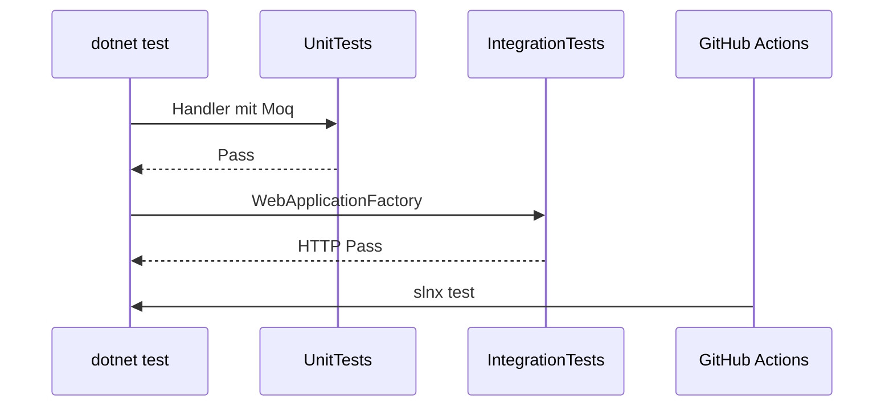

# 10 — Tests (xUnit, Moq, Integration)

[← Zurück](09-docker-compose.md) · [Inhalt](00-index.md) · [Weiter →](11-react-vite.md)

## Was ist das?

**Unit-Test**: Prüft eine kleine Einheit (Handler, Regel) isoliert; Abhängigkeiten werden **gemockt**.  
**Integrationstest**: Startet die echte WebApi-Pipeline (`WebApplicationFactory`) und testet per HTTP.

**Vergleich:** Ein Unit-Test zieht eine **Schraube** fest; ein Integrationstest lässt das **Auto** eine Runde auf dem Band drehen.


## Rolle in BankApp

- `Application.UnitTests`: Domänenregeln, Saga, Approve-Handler, Validatoren …
- `WebApi.IntegrationTests`: Login, create→approve, Idempotency, Customer-Cancel …
- CI führt das bei jedem Push aus.

## Wann hinzugefügt?

Unit: **Faz 3**. Integrationsskelett → Abläufe: **Faz 5**.

## Grundbegriffe

| Begriff | Bedeutung |
|--------|--------|
| **xUnit** | Test-Framework mit `[Fact]` / `[Theory]` |
| **Moq** | `Mock<T>`, `Setup`, `Verify` |
| **FluentAssertions** | Lesbare Asserts: `Should().Be(...)` |
| **WebApplicationFactory** | In-Process-Test-Host |
| **AAA** | Arrange / Act / Assert |



## Befehle

```powershell
# Alle Tests
dotnet test BankApp.slnx

# Nur Unit
dotnet test tests/Application.UnitTests/Application.UnitTests.csproj

# Nur Integration
dotnet test tests/WebApi.IntegrationTests/WebApi.IntegrationTests.csproj --configuration Release

# Filter
dotnet test --filter "FullyQualifiedName~ApproveCreditApplication"
```

| Flag | Bedeutung |
|--------|--------|
| `--filter` | Tests nach Namensmuster |
| `--no-build` | Wenn CI separat baut |
| `-v normal` | Ausführlichere Ausgabe |

## Klassen, Methoden, Pakete

| Paket | Rolle |
|-------|-----|
| `xunit`, `Microsoft.NET.Test.Sdk` | Runner |
| `Moq` | Mocking |
| `FluentAssertions` | Assertions |
| `Microsoft.AspNetCore.Mvc.Testing` | Integrations-Host |
| `Microsoft.EntityFrameworkCore.InMemory` | Leichte DB (je nach Factory) |

Beispiel: `ApproveCreditApplicationRequestHandlerTests` — Mock `ICurrentUserService` + `IApplicationUserRepository` → `DecisionBy`-E-Mail.

## Wo im Repo?

```
tests/Application.UnitTests/
tests/WebApi.IntegrationTests/
tests/WebApi.IntegrationTests/Infrastructure/CustomWebApplicationFactory.cs
.github/workflows/ci.yml
```

## Mini-Ablauf

`dotnet restore` → `dotnet build` → Unit-Tests → Integrationstests → (parallel) Client-`npm`-Build.

## Einstiegs-Lab

1. `dotnet test tests/Application.UnitTests` — schnelles grünes Paket.
2. Einzeltest: `--filter "FullyQualifiedName~ApproveCreditApplication"`.
3. `CustomWebApplicationFactory.cs` lesen — wie wird der Host gebaut?
4. Integrationsprojekt mit Release (wie CI).
5. Assert absichtlich brechen → rote Ausgabe lesen → reparieren.

## Häufige Fehler

- Echtes SQL erwarten, Factory nutzt InMemory — Factory-Doku lesen.  
- Kein `Verify` bei Mocks — Tests ohne Nebenwirkungsprüfung.  
- Nur Happy Path — auch 403/400-Szenarien.  

## Wo hilft es?

- [ ] Lokal `dotnet test BankApp.slnx` grün  
- [ ] CI nutzt denselben Befehl  
- [ ] Neuer Handler bekommt Unit-Test  
