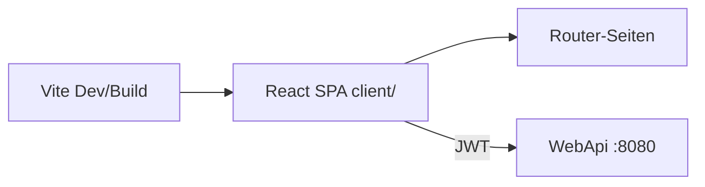

# 11 — React, Vite und TypeScript

[← Zurück](10-testing.md) · [Inhalt](00-index.md) · [Weiter →](12-i18n-ux.md)

## Was ist das?

**React**: Komponentenbasierte UI-Bibliothek.  
**Vite**: Schneller Dev-Server + Production-Bundler.  
**TypeScript**: Typisiertes JavaScript — Fehler schon beim Kompilieren.



## Rolle in BankApp

`client/` SPA: Login, Dashboard, Anträge, Kunden, Kreditarten, Personal, Profil; spricht mit der API per JWT.

## Wann hinzugefügt?

**Faz 4**.

## Grundbegriffe

| Begriff | Bedeutung |
|--------|--------|
| **Component** | `function Foo() { return <div/> }` |
| **Hook** | `useState`, `useEffect`, Custom Hook |
| **SPA** | Single Page App; Routing im Browser |
| **react-router** | URL → Seite |
| **Fetch / api module** | HTTP-Client-Schicht |

## Befehle

```powershell
cd client
npm install          # Abhängigkeiten aus package-lock
npm run dev          # Entwicklungsserver
npm run build        # tsc + vite production
npm run preview      # Build-Vorschau
```

| Script | Was macht es? |
|--------|-----------|
| `dev` | Lokale UI mit HMR |
| `build` | Erzeugt `dist/` (Docker nginx liefert das aus) |

Umgebung: `VITE_API_BASE_URL` (Build-Arg in Compose).

## Klassen, Methoden, Pakete

| Paket / Datei | Rolle |
|---------------|-----|
| `react`, `react-dom` | UI |
| `react-router-dom` | Routen |
| `@microsoft/signalr` | Live-Benachrichtigungen |
| `client/src/api/*` | REST-Wrapper |
| `AuthContext` | Token / Benutzer-State |
| `formatMoney` / `currencySymbol` | Geldanzeige |

## Wo im Repo?

```
client/package.json
client/src/main.tsx
client/src/pages/
client/src/api/
client/Dockerfile
```

## Mini-Ablauf

`npm run dev` → Login → Token in localStorage/Context → ApplicationsPage lädt Liste → SignalR-Toast.
