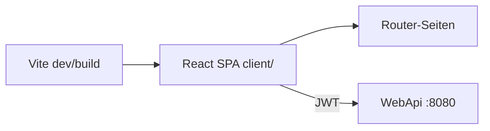
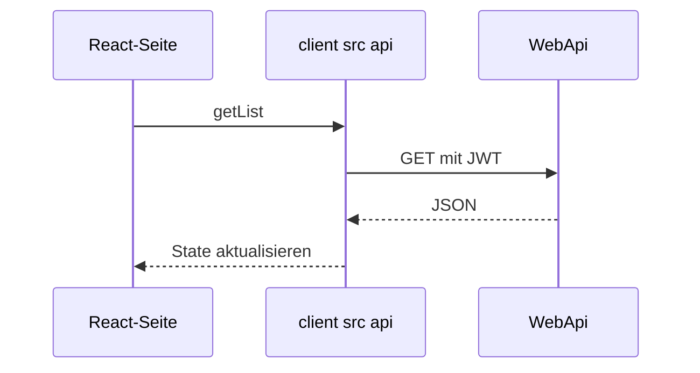

# 11 — React, Vite und TypeScript

[← Zurück](10-testing.md) · [Inhalt](00-index.md) · [Weiter →](12-i18n-ux.md)

## Was ist das?

**React**: UI-Bibliothek auf Komponentenbasis.  
**Vite**: Schneller Dev-Server + Production-Bundler.  
**TypeScript**: Typisiertes JavaScript — Fehler beim Kompilieren.

**Vergleich:** React ist der **Lego**-Kasten; Vite die schnelle **Werkbank**; TypeScript warnt vor fehlenden Teilen, bevor du öffnest.



## Rolle in BankApp

`client/`-SPA: Login, Dashboard, Anträge, Kunden, Kredittypen, Personal, Profil; spricht per JWT mit der API.

## Wann hinzugefügt?

**Faz 4**.

## Grundbegriffe

| Begriff | Bedeutung |
|--------|--------|
| **Component** | `function Foo() { return <div/> }` |
| **Hook** | `useState`, `useEffect`, Custom Hooks |
| **SPA** | Eine Seite; Client-Routing |
| **react-router** | URL → Seite |
| **Fetch / api module** | HTTP-Client-Schicht |



## Befehle

```powershell
cd client
npm install          # Abhängigkeiten aus package-lock
npm run dev          # Dev-Server
npm run build        # tsc + vite production
npm run preview      # Build-Vorschau
```

| Script | Wirkung |
|--------|-----------|
| `dev` | Lokales UI mit HMR |
| `build` | Erzeugt `dist/` (Docker nginx) |

Umgebung: `VITE_API_BASE_URL` (Build-Arg in Compose).

## Klassen, Methoden, Pakete

| Paket / Datei | Rolle |
|---------------|-----|
| `react`, `react-dom` | UI |
| `react-router-dom` | Routen |
| `@microsoft/signalr` | Live-Benachrichtigungen |
| `client/src/api/*` | REST-Wrapper |
| `AuthContext` | Token / User-State |
| `formatMoney` / `currencySymbol` | Geldbetrag-Anzeige |

## Wo im Repo?

```
client/package.json
client/src/main.tsx
client/src/pages/
client/src/api/
client/Dockerfile
```

## Mini-Ablauf

`npm run dev` → Login → Token in localStorage/Context → ApplicationsPage lädt Liste → SignalR-Toast.

Screenshot (Mitarbeiter-Dashboard): [`Bank Employee Page - Dashboard.png`](../../assets/screenshots/en/Bank%20Employee/Bank%20Employee%20Page%20-%20Dashboard.png)

## Einstiegs-Lab

1. `cd client` → `npm install` → `npm run dev`.
2. `.env` / `VITE_API_BASE_URL` zeigt auf die API?
3. Login → DevTools Application → Token/Context.
4. Unter `src/pages` Applications finden → welches `api/`-Modul?
5. `npm run build` → `dist/` (wie Docker).

## Häufige Fehler

- CORS schuld, API aus — zuerst `8080/health`.  
- TypeScript mit `any` abschalten — Typen in `client/src/api`.  
- Falsches `VITE_*` beim Prod-Build — Client mit Compose `.env` neu bauen.  

## Wo hilft es?

- [ ] `npm run dev` startet  
- [ ] Geschützte Seiten nach Login  
- [ ] `npm run build` wie CI  
