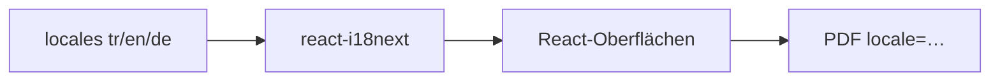

# 12 — i18n und UX (Barrierefreiheit, Datenschutz)

[← Zurück](11-react-vite.md) · [Inhalt](00-index.md) · [Weiter →](13-rabbitmq.md)

## Was ist das?

**i18n** (Internationalization): UI-Texte aus Sprachdateien.  
BankApp: **TR / EN / DE** (`react-i18next`).  
Zusätzlich: Barrierefreiheits-Panel, Cookie-/Datenschutz-Banner, Theme.



## Rolle in BankApp

- Dieselbe Oberfläche in drei Sprachen.
- Seed-Produktnamen je nach Locale.
- PDF-Export mit Locale-Query (`tr`/`en`/`de`).
- Theme / Schrift / Kontrast werden im Browser gespeichert.

## Wann hinzugefügt?

i18n: **Faz 4**. Barrierefreiheit + Privacy: **Faz 5**.

## Grundbegriffe

| Begriff | Bedeutung |
|--------|--------|
| **Locale** | `tr`, `en`, `de` |
| **Translation key** | `applications.approve` |
| **t('key')** | Übersetzungsfunktion |
| **Persisted preference** | localStorage |

## Befehle

Kein spezielles CLI. Sprache in der UI umschalten; in der Entwicklung:

```powershell
cd client
npm run dev
```

JSON-Übersetzungen bearbeiten → sofort per HMR sichtbar.

## Klassen, Methoden, Pakete

| Paket / Datei | Rolle |
|---------------|-----|
| `i18next`, `react-i18next` | Übersetzungs-Engine |
| `client/src/i18n/` oder `locales/` | Sprach-JSONs |
| Accessibility floating panel | Theme / A± / Kontrast (+ erweitertes a11y-Kit) |
| Privacy banner | Einwilligung beim ersten Besuch |

Details zum portablen Assistenten: [34 — a11y portable kit](../tr/34-a11y-portable-kit.md) *(TR bis DE-Spiegel)*.

## Wo im Repo?

```
client/src/  # i18n init, a11y/, components/AccessibilityToolbar, privacy
docs/assets/screenshots/en/Accessiblity Settings.png
```

## Mini-Ablauf

Nutzer wählt EN → `i18n.changeLanguage('en')` → alle `t()`-Keys aus EN-JSON → PDF-Download mit `locale=en` an die API.
