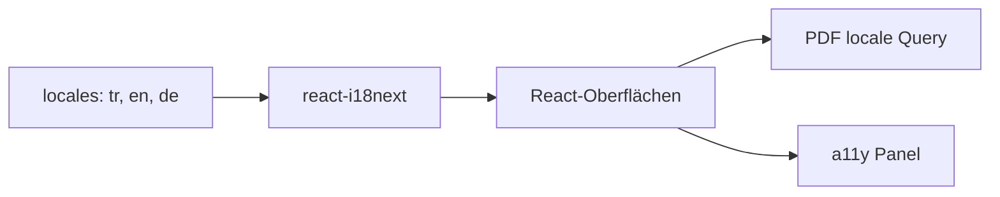
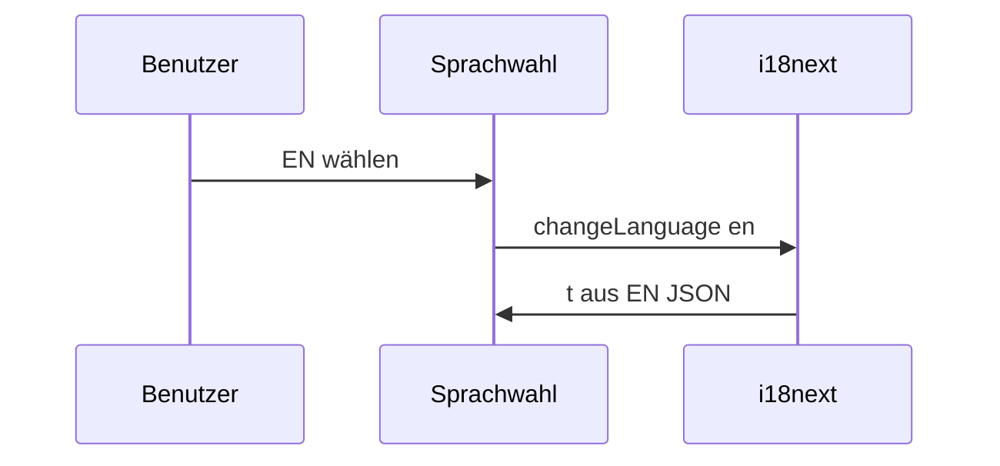

# 12 — i18n und UX (Barrierefreiheit, Datenschutz)

[← Zurück](11-react-vite.md) · [Inhalt](00-index.md) · [Weiter →](13-rabbitmq.md)

## Was ist das?

**i18n**: UI-Texte aus Sprachdateien statt fest im Code. BankApp: **TR / EN / DE** (`react-i18next`). Zusätzlich: Barrierefreiheits-Panel, Cookie-/Datenschutz-Banner, Theme.

**Analogie:** i18n = **Empfangskarte in drei Sprachen**; a11y-Panel = **Fernbedienung** für Schrift und Kontrast.



## Rolle in BankApp

Drei Sprachen, locale-abhängige Seeds, PDF mit `locale`, Theme in `localStorage`. Details: [34 — a11y portable kit](34-a11y-portable-kit.md).

## Wann hinzugefügt?

i18n **Faz 4**; a11y + Privacy **Faz 5**.

## Grundbegriffe

| Begriff | Bedeutung |
|--------|--------|
| **Locale** | `tr`, `en`, `de` |
| **Translation key** | z. B. `applications.approve` |
| **t('key')** | Übersetzungsfunktion |
| **Interpolation** | `{{amount}}` Platzhalter |



## Befehle

```powershell
cd client
npm run dev
```

```powershell
cd client
npm run build
```

## Klassen, Methoden, Pakete

`i18next`, `react-i18next`, `client/src/i18n/`, `client/src/locales/`, Accessibility-Panel.

## Wo im Repo?

```
client/src/i18n/
client/src/locales/
client/src/a11y/
```

## Mini-Ablauf

`changeLanguage` → alle `t()` aus JSON → PDF mit `locale=` → a11y bleibt gespeichert.

## Einsteiger-Lab

1. `npm run dev` → Sprache **DE** wählen.  
2. Button-Texte prüfen.  
3. `localStorage` in DevTools kontrollieren.  
4. Kontrast erhöhen, Reload → bleibt.  
5. PDF-Download → `locale` in Network.

## Häufige Fehler

- Hart codierte Strings in JSX  
- Key nur in einer JSON-Datei  
- Falsches `locale` an die API  
- Globales CSS überschreibt a11y  

## Wo hilft es?

- [ ] Drei Sprachen konsistent  
- [ ] Sprache nach Reload erhalten  
- [ ] PDF mit gewähltem `locale`  
- [ ] a11y-Einstellungen persistent
