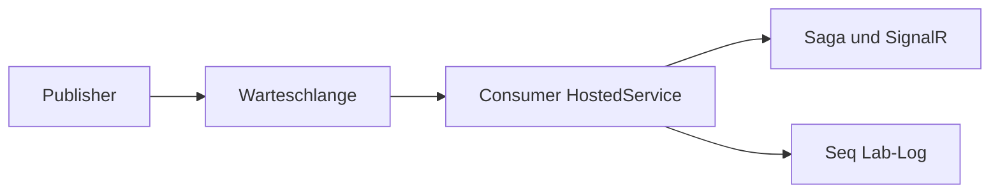
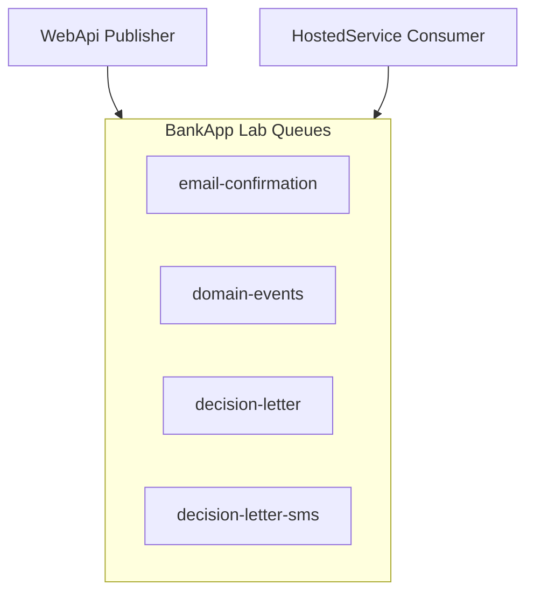

# 13 — RabbitMQ

[← Zurück](12-i18n-ux.md) · [Inhalt](00-index.md) · [Weiter →](14-outbox-events.md)

Verwandt: [14 Outbox](14-outbox-events.md) · [22 Decision letter](../tr/22-decision-letter-email.md) *(TR)* · [24 Lab tools](../tr/24-lab-tools.md) *(TR)* · [09 Compose](09-docker-compose.md)

## Was ist das?

**RabbitMQ**: Message Queue (AMQP). Producer → Queue → Consumer; HTTP antwortet schnell, Arbeit läuft im Hintergrund.

**Analogie:** **Nummernzettel** — Kasse gibt Bon, Küche arbeitet die Schlange ab.



## Rolle in BankApp

| Queue (Lab) | Inhalt |
|--------------|-----------|
| `email-confirmation` | E-Mail-Bestätigung nach Registrierung (noch kein JWT) |
| `domain-events` | Outbox → Saga + SignalR |
| `decision-letter` | Entscheidungsbrief nach Approve/Reject (Log in Seq; kein SMTP) |
| `decision-letter-sms` | SMS-Lab nach Approve/Reject (Log in Seq; kein Gateway) |

## Wann hinzugefügt?

E-Mail-Queue: **Faz 5**. Domain-Events: **Faz 6** (Outbox). Decision-letter: Lab-Benachrichtigung.

## Grundbegriffe

| Begriff | Bedeutung |
|--------|--------|
| **Producer** | Veröffentlicht Nachrichten |
| **Consumer** | Liest Nachrichten (Hosted Service) |
| **Queue** | Warteschlange |
| **Ready** | Noch nicht konsumierte Nachrichten (UI) |
| **Unacked** | Vom Consumer bearbeitet, noch nicht ack |
| **Ack / Nack** | Erfolg / Fehler markieren |
| **At-least-once** | Mindestens einmal zugestellt — Consumer muss idempotent sein |



## Befehle

```powershell
cd infra

# Broker + Management UI
docker compose --env-file .env up -d rabbitmq
# Prüfen: compose ps → rabbitmq healthy
# UI: http://localhost:15672  → guest / guest
```

```powershell
# Broker-Log (Verbindung abgelehnt, Disk-Alarm)
docker compose --env-file .env logs --tail=80 rabbitmq

# Consumer/Publisher-Fehler oft hier
docker compose --env-file .env logs --tail=100 webapi
```

**Management UI — worauf achten?**

1. Login: `guest` / `guest`.
2. **Queues** — `email-confirmation`, `domain-events`, `decision-letter`, `decision-letter-sms` (Namen wie im Code).
3. Pro Queue:
   - **Consumers** ≥ 1 → WebApi Hosted Service verbunden
   - **Ready** wächst → kein Consumer / langsam / Fehler (Seq + `logs webapi`)
   - **Unacked** dauerhaft hoch → Hänger in der Verarbeitung
4. Nachrichten per UI **Get messages** ist im Lab lehrreich, kann den Consumer verwirren (ack/requeue); zuerst Metriken lesen.

```powershell
# Diagnose im Container (Management-Plugin-CLI)
docker compose --env-file .env exec rabbitmq rabbitmq-diagnostics -q ping
# Erwartet: Exit 0 / ok-ähnliche Ausgabe
```

### Was wird kontrolliert?

| Kontrolle | Wie | Gutes Zeichen |
|---------|-------|-------------|
| Healthy | `compose ps rabbitmq` | healthy |
| UI | `:15672` | Login + Queues-Liste |
| Consumer | Queue-Zeile Consumers | ≥ 1 (WebApi läuft) |
| Fluss | Registrierung oder Approve | Ready steigt und sinkt; „verarbeitet“ in Seq |

### Notfall / Wiederherstellung (Lab)

| Situation | Vorgehen |
|-------|-----|
| Consumers = 0 | WebApi down / Crash → `ps` + `logs webapi`; `up -d webapi` |
| Ready staut sich | Consumer-Exception → Seq Error; Fix + WebApi-Neustart |
| guest-Login scheitert | Nur Lab-Default; altes Volume mit Credentials? `down -v` Lab-Reset (Vorsicht) |
| „Schmutzige“ Queue im Lab | Sanft: WebApi recreate. Hart: `compose down -v` (Redis/Seq gehen auch weg) |

```powershell
# Einzelne Services erzwingen neu (Queue-Definitionen können an Image/Volume hängen)
docker compose --env-file .env up -d --force-recreate rabbitmq webapi
```

**Best practice:** In Prod kein `guest`; TLS + eigener User. Nachrichten in der UI löschen / holen vorsichtig. Zuerst Consumers + Ready, dann Seq.

## Klassen, Methoden, Pakete

| Name | Rolle |
|------|-----|
| `RabbitMQ.Client` | AMQP-Client |
| Email publisher / consumer (Identity/Notification) | Bestätigungsmail (im Lab Log) |
| `OutboxDispatcherHostedService` | Outbox → `domain-events` |
| `DomainEventsConsumerHostedService` | Queue → Saga + SignalR |
| Decision-letter publisher / consumer | Entscheidungsbrief-Lab |

## Wo im Repo?

```
src/WebApi/Modules/Notification/Messaging/
infra/docker-compose.yml
docs/assets/screenshots/en/Queues on RabbitMQ.png
docs/learning/tr/22-decision-letter-email.md
```

## Mini-Ablauf

Registrierung → Token → `email-confirmation` → Consumer log/Seq → Nutzer bestätigt per Link → Login.  
Approve/Reject → Outbox → `domain-events` (+ `decision-letter`) → SignalR / Seq.

## Einsteiger-Lab

1. `docker compose up -d rabbitmq webapi`  
2. UI :15672 → vier Queues  
3. Registrierung → `email-confirmation`  
4. Approve → `domain-events`  
5. Seq prüfen  

## Häufige Fehler

- WebApi down, Consumers = 0  
- Get messages in UI ohne Metriken  
- `guest` in Prod  
- Queue-Namen out of sync  

## Wo hilft es?

- [ ] rabbitmq healthy  
- [ ] Consumers ≥ 1  
- [ ] Ready sinkt nach Aktion  
- [ ] Seq-Logs sichtbar
