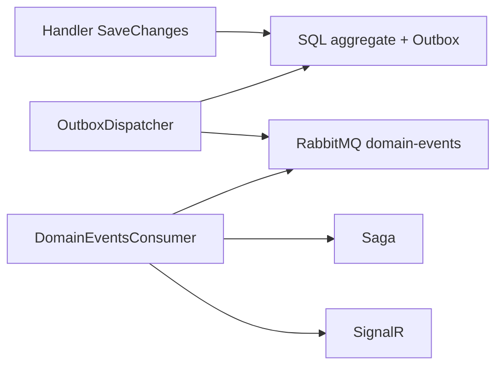
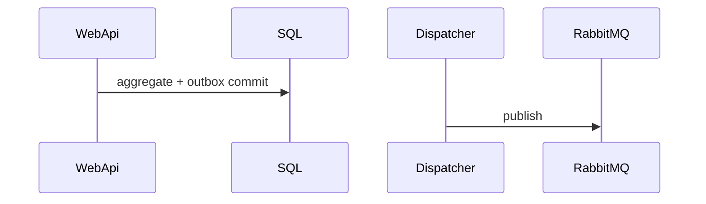

# 14 — Domain Events und Transactional Outbox

[← Zurück](13-rabbitmq.md) · [Inhalt](00-index.md) · [Weiter →](15-saga.md)

## Was ist das?

**Domain Event**: Wichtiges Ereignis im Aggregate. **Transactional Outbox**: Event in **derselben SQL-Transaktion** in `OutboxMessages`; Worker publiziert später nach RabbitMQ — weniger **Dual-Write**-Risiko.

**Analogie:** Kassentransaktion und Brief im **selben Umschlag**; Kurier (Dispatcher) bringt ihn zur Post (RabbitMQ).



## Rolle in BankApp

Zuverlässige Events nach Create/Approve/Reject → Saga + SignalR + Decision-Letter.

## Wann hinzugefügt?

**Faz 6**.

## Grundbegriffe

Outbox-Zeile, Dispatcher, `ProcessedOnUtc`, idempotenter Consumer, At-least-once.



## Befehle

```powershell
cd infra
docker compose --env-file .env logs -f webapi
```

```sql
SELECT TOP 20 Id, Type, ProcessedOnUtc FROM OutboxMessages ORDER BY OccurredOnUtc DESC;
```

```powershell
dotnet test tests/Application.UnitTests/Application.UnitTests.csproj --filter "Outbox"
```

## Wo im Repo?

`src/Domain/Events/`, Persistence Outbox, `DomainEventsConsumerHostedService.cs`

## Mini-Ablauf

SaveChanges → Dispatcher → RabbitMQ → Consumer → Saga + SignalR.

## Einsteiger-Lab

Approve im UI → Rabbit `domain-events` Ready sinkt → SQL `ProcessedOnUtc` gesetzt → Toast sichtbar.

## Häufige Fehler

- Publish ohne Outbox nach Commit  
- Outbox nicht als verarbeitet markieren  
- Event-Typ umbenennen ohne Consumer  
- Nur SignalR debuggen, Dispatcher vergessen  

## Wo hilft es?

- [ ] Outbox nach Approve verarbeitet  
- [ ] Queue läuft frei  
- [ ] Saga aktualisiert  
- [ ] SignalR am Ende der Kette
