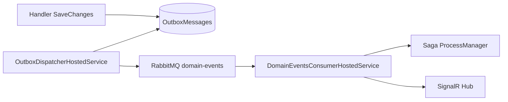

# 14 — Domain Events und Transactional Outbox

[← Zurück](13-rabbitmq.md) · [Inhalt](00-index.md) · [Weiter →](15-saga.md)

## Was ist das?

**Domain Event**: Im Aggregate passiert etwas Wichtiges (`CreditApplicationApproved`).  
**Transactional Outbox**: Event in **derselben DB-Transaktion** in `OutboxMessages` schreiben; danach ein Worker nach RabbitMQ publishen. So sinkt das Risiko „DB ja / Queue nein“.



## Rolle in BankApp

Nach Kredit Create / Approve / Reject / Cancel zuverlässige Veröffentlichung → Saga-Update + SignalR-Toast.

## Wann hinzugefügt?

**Faz 6**.

## Grundbegriffe

| Begriff | Bedeutung |
|--------|--------|
| **IDomainEvent** | Event-Vertrag |
| **Outbox row** | Noch nicht publiziertes Event |
| **Dispatcher** | Periodisch lesen und in Queue senden (Hosted Service) |
| **Dual-write problem** | Zwei Speicher inkonsistent |

## Befehle

Kein spezielles CLI. Beobachten:

```powershell
# Outbox in SQL (Lab-Verbindung)
# SELECT TOP 20 * FROM OutboxMessages ORDER BY OccurredOnUtc DESC

docker compose logs -f webapi
```

## Klassen, Methoden, Pakete

| Name | Rolle |
|------|-----|
| `CreditApplicationApproved` usw. | Domain-Event-Typen |
| `OutboxMessage` entity | Tabellenzeile |
| `OutboxDispatcherHostedService` | Publish |
| `DomainEventsConsumerHostedService` | Consume |
| Aggregate `Approve(...)` | Erzeugt Event |

## Wo im Repo?

```
src/Domain/Events/
src/Persistence/…Outbox…
src/WebApi/…/Outbox…
src/WebApi/Modules/Notification/Messaging/DomainEventsConsumerHostedService.cs
```

## Mini-Ablauf

Handler SaveChanges (Aggregate + Outbox) → Dispatcher publish → RabbitMQ → Consumer → ProcessManager + SignalR `NotifyAsync`.
