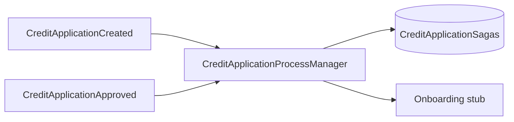

# 15 — Saga / Process Manager

[← Zurück](14-outbox-events.md) · [Inhalt](00-index.md) · [Weiter →](16-signalr.md)

## Was ist das?

**Saga / Process Manager**: Zustandsmaschine für einen längeren Geschäftsprozess.  
Schritte, die nicht in einer Transaktion enden (angelegt → Entscheidung → Onboarding-Stub), werden der Reihe nach verfolgt.



## Rolle in BankApp

Tabelle `CreditApplicationSagas` + `CreditApplicationProcessManager`: Orchestrierung des Kreditantrags-Lebenszyklus (inkl. Lern-Stubs).

## Wann hinzugefügt?

**Faz 6**.

## Grundbegriffe

| Begriff | Bedeutung |
|--------|--------|
| **Orchestration** | Zentraler Manager steuert Schritte |
| **State** | Aktueller Prozessschritt |
| **Compensation** | (Fortgeschritten) Rollback; hier Stub-Fokus |
| **Idempotent handler** | Doppeltes Event bricht nichts |

## Befehle

Kein CLI; Validierung per Unit-Tests:

```powershell
dotnet test --filter "FullyQualifiedName~Saga"
```

## Klassen, Methoden, Pakete

| Name | Rolle |
|------|-----|
| `CreditApplicationProcessManager` | State-Übergänge je Event |
| `CreditApplicationSaga` entity | Persistierter Prozessstatus |
| Aufruf aus Consumer | Nach Outbox-Event |

## Wo im Repo?

```
src/Application/Modules/Credit/Sagas/
src/Domain/… (saga entity / states)
tests/Application.UnitTests/…Saga…
```

## Mini-Ablauf

Created event → Saga „Created“ → Approved event → Entscheidungs-State → Onboarding-Stub → Completed (Happy Path in Tests festgehalten).
