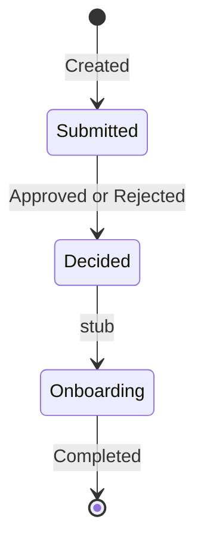
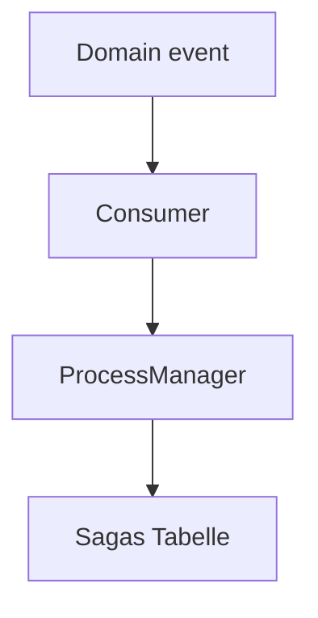

# 15 — Saga / Process Manager

[← Zurück](14-outbox-events.md) · [Inhalt](00-index.md) · [Weiter →](16-signalr.md)

## Was ist das?

**Saga**: Zustandsmaschine für lange Prozesse (Created → Entscheidung → Onboarding-Stub).

**Analogie:** Passamt-Stempel — jeder Schritt in `CreditApplicationSagas`.



## Rolle in BankApp

`CreditApplicationProcessManager` + Tabelle `CreditApplicationSagas`.

## Wann hinzugefügt?

**Faz 6**.



## Befehle

```powershell
dotnet test tests/Application.UnitTests/Application.UnitTests.csproj --filter "Saga"
```

## Wo im Repo?

`src/Application/Modules/Credit/Sagas/`

## Mini-Ablauf

Events treiben Zustandsübergänge; Tests sichern Happy Path.

## Einsteiger-Lab

Neue Bewerbung → SQL State `Submitted` → Approve → State wechselt → `dotnet test --filter Saga`.

## Häufige Fehler

- State im HTTP-Handler statt Consumer  
- Keine Idempotenz bei Duplikat-Events  
- Saga-Tabelle manuell ändern  

## Wo hilft es?

- [ ] Saga-Zeile bei neuer Bewerbung  
- [ ] State nach Entscheidung  
- [ ] Unit-Tests grün
