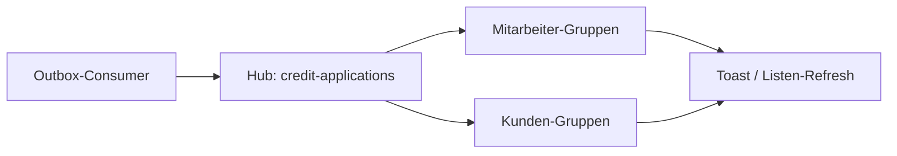
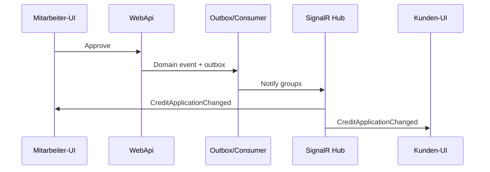

# 16 — SignalR

[← Zurück](15-saga.md) · [Inhalt](00-index.md) · [Weiter →](17-modular-monolith.md)

## Was ist das?

**SignalR** ermöglicht dem Server, dem Browser **sofort** Nachrichten zu senden (meist per WebSocket).  
Toast, Badge oder Listen-Update ohne Seitenreload.

**Vergleich:** Klassisches HTTP ist wie Frage–Antwort per Brief; SignalR ist eine offene **Telefonleitung** — die Bank (API) kann den Kunden (Browser) jederzeit „anrufen“.



## Rolle in BankApp

- Hub-Pfad: `/hubs/credit-applications`
- Outbox-Consumer verarbeitet ein Event und sendet `CreditApplicationChanged` an Staff- und betroffene Kundengruppen
- Payload enthält Betrag + **currencyCode** → UI zeigt das richtige Symbol mit `formatMoney`

Bildschirmbeispiel (Staff-Toast / Live-Update): [bank-employee screenshots](../../screenshots/bank-employee.en.md)

## Wann hinzugefügt?

**Faz 6** (vor der Modular-Monolith-Darstellung umgesetzt).

## Grundbegriffe

| Begriff | Bedeutung |
|--------|--------|
| **Hub** | Vertragspunkt Client–Server (welche Methoden / welche Events) |
| **Group** | Broadcast-Menge z. B. „Mitarbeiter dieser Filiale“ |
| **access_token** | JWT beim WebSocket-Connect (Query oder Header) |
| **Reconnect** | Automatischer Neuaufbau nach Verbindungsabbruch |



## Befehle

```powershell
# SignalR-Paket im Client
cd client
npm install @microsoft/signalr
```

Verifikation: Browser DevTools → **Network** → Filter **WS** → Hub-Frames `credit-applications`.

## Klassen, Methoden, Pakete

| Name | Rolle |
|------|------|
| Credit applications hub (WebApi) | Verbindung / Gruppen |
| `ICreditApplicationRealtimeNotifier` | Publish-Abstraktion |
| `CreditApplicationChangedMessage` | Payload (Amount, CurrencyCode) |
| `useCreditApplicationRealtime` | React-Hook + Toast |

Pakete: ASP.NET Core SignalR (Server), `@microsoft/signalr` (Client).

## Wo im Repo?

```
src/WebApi/Modules/Notification/Realtime/
client/src/realtime/
```

## Mini-Ablauf

Staff genehmigt → Outbox → Consumer → Hub-Gruppen → Kunden-Browser zeigt Success-Toast + `formatMoney(currencyCode)`.

## Einstiegs-Lab

1. API + Client mit Compose starten.
2. Zwei Browser: einer Mitarbeiter, einer Kunde (Konten mit Zugriff auf dieselbe Bewerbung).
3. Mitarbeiter genehmigt/lehnt ab.
4. Auf dem Kunden-Tab Toast ohne F5 sehen.
5. DevTools → WS: Nachricht prüfen.

## Häufige Fehler

- Hub-Verbindung ohne JWT → 401 / Verbindung bricht ab  
- Nur HTTP prüfen und WS übersehen  
- `currencyCode` ignorieren → falscher Währungssymbol  

## Wo hilft es?

- [ ] Toast nach Genehmigung/Ablehnung  
- [ ] WS-Verbindung in DevTools sichtbar  
- [ ] Kunden- und Mitarbeiter-Gruppen korrekt benachrichtigt  
