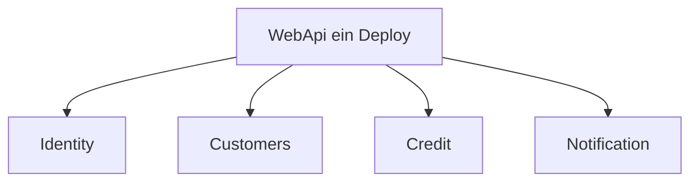

# 17 — Modular Monolith

[← Zurück](16-signalr.md) · [Inhalt](00-index.md) · [Weiter →](18-otel-observability.md)

## Was ist das?

**Modular Monolith**: Ein Deploy, meist eine DB; Code in **Modulgrenzen** getrennt. Bounded-Context-Disziplin ohne Mikroservice-Komplexität.



## Rolle in BankApp

Module: **Identity**, **Customers**, **Credit**, **Notification** — jeweils in `Application/Modules` und `WebApi/Modules`.

## Wann hinzugefügt?

**Faz 6**.

## Grundbegriffe

| Begriff | Bedeutung |
|--------|--------|
| **Bounded context** | Grenze einer Fachsprache |
| **Module** | Ordner + Registration + Controller-Gruppe |
| **Shared kernel** | Dünner Kern, den Module teilen (Domain/Core) |

## Befehle

Strukturelles Pattern; CLI:

```powershell
dotnet build BankApp.slnx
```

Neues Feature in den richtigen Modulordner legen (`Credit` oder `Identity`?).

## Klassen, Methoden, Pakete

| Name | Rolle |
|------|-----|
| `AddApplicationModules()` | Modul-DI-Registrierungen |
| `WebApi/Modules/*/Controllers` | HTTP-Endpunkte |
| Notification hosted services | Messaging / Realtime |

## Wo im Repo?

```
src/Application/Modules/
src/WebApi/Modules/
docs/architecture-notes.de.md
```

## Mini-Ablauf

Neues „Filial“-Feature → welcher Context? (Customers vs Credit) → CQRS unter `Features` des Moduls → WebApi-Controller im selben Modul.
