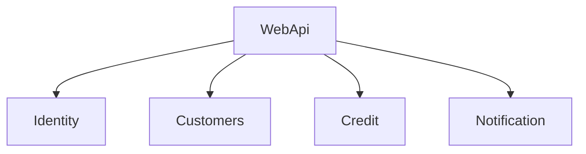
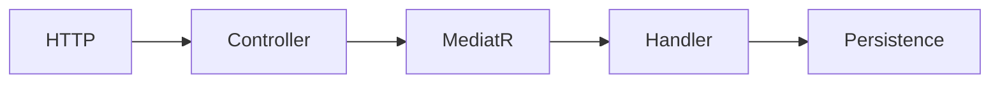

# 17 — Modularer Monolith

[← Zurück](16-signalr.md) · [Inhalt](00-index.md) · [Weiter →](18-otel-observability.md)

## Was ist das?

**Modularer Monolith**: Ein Deploy, meist eine DB; Code in **Modulen** (Identity, Credit, …).

**Analogie:** Ein Gebäude, **Etagen** pro Modul — gemeinsame Treppe (Domain), keine Tür direkt in fremde Wohnung.



## Rolle in BankApp

`Application/Modules` + `WebApi/Modules` für Identity, Customers, Credit, Notification.

## Wann hinzugefügt?

**Faz 6**.



## Befehle

```powershell
dotnet build BankApp.slnx
```

## Wo im Repo?

`src/Application/Modules/`, `src/WebApi/Modules/`, `docs/architecture-notes.tr.md`

## Mini-Ablauf

Feature → richtiges Modul → CQRS unter `Features` → Controller im selben Modul.

## Einsteiger-Lab

Vier Modulordner ansehen → Credit-Controller → `NotificationHostModule` → `dotnet build`.

## Häufige Fehler

- Alles in WebApi  
- Direkte Modul-zu-Modul-Kopplung  
- Regeln im Controller statt Handler  

## Wo hilft es?

- [ ] Feature im richtigen Modul  
- [ ] Build ohne Fehler  
- [ ] Dünne Controller
