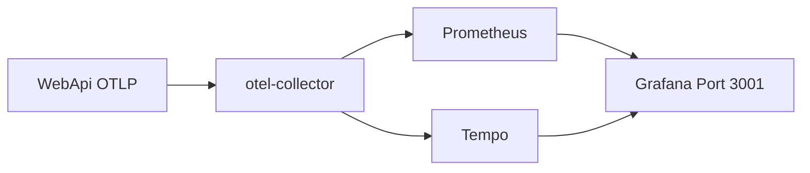
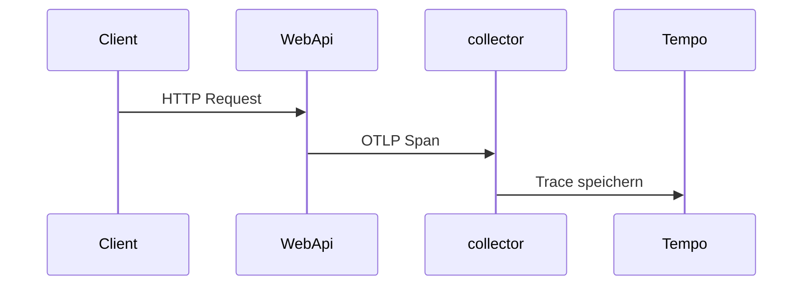

# 18 — OpenTelemetry, Prometheus, Grafana

[← Zurück](17-modular-monolith.md) · [Inhalt](00-index.md) · [Weiter →](19-vault-lab.md)

## Was ist das?

**OpenTelemetry (OTel)**: Standard zum Sammeln von **Traces / Metriken / (Log-Brücken)** aus der App.  
**Prometheus**: Metrics scrape und Speicher.  
**Grafana**: Dashboard-UI. Im Lab **Tempo** als Trace-Backend.  
**Seq** bleibt für Logs (Kapitel 07).

**Analogie:** OTel = **Überwachungskamera**; Grafana = **Leitstand** für Traces und Metriken.



## Rolle in BankApp

WebApi sendet per OTLP an den Collector → Prometheus / Tempo → Grafana unter `:3001`.

## Wann hinzugefügt?

**Faz 6** (OTel-Slice).

## Grundbegriffe

| Begriff | Bedeutung |
|--------|--------|
| **Trace / Span** | Request-Reise und Teilschritte |
| **Metric** | Counter / Histogram (z. B. HTTP-Dauer) |
| **OTLP** | OTel-Export-Protokoll |
| **Collector** | Vermittler (empfängt, verteilt) |
| **service.name** | Filter `bankapp-webapi` in Tempo |



## Befehle

```powershell
cd infra
docker compose --env-file .env up -d otel-collector prometheus grafana tempo

# Grafana http://localhost:3001  → admin / admin
# Prometheus http://localhost:9090
# OTLP (App → collector) localhost:4317

docker compose --env-file .env ps otel-collector tempo prometheus grafana
curl -s http://localhost:9090/-/ready
curl -s -o NUL -w "%{http_code}`n" http://localhost:3001/api/health
```

Kurzer Grafana-Rundgang:

1. Einige API-Requests (Scalar / Client; `/health` oft ohne Trace).
2. **Dashboards → BankApp → BankApp HTTP (OTel)**.
3. **Explore → Tempo** → Service `bankapp-webapi`.
4. **Explore → Prometheus** → z. B. `up` oder HTTP-Duration-Metriken.
5. In Seq `TraceId` desselben Requests prüfen.

Ausführliche Lab-Tool-Notizen: [24 — Lab-Tools](24-lab-tools.md).

## Klassen, Methoden, Pakete

| Paket | Rolle |
|-------|-----|
| `OpenTelemetry.Extensions.Hosting` | Host |
| `OpenTelemetry.Instrumentation.AspNetCore` / `Http` / `Runtime` | Automatische Spans/Metriken |
| `OpenTelemetry.Exporter.OpenTelemetryProtocol` | OTLP-Export |

Registrierung: WebApi DI / `Program` oder Extension-Methoden.

## Wo im Repo?

```
src/WebApi/… OpenTelemetry setup
infra/docker-compose.yml
infra/otel/ (falls Collector-Config)
docs/assets/screenshots/en/Metrics on Grafana.png
docs/assets/screenshots/en/Metrics on Grafana - 2.png
```

## Mini-Ablauf

HTTP-Request → AspNetCore-Instrumentation-Span → OTLP Collector → Tempo/Prometheus → Grafiken in Grafana.

Prometheus (Scrape-Ziele):


Grafana-Dashboard:


## Einsteiger-Lab

Stack starten → echte API-Calls (nicht nur health) → Grafana Dashboard BankApp HTTP → Tempo Explore → TraceId in Seq vergleichen.

## Häufige Fehler

- Kein Traffic vor Grafana  
- Nur health endpoint  
- Collector down ignorieren  

## Wo hilft es?

- [ ] Prometheus ready  
- [ ] Tempo Spans für webapi  
- [ ] Grafana Dashboards laden
