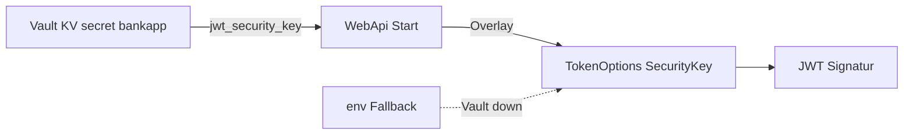
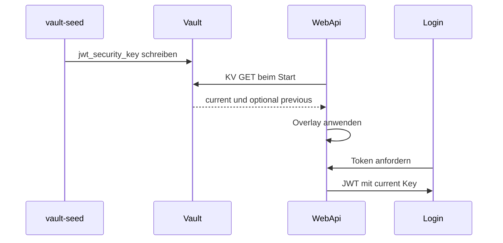

# 19 — HashiCorp Vault (Lab) + WebApi-Overlay

[← Zurück](18-otel-observability.md) · [Inhalt](00-index.md) · [Weiter →](20-pdf-export.md)

Verwandt: [06 JWT](06-jwt-rbac.md) · [24 Lab-Tools](24-lab-tools.md) · [09 Compose](09-docker-compose.md)

## Was ist das?

**Vault**: Speicher für Secrets. Im BankApp-Lab: Compose **Dev-Mode** Vault + `vault-seed` → KV-Pfad `secret/bankapp`.  
Beim WebApi-Start optional **JWT-SecurityKey** aus Vault lesen und `TokenOptions:SecurityKey` überschreiben.

**Analogie:** Vault = **Tresor**; Overlay = Schlüssel vom Tresor auf den Schreibtisch legen; `.env` = Lab-Reserve.



## Rolle in BankApp

- Secrets in der UI sichtbar machen (Schulung).
- Mit `Vault__Enabled=true` in Compose kommt der JWT-Key aus Vault; bei Vault-Ausfall Fallback über `.env` / `TokenOptions__SecurityKey`.
- SQL-Connection-String bleibt bewusst in Compose-Env (einfach); später erweiterbar.

## Wann hinzugefügt?

Compose-Lab früher; **WebApi JWT-Overlay** im Security-Slice.

## Grundbegriffe

| Begriff | Bedeutung |
|--------|--------|
| **KV v2** | HTTP-API `secret/data/{path}` |
| **X-Vault-Token** | Token im Request-Header |
| **Overlay** | Config-Überschreibung via `AddInMemoryCollection` |
| **Dev mode** | Kein Prod; kein Unseal/Raft; Daten ephemeral |
| **Root token** | Im Lab alles erlaubt — Prod-Antipattern |



## Befehle

```powershell
cd infra

# Vault + Seed-Job (Seed schreibt Secret einmal)
docker compose --env-file .env up -d vault
docker compose --env-file .env up vault-seed
# Prüfen: vault healthy; UI http://localhost:8200
# Token: VAULT_DEV_ROOT_TOKEN_ID in .env (z. B. bankapp-vault-root-token)
```

**Vault UI**

1. Method: **Token** → `VAULT_DEV_ROOT_TOKEN_ID` einfügen.
2. Secrets → KV → `secret` → `bankapp` (oder Seed-Pfad).
3. Feld `jwt_security_key` lesen (Wert nicht in Screenshots).

```powershell
# Gleiches Secret per CLI (vault-Binary im Container)
docker compose --env-file .env exec vault vault kv get secret/bankapp
# Erwartet: Zeile jwt_security_key; Fehler → Seed nicht gelaufen oder falscher Pfad
```

```powershell
# Vault-Status (Dev mode)
docker compose --env-file .env exec vault vault status

# WebApi-Overlay aktiv?
docker compose --env-file .env logs webapi | Select-String -Pattern "Vault"
# Erwartet: "Vault overlay applied" oder Fallback-Warnung
```

```powershell
# Grober Check von Host aus
curl -s -o NUL -w "%{http_code}`n" http://localhost:8200/ui/
curl -s -H "X-Vault-Token: bankapp-vault-root-token" http://localhost:8200/v1/secret/data/bankapp
# Token durch eigenen .env-Wert ersetzen; 200 + JSON data
```

### Secret-Rotation (Lab Dual-Key) und Raft HA (optional)

Der Alltags-Stack nutzt **Dev-Mode** Vault (`:8200`). **JWT Dual-Key** läuft hier. **Raft HA** separat: `docker-compose.vault-raft.yml` (Ports **8210/8211/8212**).

| Thema | Im Lab | Produktion |
|------|--------|------------|
| **JWT-Rotation** | `jwt_security_key` + `jwt_security_key_previous`; Signatur=current, Validierung=beide | Key-ID, kurzes Dual-Key-Fenster, Rolling-Restart |
| **Raft / HA** | Optionales 3-Node-Compose-Overlay | ≥3 Raft-Nodes, Unseal, Audit, TLS |
| **Policy** | Root-Token | AppRole + enge Policy |

**Dual-Key rotate (empfohlen im Lab):**

```powershell
cd infra

docker compose --env-file .env exec `
  -e VAULT_TOKEN=bankapp-vault-root-token `
  vault /bin/sh /vault-rotate-jwt.sh

docker compose --env-file .env up -d --force-recreate --no-deps webapi
```

**Prüfen:** `vault kv get secret/bankapp` → beide Key-Felder; Log `SecurityKey + Previous`.  
Alter Access-Token (mit previous signiert) bleibt gültig; neuer Login nutzt current.  
`vault-seed` überschreibt vorhandenes Secret nicht mehr; bei Recreate trotzdem `--no-deps` gewohnheitsmäßig.

Optionaler eigener Key:

```powershell
docker compose --env-file .env exec `
  -e VAULT_TOKEN=bankapp-vault-root-token `
  -e NEW_JWT_KEY="BankApp-Rotated-Jwt-Key-Replace-Me-With-At-Least-64-Characters-ABCDEF" `
  vault /bin/sh /vault-rotate-jwt.sh
```

**Destructiver (alter Weg):**

```powershell
docker compose --env-file .env up -d --force-recreate vault
docker compose --env-file .env up vault-seed
docker compose --env-file .env up -d --force-recreate webapi
```

**Raft HA Lab (optional):**

```powershell
cd infra
docker compose -f docker-compose.vault-raft.yml up -d
docker compose -f docker-compose.vault-raft.yml exec vault-raft-1 /bin/sh /vault-raft-init.sh
```

Peer join (Node 2/3 — Leader muss unsealed sein):

```powershell
docker compose -f docker-compose.vault-raft.yml exec vault-raft-2 `
  vault operator raft join http://vault-raft-1:8200
docker compose -f docker-compose.vault-raft.yml exec vault-raft-2 `
  vault operator unseal <UNSEAL>
# analog vault-raft-3
docker compose -f docker-compose.vault-raft.yml exec -e VAULT_TOKEN=<ROOT> vault-raft-1 `
  vault operator raft list-peers
```

**Hinweis:** Standard-WebApi bleibt `vault:8200` (dev). Raft-Anbindung = separates Experiment (`Vault__Address=http://host.docker.internal:8210`).  
**Destructiv:** `docker compose -f docker-compose.vault-raft.yml down` (tmp-Daten weg).

**Achtung:** Dev mode ≠ Prod. Root-Token nicht öffentlich posten. SQL/Rabbit weiter in Compose-Env — bewusste Vereinfachung.

## Klassen, Methoden, Pakete

| Name | Rolle |
|------|-----|
| `VaultOptions` | Enabled, Address, Token, MountPath, SecretPath |
| `ApplyVaultSecretsAsync` | HTTP GET KV → Keys → Config-Overlay |
| `TokenOptions.SecurityKeyPrevious` | Dual-Key-Validierungsfenster |
| `TokenSigningKeyFactory` | Signatur: current; Validierung: current + previous |
| `vault-rotate-jwt.sh` | KV-Rotation (previous ← current) |
| `vault-raft-init.sh` | Raft-Leader init/unseal (optional) |
| `Program.cs` | Vor DI: `await builder.Configuration.ApplyVaultSecretsAsync()` |

Kein Vault-SDK — `HttpClient` + JSON.

## Wo im Repo?

```
src/WebApi/Configuration/VaultOptions.cs
src/WebApi/Configuration/VaultConfigurationExtensions.cs
src/WebApi/Program.cs
src/WebApi/appsettings.json          # Vault:Enabled=false (lokal)
infra/docker-compose.yml             # Vault__Enabled=true (dev)
infra/docker-compose.vault-raft.yml
infra/vault-raft/config-node*.hcl
infra/scripts/vault-seed.sh
infra/scripts/vault-rotate-jwt.sh
infra/scripts/vault-raft-init.sh
infra/.env.example
```

## Mini-Ablauf

vault-seed schreibt `jwt_security_key` → WebApi-Start → Overlay → JWT-Signatur mit current key.  
Rotate-Script → previous + neuer current → WebApi recreate → alte Tokens über previous, neue Logins über current.

Bildschirm (Vault UI — Secrets; Tokens/Werte nicht teilen):


## Einsteiger-Lab

Vault + seed → `kv get` → WebApi-Log Overlay → Login → optional JWT-Rotate testen.

## Häufige Fehler

- Dev-Mode mit Raft verwechseln  
- Seed nach Rotate ohne Vorsicht  
- JWT-Key zu kurz  
- Root-Token teilen  

## Wo hilft es?

### Gesundheits-Checkliste

| Check | Wie | Gut |
|-------|-----|-----|
| Vault up | `compose ps vault` | healthy / Up |
| Seed | `vault kv get secret/bankapp` | Key gesetzt |
| Overlay | `logs webapi` + Vault | overlay applied |
| Fallback | Vault stoppen, WebApi restart | läuft mit `.env`-Key (Lab) |

### Disaster / Recovery (Lab)

| Situation | Weg |
|-----------|-----|
| UI sealed / leer (Dev-Reset) | Vault neu starten → **Seed erneut** (`up vault-seed`) |
| kv get not found | Seed exit code / `logs vault-seed`; Pfad `secret/bankapp` |
| WebApi 500 JWT / Signatur | Kein Overlay + falsche Key-Länge; `.env` `TOKEN_SECURITY_KEY` ≥ 64 Byte |
| Token vergessen | `infra/.env` → `VAULT_DEV_ROOT_TOKEN_ID` |

```powershell
docker compose --env-file .env up vault-seed
docker compose --env-file .env up -d --force-recreate vault
docker compose --env-file .env up vault-seed
docker compose --env-file .env up -d --force-recreate webapi
```
