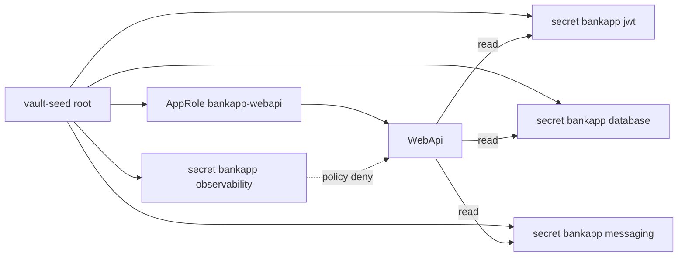
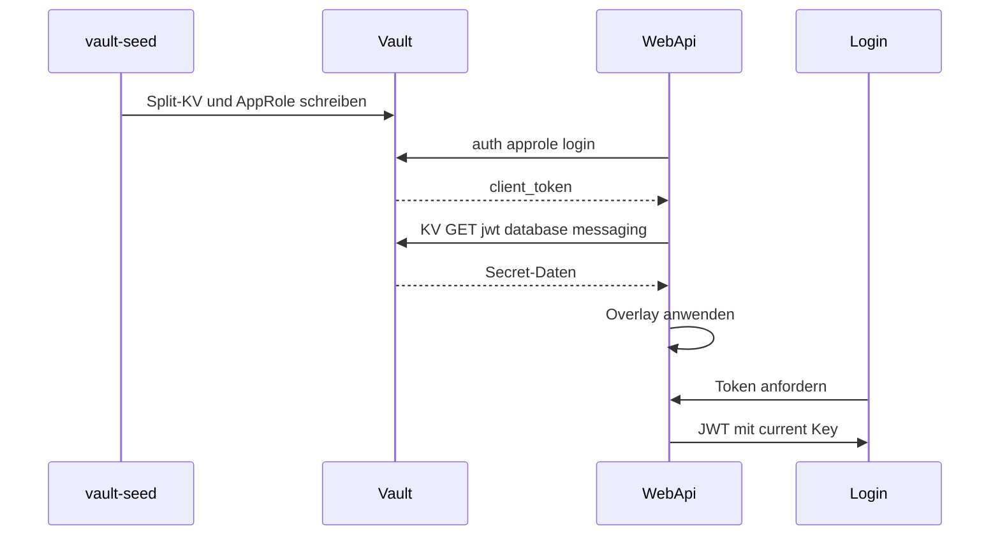

# 19 — HashiCorp Vault (Lab) + WebApi-Overlay

[← Zurück](18-otel-observability.md) · [Inhalt](00-index.md) · [Weiter →](20-pdf-export.md)

Verwandt: [06 JWT](06-jwt-rbac.md) · [24 Lab-Tools](24-lab-tools.md) · [09 Compose](09-docker-compose.md)

## Was ist das?

**Vault**: Speicher für Secrets. Im BankApp-Lab schreibt Compose **Dev-Mode** Vault + `vault-seed` **getrennte KV-Pfade** und erzeugt **AppRole**-Credentials.  
WebApi nutzt **keinen Root-Token**; Login per AppRole und Overlay von JWT + SQL-Passwort + RabbitMQ (`FailClosed=true` bricht den Start bei Vault-Fehler ab).

**Analogie:** Vault = **Tresor**; AppRole = **eingeschränkte Zutrittskarte**; Root-Token = Meisterschlüssel (nur Seed/UI); Observability-Pfad = Kameraschrank (Karte verweigert).



## Rolle in BankApp

- Pfadgetrennte Secrets in der Lab-UI.
- Compose AppRole + `FailClosed=true`: Overlay JWT, SQL-`Password`, RabbitMQ User/Passwort aus Vault.
- Observability-Admin-Secrets liegen in Vault; WebApi-Policy **darf nicht** lesen.
- SQL/Rabbit/Grafana/Keycloak-**Container** starten weiterhin aus Compose-`.env` (Vault Agent außerhalb des Scopes).

## Wann hinzugefügt?

Compose-Lab + JWT-Overlay früher; **AppRole + Split-Pfade + FailClosed** im Security-Hardening-Slice.

## Grundbegriffe

| Begriff | Bedeutung |
|--------|--------|
| **KV v2** | HTTP-API `secret/data/{path}` |
| **AppRole** | `role_id` + `secret_id` → kurzlebiger Client-Token |
| **Policy** | Welche Pfade lesbar/schreibbar — Least Privilege |
| **FailClosed** | App startet nicht, wenn Vault/AppRole fehlschlägt |
| **Overlay** | Config-Überschreibung via `AddInMemoryCollection` |
| **Dev mode** | Kein Prod; kein Unseal/Raft; Daten ephemeral |
| **Root token** | Nur Bootstrap — nie an WebApi |



## Befehle

```powershell
cd infra

# Vault + Seed-Job (Seed schreibt Secret einmal)
docker compose --env-file .env up -d vault
docker compose --env-file .env up vault-seed
# Prüfen: vault healthy; UI http://localhost:8200
# Token: VAULT_DEV_ROOT_TOKEN_ID in .env (z. B. bankapp-vault-root-token)
```

**Vault UI**

1. Method: **Token** → `VAULT_DEV_ROOT_TOKEN_ID` (nur Operator).
2. Secrets → KV → `secret` → `bankapp` → `jwt` / `database` / `messaging` / `observability`.
3. Unter `jwt` Feld `jwt_security_key` lesen (Wert nicht in Screenshots).

```powershell
docker compose --env-file .env exec vault vault kv get secret/bankapp/jwt
docker compose --env-file .env exec vault vault kv get secret/bankapp/database
docker compose --env-file .env exec vault vault kv get secret/bankapp/messaging
docker compose --env-file .env exec vault vault kv get secret/bankapp/observability
```

```powershell
docker compose --env-file .env exec vault vault status

docker compose --env-file .env logs webapi | Select-String -Pattern "Vault"
# Erwartet: "Vault overlay applied via AppRole"
```

### Secret-Rotation (Lab Dual-Key) und Raft HA (optional)

Der Alltags-Stack nutzt **Dev-Mode** Vault (`:8200`). **JWT Dual-Key** läuft hier. **Raft HA** separat: `docker-compose.vault-raft.yml` (Ports **8210/8211/8212**).

| Thema | Im Lab | Produktion |
|------|--------|------------|
| **JWT-Rotation** | `secret/bankapp/jwt` Dual-Key; Signatur=current, Validierung=beide | Key-ID, kurzes Dual-Key-Fenster, Rolling-Restart |
| **Auth** | AppRole + enge Policy (Compose) | K8s Auth / AppRole / JWT Auth + CSI / Agent |
| **Raft / HA** | Optionales 3-Node-Compose-Overlay | ≥3 Raft-Nodes, Unseal, Audit, TLS |

**Dual-Key rotate (empfohlen im Lab):**

```powershell
cd infra

# Nur secret/bankapp/jwt (database/messaging unberührt)
docker compose --env-file .env exec `
  -e VAULT_TOKEN=bankapp-vault-root-token `
  vault /bin/sh /vault-rotate-jwt.sh

docker compose --env-file .env up -d --force-recreate --no-deps webapi
```

**Prüfen:** `vault kv get secret/bankapp/jwt` → beide Key-Felder; Log `SecurityKey + Previous`.  
Alter Access-Token (mit previous signiert) bleibt gültig; neuer Login nutzt current.  
`vault-seed` lässt jwt/database/messaging bestehen; Observability kann je Seed aus Env aktualisiert werden.

Optionaler eigener Key:

```powershell
docker compose --env-file .env exec `
  -e VAULT_TOKEN=bankapp-vault-root-token `
  -e NEW_JWT_KEY="BankApp-Rotated-Jwt-Key-Replace-Me-With-At-Least-64-Characters-ABCDEF" `
  vault /bin/sh /vault-rotate-jwt.sh
```

**Destructiver (alter Weg):**

```powershell
docker compose --env-file .env up -d --force-recreate vault
docker compose --env-file .env up vault-seed
docker compose --env-file .env up -d --force-recreate webapi
```

**Raft HA Lab (optional):**

```powershell
cd infra
docker compose -f docker-compose.vault-raft.yml up -d
docker compose -f docker-compose.vault-raft.yml exec vault-raft-1 /bin/sh /vault-raft-init.sh
```

Peer join (Node 2/3 — Leader muss unsealed sein):

```powershell
docker compose -f docker-compose.vault-raft.yml exec vault-raft-2 `
  vault operator raft join http://vault-raft-1:8200
docker compose -f docker-compose.vault-raft.yml exec vault-raft-2 `
  vault operator unseal <UNSEAL>
# analog vault-raft-3
docker compose -f docker-compose.vault-raft.yml exec -e VAULT_TOKEN=<ROOT> vault-raft-1 `
  vault operator raft list-peers
```

**Hinweis:** Standard-WebApi bleibt `vault:8200` (dev). Raft-Anbindung = separates Experiment (`Vault__Address=http://host.docker.internal:8210`).  
**Destructiv:** `docker compose -f docker-compose.vault-raft.yml down` (tmp-Daten weg).

**Achtung:** Dev mode ≠ Prod (Raft, TLS, Audit). Root-Token nie an WebApi. Container starten weiter aus Compose-`.env`.

## Klassen, Methoden, Pakete

| Name | Rolle |
|------|-----|
| `VaultOptions` | Enabled, AppRole-Dateien, Pfade, FailClosed |
| `ApplyVaultSecretsAsync` | AppRole-Login → KV jwt/database/messaging → Overlay |
| `VaultFailClosedException` | Start abbrechen bei FailClosed=true |
| `TokenOptions.SecurityKeyPrevious` | Dual-Key-Validierungsfenster |
| `TokenSigningKeyFactory` | Signatur: current; Validierung: current + previous |
| `vault-seed.sh` | Split-KV + Policy + AppRole-Credential-Dateien |
| `vault-rotate-jwt.sh` | Dual-Key nur für `secret/bankapp/jwt` |
| `vault-raft-init.sh` | Raft-Leader init/unseal (optional) |
| `Program.cs` | Vor DI: `await builder.Configuration.ApplyVaultSecretsAsync()` |

Kein Vault-SDK — `HttpClient` + JSON.

## Wo im Repo?

```
src/WebApi/Configuration/VaultOptions.cs
src/WebApi/Configuration/VaultConfigurationExtensions.cs
src/WebApi/Program.cs
src/WebApi/appsettings.json          # Vault:Enabled=false (lokal)
infra/docker-compose.yml             # Vault__Enabled=true (dev)
infra/docker-compose.vault-raft.yml
infra/vault-raft/config-node*.hcl
infra/scripts/vault-seed.sh
infra/scripts/vault-rotate-jwt.sh
infra/scripts/vault-raft-init.sh
infra/.env.example
```

## Mini-Ablauf

vault-seed schreibt Split-Pfade + AppRole → WebApi AppRole-Login → JWT/SQL/Rabbit-Overlay → JWT mit current key.  
Rotate → nur jwt-Pfad → WebApi recreate → alte Tokens über previous gültig.

Bildschirm (Vault UI — Secrets; Tokens/Werte nicht teilen):


## Einsteiger-Lab

1. Vault + seed → UI :8200 mit Root-Token.
2. `kv get secret/bankapp/jwt` (+ database/messaging/observability).
3. WebApi-Log: `Vault overlay applied via AppRole`.
4. Login → gültiges JWT.
5. Rotate + WebApi recreate → Dual-Key testen.
6. (Fortgeschritten) Observability mit AppRole lesen → Policy deny.

## Häufige Fehler

- Root-Token an WebApi geben — Compose nutzt AppRole  
- Nach Seed WebApi nicht recreaten — alter/fehlender `secret_id`  
- Dev-Mode mit Raft verwechseln  
- JWT-Key unter 64 Byte  
- RabbitMQ-Passwort in `.env` ändern ohne `rabbitmq-data` Volume  

## Wo hilft es?

### Gesundheits-Checkliste

| Check | Wie | Gut |
|-------|-----|-----|
| Vault up | `compose ps vault` | healthy / Up |
| Vier KV-Pfade | `kv get` jwt/database/messaging/observability | gesetzt |
| AppRole-Dateien | WebApi `/vault-approle` | role_id + secret_id |
| Overlay | `logs webapi` | AppRole overlay applied |
| FailClosed | Vault down + WebApi recreate | WebApi bleibt nicht healthy |

### Disaster / Recovery (Lab)

| Situation | Weg |
|-----------|-----|
| UI sealed / leer (Dev-Reset) | Vault recreate → **Seed** → **webapi recreate** |
| kv get not found | `logs vault-seed`; Pfad `secret/bankapp/jwt` usw. |
| FailClosed-Loop | Seed fertig? Approle-Volume gemountet? |
| JWT / Signatur | `TOKEN_SECURITY_KEY` ≥ 64 Byte; jwt-Pfad gesetzt |
| Root-Token vergessen | `infra/.env` → `VAULT_DEV_ROOT_TOKEN_ID` |

```powershell
docker compose --env-file .env up vault-seed
docker compose --env-file .env up -d --force-recreate --no-deps webapi
docker compose --env-file .env up -d --force-recreate vault
docker compose --env-file .env up vault-seed
docker compose --env-file .env up -d --force-recreate --no-deps webapi
```
