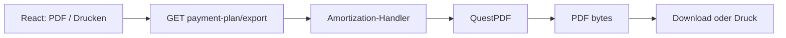
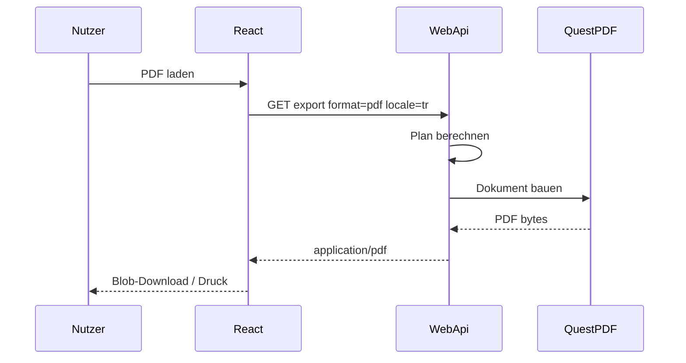

# 20 — QuestPDF und Zahlungsplan-Export

[← Zurück](19-vault-lab.md) · [Inhalt](00-index.md) · [Weiter →](21-ci-github-actions.md)

## Was ist das?

**QuestPDF** ist eine C#-Bibliothek zur PDF-Erzeugung per Code (Seitenlayout ohne HTML-Abhängigkeit).  
In BankApp wird der Kredit-**Tilgungs-/Zahlungsplan** als PDF zum Herunterladen und Drucken erzeugt.

**Vergleich:** Wie „Als PDF speichern“ in Excel — aber Layout und Beschriftungen kommen vom Server, locale-abhängig.



## Rolle in BankApp

- API: `payment-plan/export?format=pdf&locale=…`
- Austauschbarer Exporter (`IPaymentPlanDocumentExporter`) — später CSV/XLSX möglich
- Labels und Währungssymbole nach Locale (₺ $ €)

Bildschirm: [Bank Manager — Print & PDF](../../screenshots/bank-manager.en.md)

## Wann hinzugefügt?

PDF/Print-UX: Feature-Slice nach Faz 6 (README Features + Screenshots).

## Grundbegriffe

| Begriff | Bedeutung |
|--------|--------|
| **Exporter** | Dokument → Bytes / Datei |
| **Locale** | Sprache der PDF-Texte (`tr` / `en` / `de`) |
| **Amortization** | Tabelle Rate, Zins, Restkapital |



## Befehle

```powershell
dotnet add src/Application package QuestPDF
```

HTTP (mit Bearer-Token):

```http
GET /api/CreditApplications/{id}/payment-plan/export?format=pdf&locale=tr
```

(Echten Pfad im Repo über `applicationsApi` / Controller prüfen; Query enthält `locale` und ggf. Planparameter.)

## Klassen, Methoden, Pakete

| Name | Rolle |
|------|------|
| `QuestPDF` | PDF-Engine |
| `PaymentPlanPdfExporter` | `IPaymentPlanDocumentExporter` |
| `PaymentPlanPdfLabels.For(locale)` | TR/EN/DE-Labels |
| `PaymentPlanMoneyFormatter` | Beträge mit Symbol |
| `exportPaymentPlan` (client) | Blob-Download + Druck |

## Wo im Repo?

```
src/Application/Services/Amortization/Export/
client/src/api/applicationsApi.ts
client/src/pages/ApplicationDetailPage.tsx
docs/screenshots/bank-manager.en.md
```

## Mini-Ablauf

UI „PDF“ → `locale` + Plan → Handler rechnet → QuestPDF-Dokument → Download / Druckdialog.

Bildschirm (Zahlungsplan Drucken & PDF):


Zahlungsplan (Detail):


## Einstiegs-Lab

1. Detail einer genehmigten Bewerbung öffnen (Zahlungsplan sichtbar).
2. PDF laden — Datei muss sich öffnen.
3. Sprache EN/DE wählen, erneut laden — Überschriften wechseln.
4. Drucken testen (Browser-Druckdialog).

## Häufige Fehler

- Kein `locale` senden → Standardsprache / falsche Labels  
- PDF als JSON mit `response.json()` → kaputt; Blob nutzen  
- In Mermaid/Doku verschachtelte Klammern wie `byte[]` → Diagramm bricht  

## Wo hilft es?

- [ ] PDF lädt und öffnet sich  
- [ ] TR/EN/DE-Labels passen zur Locale  
- [ ] Druckweg funktioniert  
