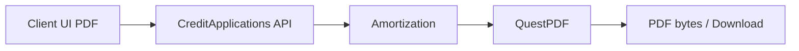

# 20 — QuestPDF und Zahlungsplan-Export

[← Zurück](19-vault-lab.md) · [Inhalt](00-index.md) · [Weiter →](21-ci-github-actions.md)

## Was ist das?

**QuestPDF**: C#-Bibliothek zur PDF-Erzeugung.  
In BankApp: Amortisations-**Zahlungsplan** als PDF herunterladen / drucken.



## Rolle in BankApp

- API: `payment-plan/export?format=pdf&locale=…`
- Austauschbarer Exporter (`IPaymentPlanDocumentExporter`) — später CSV/XLSX.
- Labels und Währungssymbole (₺ $ €) nach Locale.

## Wann hinzugefügt?

PDF/Print-UX: Feature-Slice nach Faz 6 (README Features + Screenshots).

## Grundbegriffe

| Begriff | Bedeutung |
|--------|--------|
| **Exporter** | Document → byte[] / Datei |
| **Locale** | Sprache der PDF-Texte |
| **Amortization** | Tabelle Rate / Zins / Restkapital |

## Befehle

```powershell
dotnet add src/Application package QuestPDF
```

HTTP (mit Token):

```http
GET /api/CreditApplications/payment-plan/export?format=pdf&amount=50000&termMonths=24&locale=tr
```

## Klassen, Methoden, Pakete

| Name | Rolle |
|------|-----|
| `QuestPDF` | PDF-Engine |
| `PaymentPlanPdfExporter` | `IPaymentPlanDocumentExporter` |
| `PaymentPlanPdfLabels.For(locale)` | TR/EN/DE-Labels |
| `PaymentPlanMoneyFormatter` | Beträge mit Symbol |
| `exportPaymentPlan` (client) | Blob-Download + Druck |

## Wo im Repo?

```
src/Application/Services/Amortization/Export/
client/src/api/applicationsApi.ts
client/src/pages/ApplicationDetailPage.tsx
docs/screenshots/bank-manager.en.md  # Print&Pdf
```

## Mini-Ablauf

UI „PDF“ → `locale` + Planparameter → Handler berechnet Plan → QuestPDF-Dokument → Download / Druckdialog.

## Wo hilft es?

| Check | Wie | Gut |
|-------|-----|-----|
| Endpoint | Scalar mit gültigem JWT | 200 + PDF-Content-Type |
| Locale | `locale=de` | Deutsche Spaltenüberschriften |
| Ohne Auth | Request ohne Bearer | 401 |
