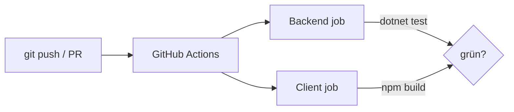

# 21 — GitHub Actions CI

[← Zurück](20-pdf-export.md) · [Inhalt](00-index.md) · [Weiter →](22-decision-letter-email.md)

## Was ist das?

**CI** (Continuous Integration): Automatischer Build + Test bei jedem Push/PR.  
**GitHub Actions**: YAML-Workflows im Repo, ausgeführt auf Runnern.



## Rolle in BankApp

`.github/workflows/ci.yml`:

1. Backend: restore → build → unit → integration  
2. Client: Node setup → `npm ci` / build  

Grünes CI = Vertrauen in `main`.

## Wann hinzugefügt?

Um **Faz 5**; später erweitert.

## Grundbegriffe

| Begriff | Bedeutung |
|--------|--------|
| **Workflow** | YAML-Datei |
| **Job** | Parallel lauffähige Einheit (backend / client) |
| **Step** | Schritt innerhalb eines Jobs |
| **Runner** | VM z. B. `ubuntu-24.04` |
| **Badge / check** | Grün/rot am PR |
| **Cache** | Client: `setup-node` `cache: npm`; Backend: `actions/cache` → `~/.nuget/packages` |

## Befehle

CI lokal nachbilden:

```powershell
dotnet restore BankApp.slnx
dotnet build BankApp.slnx --configuration Release --no-restore
dotnet test tests/Application.UnitTests/Application.UnitTests.csproj -c Release --no-build
dotnet test tests/WebApi.IntegrationTests/WebApi.IntegrationTests.csproj -c Release --no-build

cd client
npm ci
npm run build
```

GitHub CLI:

```powershell
gh run list --limit 5
gh run view <id> --log-failed
```

## Klassen, Methoden, Pakete

Actions (Node-24-Runtime):

- `actions/checkout@v5`
- `actions/setup-dotnet@v5`
- `actions/setup-node@v5` (`cache: npm`)
- `actions/cache@v5` (NuGet, Key = csproj/slnx-Hash)
- Runner: `ubuntu-24.04`

## Wo im Repo?

```
.github/workflows/ci.yml
```

## Mini-Ablauf

`git push` → Actions starten → NU1605 / Test-Fail = rot → fixen → wieder grün.

## Wo hilft es?

| Situation | Werkzeug |
|-----------|----------|
| PR blockiert | `gh run view --log-failed` |
| Lokal grün, CI rot | Node/.NET-Version mit Workflow abgleichen |
| Langsame Pipelines | Cache-Hits in Action-Logs prüfen |
