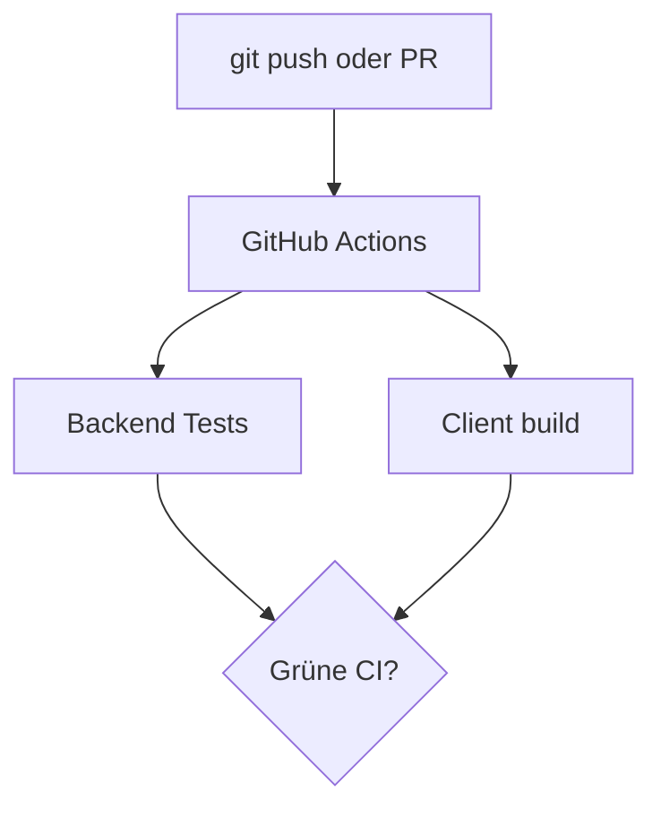
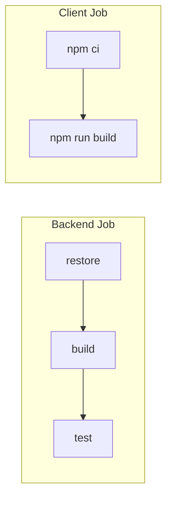

# 21 — GitHub Actions CI

[← Zurück](20-pdf-export.md) · [Inhalt](00-index.md) · [Weiter →](22-decision-letter-email.md)

## Was ist das?

**CI**: Automatischer Build + Test bei Push/PR. **GitHub Actions** führt YAML-Workflows auf Runnern aus.

**Analogie:** **Qualitätsband** in der Fabrik — jeder Commit wird geprüft.



## Rolle in BankApp

`.github/workflows/ci.yml` — Backend restore/build/test, Client `npm ci` + build, Cache v5, `ubuntu-24.04`.

## Wann hinzugefügt?

**Faz 5**, später erweitert.



## Befehle

```powershell
dotnet restore BankApp.slnx
dotnet build BankApp.slnx -c Release --no-restore
dotnet test tests/Application.UnitTests/Application.UnitTests.csproj -c Release --no-build
cd client
npm ci
npm run build
```

```powershell
gh run list --limit 5
gh run view <id> --log-failed
```

## Wo im Repo?

`.github/workflows/ci.yml`

## Mini-Ablauf

Push → CI → bei Rot Logs lesen → fixen → grün.

## Einsteiger-Lab

Branch pushen → Actions beobachten → absichtlich Client-Fehler → zurückrollen → lokal gleiche Befehle.

## Häufige Fehler

- Nur `npm run dev`, nie `npm run build`  
- lock-Datei vergessen  
- Integration lokal überspringen  

## Wo hilft es?

- [ ] CI bei Push/PR  
- [ ] Beide Jobs grün  
- [ ] Lokal wie CI reproduzierbar
