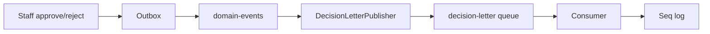

# 22 — Entscheidungsbrief E-Mail (Lab)

[← Zurück](21-ci-github-actions.md) · [Inhalt](00-index.md) · [Weiter →](25-decision-letter-sms.md)

Verwandt: [25 SMS-Lab](25-decision-letter-sms.md)

## Was ist das?

Nach **Genehmigung oder Ablehnung** einer Kreditanfrage durch Mitarbeitende: „Entscheidungsbrief“ an den Kunden.  
Im Lab kein echtes SMTP: Nachricht in **RabbitMQ**, Consumer schreibt nach **Seq/Serilog** (gleiches Schulungsmodell wie E-Mail-Verifikation).



## Rolle in BankApp

- UI-Notes aus Genehmigung/Ablehnung werden als Body mitgesendet.
- An Outbox → `domain-events` gekoppelt; nach SignalR-Toast.
- Queue-Name: `decision-letter`.

## Wann hinzugefügt?

Roadmap „Später“ — E-Mail-Lab-Slice; SMS in [25](25-decision-letter-sms.md).

## Grundbegriffe

| Begriff | Bedeutung |
|--------|--------|
| **Decision letter** | Kundentext nach Entscheidung |
| **Publisher** | Schreibt in die Queue |
| **Consumer** | Hosted Service simuliert Versand |
| **Lab delivery** | Log ersetzt echte E-Mail |

## Befehle

```powershell
cd infra
docker compose up -d rabbitmq webapi
# RabbitMQ UI → Queues → decision-letter
# Seq → "Decision letter consumed"
```

Broker aus: Publisher warnt, Body wird trotzdem geloggt — Genehmigungsflow bricht nicht.

## Klassen, Methoden, Pakete

| Name | Rolle |
|------|-----|
| `DecisionLetterRequested` | ToEmail, Subject, Body, Decision, … |
| `IDecisionLetterPublisher` | Abstraktion |
| `RabbitMqDecisionLetterPublisher` | Publish / Fallback-Log |
| `DecisionLetterConsumerHostedService` | Consume + Seq |
| `DomainEventsConsumerHostedService.TryPublishDecisionLetterAsync` | Nach Approve/Reject |
| `RabbitMqOptions.DecisionLetterQueue` | Default `decision-letter` |

Paket: `RabbitMQ.Client` (Notification-Host).

## Wo im Repo?

```
src/Application/Services/Messaging/DecisionLetterRequested.cs
src/Application/Services/Messaging/IDecisionLetterPublisher.cs
src/WebApi/Modules/Notification/Messaging/RabbitMqDecisionLetterPublisher.cs
src/WebApi/Modules/Notification/Messaging/DecisionLetterConsumerHostedService.cs
src/WebApi/Modules/Notification/Messaging/DomainEventsConsumerHostedService.cs
src/WebApi/Modules/Notification/NotificationHostModule.cs
tests/Application.UnitTests/Services/Messaging/DecisionLetterRequestedTests.cs
```

## Mini-Ablauf

Mitarbeiter genehmigt → Outbox → `domain-events` → Saga + SignalR → Kunden-E-Mail → `DecisionLetterRequested` → Queue → Consumer loggt `To` / `Subject` / `Body` in Seq.

## Wo hilft es?

| Check | Gut |
|-------|-----|
| Queue `decision-letter` | Consumers ≥ 1 |
| Approve im UI | Seq: consumed + Felder |
| Rabbit down | Warn-Log, kein 500 auf Approve |
