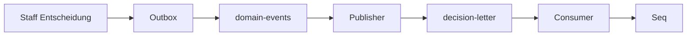
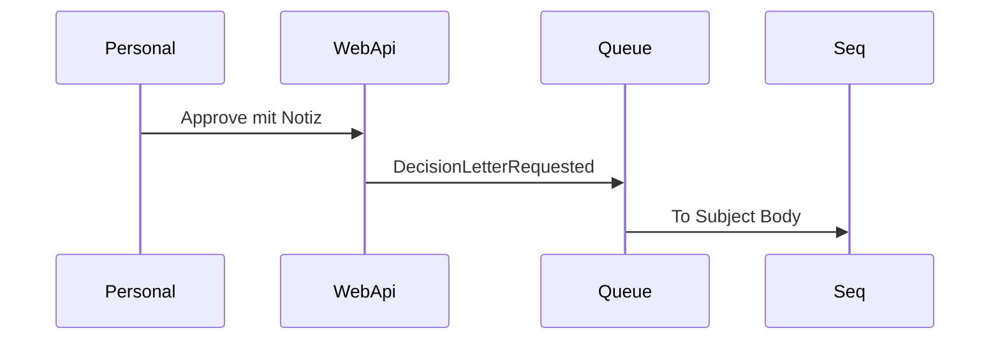

# 22 — Entscheidungsbrief E-Mail (Lab)

[← Zurück](21-ci-github-actions.md) · [Inhalt](00-index.md) · [Weiter →](25-decision-letter-sms.md)

## Was ist das?

Nach **Approve/Reject** soll der Kunde einen Entscheidungsbrief bekommen. Im Lab **kein SMTP** — Queue `decision-letter`, Consumer loggt in **Seq**.

**Analogie:** **Fax-Simulation** — Inhalt echt, Zustellung = Logzeile.



## Rolle in BankApp

Notizen aus UI werden `Body`; Outbox-Kette; Queue `decision-letter`.

## Wann hinzugefügt?

E-Mail-Lab-Slice; SMS in Kapitel 25.



## Befehle

```powershell
cd infra
docker compose --env-file .env up -d rabbitmq webapi seq
```

```powershell
dotnet test tests/Application.UnitTests/Application.UnitTests.csproj --filter "DecisionLetter"
```

## Wo im Repo?

`src/WebApi/Modules/Notification/Messaging/`, `DecisionLetterRequested.cs`

## Mini-Ablauf

Approve → Outbox → Queue → Seq mit To/Subject/Body.

UI-Briefvorlage (Genehmigen/Ablehnen-Notiz — Body für die Queue):


Im Lab erscheint die „gesendete E-Mail“ in Seq:


## Einsteiger-Lab

Approve mit markantem Satz → Rabbit Ready → Seq Body prüfen → Rabbit stoppen → Fallback-Log.

## Häufige Fehler

- Seq nicht prüfen  
- Consumer vergessen  
- Leere `ToEmail`  
- Messages in UI löschen  

## Wo hilft es?

- [ ] Queue verarbeitet  
- [ ] Seq vollständig  
- [ ] Unit-Tests grün  
- [ ] Approve ohne Broker bricht HTTP nicht
