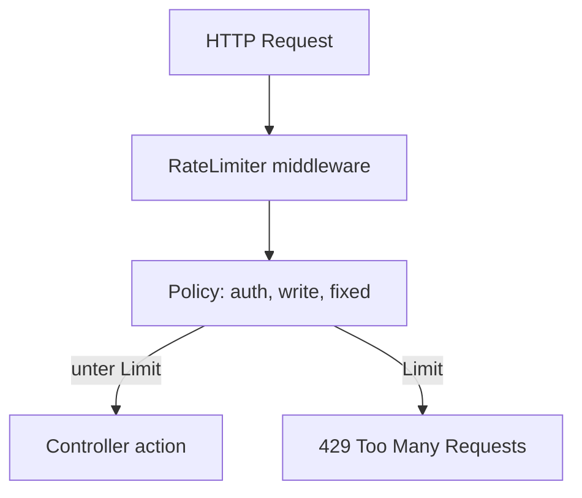
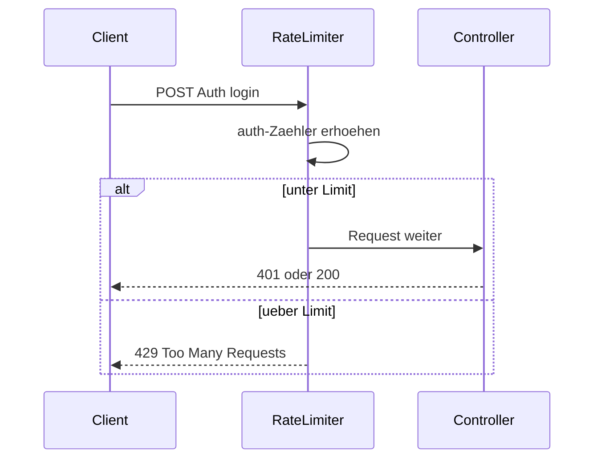

# 23 — Rate Limiting (ASP.NET Core)

[← Zurück](22-decision-letter-email.md) · [Inhalt](00-index.md) · [Weiter →](24-lab-tools.md)

Verwandt: [19 — Vault lab](19-vault-lab.md)

## Was ist das?

**Rate limiting**: Begrenzt, wie viele Requests ein Client/IP im Zeitfenster senden darf. Überschreitung → HTTP **429 Too Many Requests**.

**Analogie:** Wie ein Bankdrehkreuz: höchstens N Kartentaps pro Minute; weitere Versuche stoppt das System (429). Login (`auth`), Schreib-Endpoints (`write`) und Rest (`fixed`) haben getrennte Zähler.



## Rolle in BankApp

Schutz vor Login-Brute-Force und Spam auf Schreib-Endpoints. Drei Policies — **limits je nach Umgebung**:

| Policy | Development (Lab) | Prod-ähnlich (`appsettings.json`) | Wo |
|--------|-------------------|-----------------------------------|-----|
| `auth` | 20 / 60s | 10 / 60s | `AuthController` |
| `write` | 60 / 60s | 30 / 60s | CreditApplications create/approve/reject/cancel/update/delete |
| `fixed` | 100 / 60s | 60 / 60s | Andere Controller |

Compose-Default `ASPNETCORE_ENVIRONMENT=Development` → lockere Lab-Limits.  
`/health` und SignalR-Hub sind ausgenommen.

## Wann hinzugefügt?

`fixed` früher; **auth / write** im Security-Slice. **Umgebungstrennung** (straffe Base + Dev-Overlay) 2026-10-28.

## Grundbegriffe

| Begriff | Bedeutung |
|--------|--------|
| **Fixed window** | N Requests pro festem Fenster |
| **PermitLimit** | Erlaubte Requests im Fenster |
| **QueueLimit** | Warteschlange bei Limit (0 = sofort 429) |
| **EnableRateLimiting** | Attribute an Controller/Action |
| **Umgebungs-Layer** | `appsettings.json` + `appsettings.{Environment}.json` |



## Befehle

Prod-ähnliche Base in `appsettings.json`:

```json
"RateLimiting": {
  "Fixed": { "PermitLimit": 60, "WindowSeconds": 60 },
  "Auth": { "PermitLimit": 10, "WindowSeconds": 60 },
  "Write": { "PermitLimit": 30, "WindowSeconds": 60 }
}
```

Lab-Overlay `appsettings.Development.json`:

```json
"RateLimiting": {
  "Fixed": { "PermitLimit": 100, "WindowSeconds": 60 },
  "Auth": { "PermitLimit": 20, "WindowSeconds": 60 },
  "Write": { "PermitLimit": 60, "WindowSeconds": 60 }
}
```

Umgebung im Container:

```powershell
docker compose -f infra/docker-compose.yml --env-file infra/.env exec webapi printenv ASPNETCORE_ENVIRONMENT
# Erwartet Lab: Development → Auth 20/60s
```

Login-Spam-Test (Development ~21. Request → 429):

```powershell
1..30 | ForEach-Object {
  curl -s -o NUL -w "%{http_code}`n" -X POST http://localhost:8080/api/Auth/login `
    -H "Content-Type: application/json" `
    -d '{"email":"x","password":"y"}'
}
```

Strikte Limits im Compose testen (temporär):

```powershell
# infra/.env: ASPNETCORE_ENVIRONMENT=Production → webapi recreate
# Danach wieder Development — sonst Demo/UI 429
docker compose -f infra/docker-compose.yml --env-file infra/.env up -d --force-recreate webapi
```

## Klassen, Methoden, Pakete

| Name | Rolle |
|------|-----|
| `RateLimitPolicies` | Konstanten Fixed / Auth / Write |
| `AddRateLimitingConfiguration` | `AddFixedWindowLimiter` |
| `UseRateLimiter()` | Middleware |
| `Microsoft.AspNetCore.RateLimiting` | Framework-API |

## Wo im Repo?

```
src/WebApi/Constants/RateLimitPolicies.cs
src/WebApi/Extensions/ServiceCollectionExtensions.cs
src/WebApi/Extensions/ApplicationBuilderExtensions.cs
src/WebApi/Modules/Identity/Controllers/AuthController.cs
src/WebApi/Modules/Credit/Controllers/CreditApplicationsController.cs
src/WebApi/appsettings.json
src/WebApi/appsettings.Development.json
```

## Mini-Ablauf

Request → RateLimiter → Policy-Zähler (aus Config) → erlaubt → Action; sonst 429.

## Einstiegs-Lab

1. Stack unter `infra` starten; `printenv ASPNETCORE_ENVIRONMENT` → `Development`.
2. 30×-Login-Schleife ausführen; zuerst 401/400, dann **429**.
3. 60s warten; ein Login erneut → Fenster zurückgesetzt.
4. `/health` fünfmal aufrufen → immer **200** (ausgenommen).

## Häufige Fehler

- Lab-Skripte unter **Production** → frühes 429; Demo-UI blockiert.
- **429** als CORS oder **401** deuten → Statuscode lesen.
- Andere Zähler pro Browser-Tab erwarten — Partition meist **Client-IP**.
- Mermaid-Knoten mit `auth / write` ohne Anführungszeichen → Diagramm defekt.

## Wo hilft es?

### Gesundheits-Checkliste

| Check | Wie | Gut |
|-------|-----|-----|
| Umgebung | `printenv ASPNETCORE_ENVIRONMENT` | Lab: `Development` |
| Auth 429 | 30× Login-Schleife | Ab ~21. Request 429 |
| Health exempt | viele `curl /health` | Immer 200 |
| Write | viele create/approve gleiche IP | danach 429 |

### Disaster / Recovery (Lab)

| Situation | Weg |
|-----------|-----|
| UI dauernd 429 | 60s warten oder WebApi recreate |
| Tests/Demo 429 | Development bestätigen; Production-Experiment rückgängig |
| Limit nie | Falsche URL; fehlendes Policy-Attribut |
| Health 429 | Sollte nicht — Exemption prüfen |
