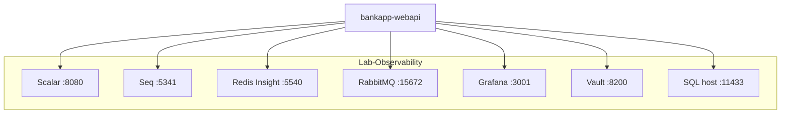
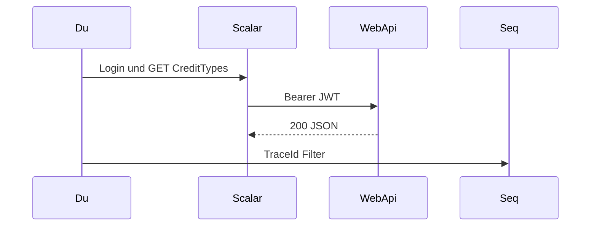

# 24 — Lab-Tools (Beobachten und Debuggen)

[← Zurück](23-rate-limiting.md) · [Inhalt](00-index.md) · [Weiter →](25-decision-letter-sms.md)

Verwandt: [07 Seq](07-serilog-seq.md) · [08 Redis](08-redis.md) · [09 Compose](09-docker-compose.md) · [13 RabbitMQ](13-rabbitmq.md) · [18 OTel/Grafana](18-otel-observability.md) · [19 Vault](19-vault-lab.md)

## Was ist das?

**Lab-Tools**: UIs und CLIs, um API, Cache, Queue, Logs, Metriken, Secrets und DB im BankApp-Stack zu **beobachten und zu debuggen**. Viele Server (z. B. Redis) haben keine eingebaute „schöne“ Oberfläche — Redis Insight, Grafana, Scalar usw. füllen die Lücke.

Stil: Über/neben Befehlen steht, **was sie tun**, **was danach zu prüfen ist**, und wo sinnvoll **Recovery** (siehe [09 Compose](09-docker-compose.md)).

**Analogie:** Wie eine Krankenstation — WebApi ist der Patient; Seq, Grafana, Redis Insight und RabbitMQ sind unterschiedliche Monitore.



## Rolle in BankApp

Nach `docker compose up` sind die meisten Tools per URL erreichbar. Ziel: Fragen wie „Cache gefüllt?“, „Was im Log?“, „Nachricht in der Queue?“, „Trace gebrochen?“ lokal beantworten.

| Tool | URL / Endpunkt | Was siehst du? |
|------|----------------|----------------|
| **Scalar** | http://localhost:8080/scalar/v1 | HTTP-API (JWT, Body) |
| **Seq** | http://localhost:5341 | Strukturierte Logs |
| **Redis Insight** | http://localhost:5540 | Redis Keys / TTL |
| **RabbitMQ Management** | http://localhost:15672 | Queues, Consumer |
| **Grafana** | http://localhost:3001 | Metriken + Traces |
| **Prometheus** | http://localhost:9090 | Rohmetriken |
| **Vault UI** | http://localhost:8200 | Lab-Secrets (KV) |
| **SQL-Client** *(Host)* | `localhost,11433` | Datenbank (kein Compose-UI) |
| **Docker Desktop / CLI** | — | Container-Gesundheit |

## Wann hinzugefügt?

Services Faz 2–6; **Redis Insight** und dieser Sammel-Leitfaden im Schulungs-Slice.

## Grundbegriffe

| Begriff | Bedeutung |
|--------|--------|
| **Observability** | Logs + Metriken + Traces |
| **Compose DNS** | Container erreichen sich per **Servicename** (`redis`, `webapi`) |
| **Host port** | `localhost:PORT` im Browser |
| **Lab credential** | Nur Schulung — in Prod rotieren / Vault |
| **Liveness vs data UI** | `/health` = lebt; Insight/Grafana = Inhalt |



---

## Tool für Tool

### 1) Scalar (API testen)

**Setup:** In WebApi Dev eingebaut.  
**Nutzung:**

1. `POST /api/Auth/login` → Token (Demo-Accounts in README).
2. Header **`Authorization`**: `Bearer <token>` (nicht `Auth`).
3. Schreibende Kredit-Calls: **`Idempotency-Key`** (UUID).

**Achtung:** Abgelaufener Token → 401; fehlende Rolle → 403; Rate limit → **429** ([23](23-rate-limiting.md)).

**Best practice:** Szenarien wiederholbar (fester Idempotency-Key für Replay/409).

---

### 2) Seq (Logs)

Details: **[07 — Serilog/Seq](07-serilog-seq.md)**.

```powershell
cd infra
docker compose --env-file .env up -d seq
docker compose --env-file .env logs --tail=50 webapi
```

**Achtung:** Volume wächst; Lab-Reset `down -v` ([09](09-docker-compose.md)).

---

### 3) Redis Insight

**Setup:** Service `redis-insight`, Port `5540`.  
**Erste Verbindung:**

```text
redis://redis:6379
```

Host **`redis`** (Servicename), nicht `localhost` *im Insight-Container*.

**Typische Keys:** `BankApp:CreditTypeList…`, Cache-Gruppen, Idempotency nach Writes.

**Achtung:** `FLUSHDB` im Lab riskant; Prod nicht öffentlich exposen.

---

### 4) RabbitMQ Management

Details: **[13 — RabbitMQ](13-rabbitmq.md)**.

UI http://localhost:15672 — **`guest` / `guest`**.

```powershell
cd infra
docker compose --env-file .env up -d rabbitmq
docker compose --env-file .env exec rabbitmq rabbitmq-diagnostics -q ping
```

Queues u. a. `decision-letter`, `decision-letter-sms`.

---

### 5) Grafana + Prometheus (+ Tempo)

Siehe auch [18](18-otel-observability.md). Grafana `:3001` — `admin` / `admin`.

```powershell
cd infra
docker compose --env-file .env up -d otel-collector tempo prometheus grafana
curl -s -o NUL -w "%{http_code}" http://localhost:3001/api/health
curl -s http://localhost:9090/-/ready
```

UI: Dashboard **BankApp HTTP (OTel)**; Explore → Tempo Service `bankapp-webapi`; Prometheus `up`.

**Achtung:** Client `:3000`, Grafana `:3001`. Keine Traces → OTel enabled?, Collector healthy?, echte API-Calls (nicht nur `/health`).

---

### 6) Vault UI

Details: **[19 — Vault lab](19-vault-lab.md)**.

```powershell
cd infra
docker compose --env-file .env up -d vault
docker compose --env-file .env up vault-seed
docker compose --env-file .env exec vault vault kv get secret/bankapp
```

---

### 7) SQL Server (Host-Tool)

[Azure Data Studio](https://learn.microsoft.com/sql/azure-data-studio/) oder SSMS.  
Server `localhost,11433`, Login `sa`, Passwort `MSSQL_SA_PASSWORD` aus `infra/.env`.

---

### 8) Docker Desktop / Compose CLI

Details: **[09 — Docker Compose](09-docker-compose.md)**.

```powershell
cd infra
docker compose --env-file .env ps
docker compose --env-file .env logs -f webapi
docker compose --env-file .env down
# Destruktiv: docker compose --env-file .env down -v
```

**Recovery-Reihenfolge:** `ps` → `logs` → Dependency healthy → `--force-recreate` einzelner Service → ggf. `down -v`.

---

### 9) Client (Bonus)

| Tool | Zweck |
|------|--------|
| DevTools → Network | React → API, 401/429 |
| Postman / Bruno | Alternative zu Scalar |

---

## Lab Best Practices

1. Stack zuerst hochfahren (`compose ps` healthy).  
2. Browser = **Host-Port**; Container-zu-Container = **Servicename**.  
3. Credentials nur in `.env`, nicht committen.  
4. Ereignis dreifach: **Scalar** → **Seq** → **Redis/Rabbit/SQL/Grafana**.  
5. Destruktive Aktionen in Insight/SQL bewusst.

## Befehle (Kurz)

```powershell
cd infra
copy .env.example .env
docker compose --env-file .env up -d --build
docker compose exec redis redis-cli KEYS "BankApp:*"
```

| Service | Lab-Login |
|---------|-----------|
| Grafana | `admin` / `admin` |
| RabbitMQ | `guest` / `guest` |
| Vault | Token aus `.env` |
| SQL | `sa` / `MSSQL_SA_PASSWORD` |
| Redis / Seq / Prometheus | meist ohne Auth |

## Klassen, Methoden, Pakete

Ops/DX; Codebezug:

| Name | Rolle |
|------|-----|
| `AddStackExchangeRedisCache` | Cache + Idempotency |
| Serilog → Seq | Logs |
| OTLP Exporter | Traces/Metriken |
| `IdempotencyKeyFilter` | Redis für Write-Responses |

## Wo im Repo?

```
infra/docker-compose.yml
infra/.env.example
infra/README.md
README*.md
docs/learning/de/07…19, 23
docs/learning/de/08-redis.md
```

## Mini-Ablauf

1. Scalar: Login → `GET /api/CreditTypes`.  
2. Redis Insight: List-Cache-Key?  
3. Seq: Request-Zeilen.  
4. CreditType-Update → Cache-Gruppe invalidiert?  
5. Optional Grafana HTTP-Dauer / Trace.  
Dasselbe mit Approve + Idempotency-Key → Redis + Rabbit `decision-letter`.

## Einstiegs-Lab

1. `docker compose up -d --build` → `ps` healthy.
2. Scalar Login → `GET /api/CreditTypes`.
3. Redis Insight: `redis://redis:6379`.
4. Seq Errors der letzten Minuten prüfen.

## Häufige Fehler

- Insight mit `localhost:6379` statt Host **`redis`**.
- Header `Auth` statt **`Authorization: Bearer`**.
- Grafana auf Port **3001**, nicht 3000.

## Wo hilft es?

| Problem | Erster Stopp |
|---------|--------------|
| 401/403 | Scalar Token / Rolle; Seq |
| Langsam | Grafana Tempo → Seq `TraceId` |
| Cache seltsam | Redis Insight TTL/Keys |
| Queue wächst | Rabbit Consumers + `logs webapi` |
| Secret/JWT | Vault UI + WebApi Vault-Log |
