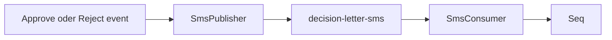
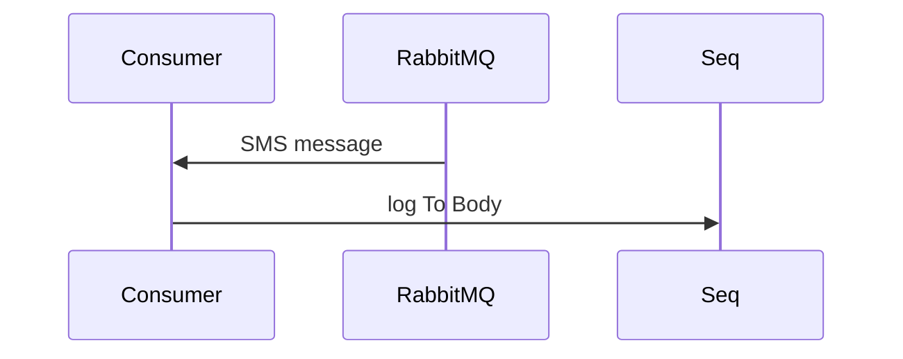

# 25 — Entscheidungsbrief SMS (Lab)

[← Zurück](24-lab-tools.md) · [Inhalt](00-index.md) · [Weiter →](26-credit-application-documents.md)

Verwandt: [22 E-Mail-Lab](22-decision-letter-email.md) · [13 RabbitMQ](13-rabbitmq.md) · [07 Seq](07-serilog-seq.md)

## Was ist das?

**SMS-Benachrichtigung** nach Genehmigung/Ablehnung.  
Kein Twilio o. Ä.: **RabbitMQ** → Consumer → **Seq**-Log (wie E-Mail-Lab).

**Analogie:** Wie E-Mail-Lab — Kurier ist RabbitMQ, Seq ist die kurze SMS-Zeile im Heft.





## Rolle in BankApp

- Parallel zur E-Mail ([22](22-decision-letter-email.md)) aus demselben Domain-Event.
- Telefon aus `Customer.PhoneNumber`; fehlt → Skip + Warning, Flow läuft weiter.
- Queue: `decision-letter-sms`; Body kurz (Lab max ~320 Zeichen).

## Wann hinzugefügt?

Roadmap „Entscheidungsbrief per SMS“ — Slice nach E-Mail-Lab.

## Grundbegriffe

| Begriff | Bedeutung |
|--------|--------|
| **Decision SMS** | Kurztext ans Telefon |
| **Lab delivery** | Seq = SMS-Ersatz |
| **Skip** | Kein Publish ohne Nummer |

## Befehle

```powershell
cd infra
docker compose --env-file .env up -d rabbitmq webapi
# RabbitMQ UI → Queues → decision-letter-sms (Consumers ≥ 1)
```

```powershell
# Nach Approve/Reject
# Seq: "Decision SMS consumed" (To, Body)
docker compose --env-file .env logs --tail=50 webapi
```

Broker aus: Warn-Log, kein Bruch der Genehmigung.

### Prüfpunkte

| Check | Gut |
|-------|-----|
| Queue `decision-letter-sms` | Consumers ≥ 1 |
| Approve/Reject | Seq: E-Mail + SMS |
| Kunde ohne Telefon | Warning skip; E-Mail möglich |

## Klassen, Methoden, Pakete

| Name | Rolle |
|------|-----|
| `DecisionSmsRequested` | ToPhone, Body, Decision, … |
| `IDecisionSmsPublisher` / `RabbitMqDecisionSmsPublisher` | Publish |
| `DecisionSmsConsumerHostedService` | Consume → Seq |
| `TryPublishDecisionSmsAsync` | Im Domain-Events-Consumer |
| `RabbitMqOptions.DecisionSmsQueue` | Default `decision-letter-sms` |

## Wo im Repo?

```
src/Application/Services/Messaging/DecisionSmsRequested.cs
src/Application/Services/Messaging/IDecisionSmsPublisher.cs
src/WebApi/Modules/Notification/Messaging/RabbitMqDecisionSmsPublisher.cs
src/WebApi/Modules/Notification/Messaging/DecisionSmsConsumerHostedService.cs
src/WebApi/Modules/Notification/Messaging/DomainEventsConsumerHostedService.cs
src/WebApi/Modules/Notification/NotificationHostModule.cs
tests/.../DecisionSmsRequestedTests.cs
```

## Mini-Ablauf

Mitarbeiter genehmigt → Outbox → `domain-events` → SignalR + E-Mail + **decision-letter-sms** → Consumer loggt `To` / `Body`.

## Einstiegs-Lab

1. RabbitMQ UI: Queue `decision-letter-sms`.
2. Pending mit Telefon genehmigen → Seq SMS-Zeile.
3. Ohne Telefon → Warning-Skip.

## Häufige Fehler

- Nur E-Mail-Queue prüfen — SMS ist separate Queue.
- Genehmigung für gescheitert halten wenn Broker down — nur Warning.

## Wo hilft es?

| Situation | Tipp |
|-----------|------|
| Keine SMS in Seq | Kunden-Telefon in DB? |
| Queue wächst | Consumer läuft? `logs webapi` |
| Nur E-Mail | SMS-Publisher-Warnungen in Seq |
