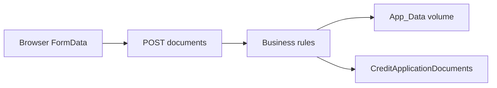
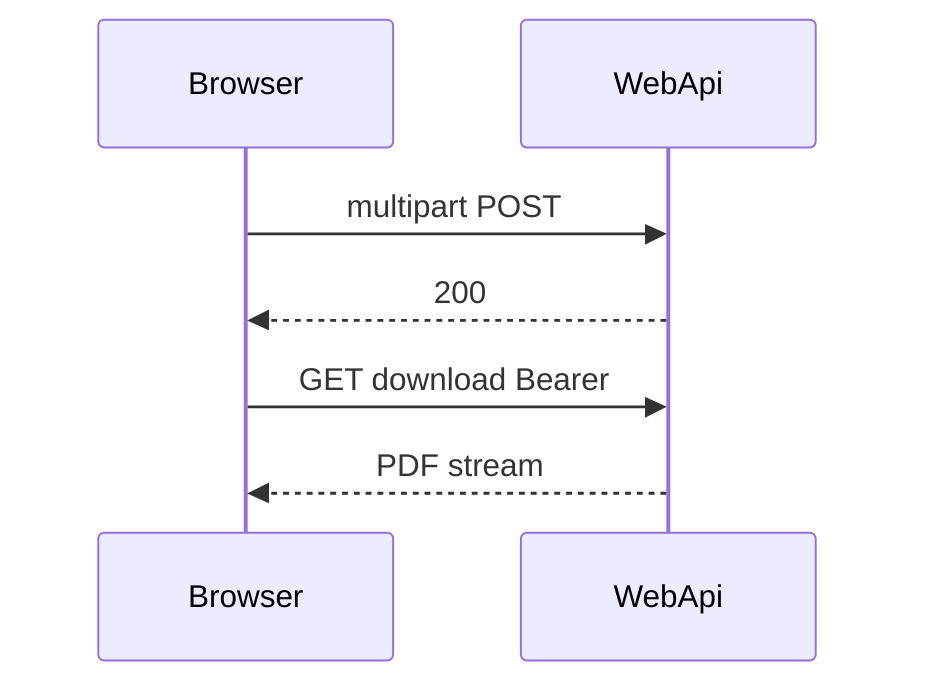

# 26 — Kreditantrag-Dokumente (Lab)

[← Zurück](25-decision-letter-sms.md) · [Inhalt](00-index.md) · [Weiter →](27-branch-model.md)

Verwandt: [03 EF Core](03-ef-core-sql.md) · [06 JWT / RBAC](06-jwt-rbac.md) · Profil-Avatar (gleiches Multipart-Muster)

## Was ist das?

Dateien an einen Antrag anhängen (Ausweis / Einkommen / Sonstiges).  
Blob auf Disk (`App_Data`, nicht wwwroot); Metadaten in SQL. Download nur über **JWT-API** — kein öffentliches StaticFiles.



## Rolle in BankApp

- Upload für Pending-Anträge (Lab; noch nicht Pflicht für Genehmigung).
- Typen: `IdentityDocument`, `IncomeProof`, `Other` (SmartEnum).
- ≤ 5 MB; PDF/JPEG/PNG; max. 10 Dateien pro Antrag.
- Bei Pending: **Vorschau / Download / Entfernen** (Soft-Delete + Disk); Entfernen mit Bestätigung (i18n).
- Compose-Volume `credit-document-uploads` → `/app/App_Data/credit-documents`.

## Wann hinzugefügt?

Roadmap „Dokument-Upload“ (2026-10-28); vom Avatar-Muster abgeleitet.

## Grundbegriffe

| Begriff | Bedeutung |
|--------|--------|
| **Multipart / IFormFile** | `FormData` vom Browser |
| **Metadata vs blob** | SQL-Zeile + Pfad auf Disk |
| **App_Data** | Außerhalb wwwroot |
| **Magic bytes** | Inhalt vs Content-Type |
| **Path traversal** | Pfad bleibt unter Storage-Root |



## Befehle

Migration (im Repo; neue Umgebung: WebApi `MigrateAsync`):

```powershell
dotnet ef migrations add AddCreditApplicationDocuments `
  --project src/Persistence/Persistence.csproj `
  --startup-project src/WebApi/WebApi.csproj
```

Compose + WebApi:

```powershell
cd infra
docker compose --env-file .env up -d --build webapi client
docker compose --env-file .env ps
# webapi healthy; Volume bankapp-credit-document-uploads
```

Upload (Pending + JWT):

```powershell
curl -X POST "http://localhost:8080/api/CreditApplications/<APP_ID>/documents" `
  -H "Authorization: Bearer <TOKEN>" `
  -F "documentType=IdentityDocument" `
  -F "file=@C:\temp\ausweis.pdf;type=application/pdf"
```

Liste + Download:

```powershell
curl -s -H "Authorization: Bearer <TOKEN>" `
  "http://localhost:8080/api/CreditApplications/<APP_ID>/documents"

curl -L -H "Authorization: Bearer <TOKEN>" `
  -o herunter.pdf `
  "http://localhost:8080/api/CreditApplications/<APP_ID>/documents/<DOC_ID>/download"
```

## Klassen, Methoden, Pakete

| Name | Rolle |
|------|-----|
| `CreditApplicationDocument` | Entity |
| `CreditDocumentType` | SmartEnum |
| `ICreditDocumentStorage` / `LocalCreditDocumentStorage` | Disk-I/O |
| `UploadCreditApplicationDocumentRequest` | MediatR Upload |
| `DeleteCreditApplicationDocumentRequest` | MediatR Löschen (Pending) |
| `CreditApplicationDocumentBusinessRules` | Größe / Typ / Pending / Limit |

## Wo im Repo?

```
src/Domain/Entities/CreditApplicationDocument.cs
src/Domain/Enums/CreditDocumentType.cs
src/Application/Modules/Credit/Features/CreditApplicationDocuments/
src/WebApi/Services/LocalCreditDocumentStorage.cs
src/WebApi/Modules/Credit/Controllers/CreditApplicationsController.cs  # …/documents*
infra/docker-compose.yml  # credit-document-uploads
client/src/pages/ApplicationDetailPage.tsx
```

## Mini-Ablauf

1. Neuer Antrag optional mit Datei → create → `POST …/documents` → Detailseite.  
2. Oder Pending-Detail: Panel „Dokumente“ → hochladen / Liste / Vorschau / Download / Entfernen.

## Einstiegs-Lab

1. Pending-Antrag → kleines PDF hochladen.
2. Vorschau (Modal) und Download → Datei ok.
3. Entfernen → Bestätigung → Liste aktualisiert; „Unterlagen fehlen“ kann zurückkehren.
4. Download ohne Token → 401.
5. Volume `bankapp-credit-document-uploads` prüfen.

## Häufige Fehler

- Dateien unter **wwwroot** suchen — Pfad ist `App_Data`.
- Upload auf **Approved** — UI verborgen.

## Wo hilft es?

### Gesundheits-Checkliste

| Check | Wie | Gut |
|-------|-----|-----|
| Tabelle | SQL `CreditApplicationDocuments` | nach Migration |
| Volume | `docker volume ls` | `bankapp-credit-document-uploads` |
| UI | Pending-Detail | Form sichtbar; Approved ohne Upload |
| Auth | Download ohne Token | 401 |
| Typ | `.gif` / 6 MB | 400 |

### Disaster / Recovery (Lab)

| Situation | Weg |
|-----------|-----|
| Metadaten ohne Datei | Volume/Mount prüfen; neu hochladen |
| Volume wipe | `docker volume rm bankapp-credit-document-uploads` (**destruktiv**) → webapi recreate |
| Disk voll | Alte Lab-Dateien löschen oder Volume neu |
| Keine Migration | WebApi-Log + `dotnet ef database update` |
