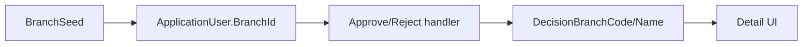
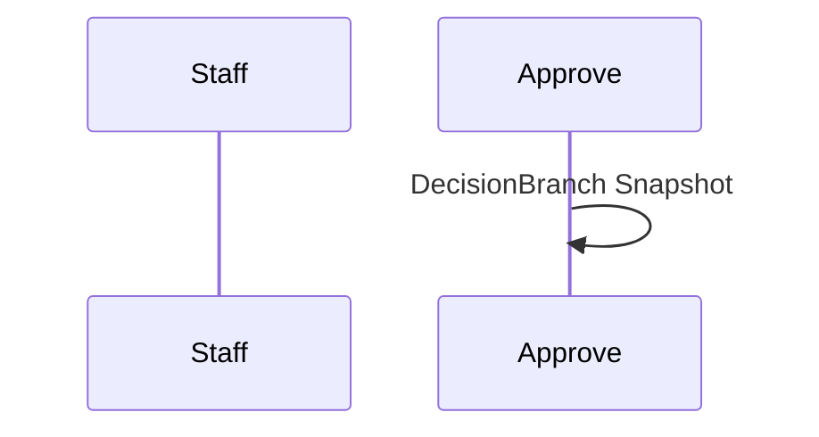

# 27 — Filialmodell (Branch)

[← Zurück](26-credit-application-documents.md) · [Inhalt](00-index.md) · [Weiter →](28-branch-rbac-superadmin.md)

Verwandt: [06 JWT / RBAC](06-jwt-rbac.md) · Personalverwaltung

## Was ist das?

**Filiale (Branch)**: Organisationseinheit der Bank. Personal hat `BranchId`; bei Genehmigung/Ablehnung werden Filialdaten als **Snapshot** am Antrag gespeichert (unabhängig von späterer Versetzung).



## Rolle in BankApp

- Tabelle `Branches` (Code, Name, City, IsActive, MaxApprovalAmount — DoA-Details [30](30-approve-gate-authority.md)).
- `ApplicationUser.BranchId` im Demo-Seed.
- Approve/Reject → `DecisionBranchCode` / `DecisionBranchName` am Antrag.
- API: `GET /api/Branches`; sichtbar in Personalliste, Profil, Antragsdetail.
- Manager kann Filiale beim Personal bearbeiten zuweisen.

## Wann hinzugefügt?

Roadmap „Filialmodell“ (2026-10-29).

## Grundbegriffe

| Begriff | Bedeutung |
|--------|--------|
| **Snapshot** | Kopie von Code/Name zum Entscheidungszeitpunkt |
| **BranchId** | Aktuelle Filiale des Users (FK) |
| **Seed sync** | Demo-Filialen + Staff ohne DB-Wipe |



## Befehle

```powershell
cd infra
docker compose --env-file .env up -d --build webapi client
# Seed: IST-01, ANK-01, BER-01; staff@ → IST-01, manager@ → ANK-01, …
```

```powershell
curl -s -H "Authorization: Bearer <TOKEN>" http://localhost:8080/api/Branches
```

## Klassen, Methoden, Pakete

| Name | Rolle |
|------|-----|
| `Branch` | Entity |
| `BranchSeed` | Demo-Filialen |
| `GetListBranchRequest` | Listen-Query |
| `Approve` / `Reject` handler | Branch-Snapshot |
| `BranchesController` | `GET /api/Branches` |

## Wo im Repo?

```
src/Domain/Entities/Branch.cs
src/Persistence/Seed/BranchSeed.cs
src/Application/Modules/Identity/Features/Branches/
src/WebApi/Modules/Identity/Controllers/BranchesController.cs
client/src/pages/StaffPage.tsx
client/src/pages/ApplicationDetailPage.tsx
```

## Mini-Ablauf

Seed-Filiale → Staff `BranchId` → Mitarbeiter genehmigt → `DecisionBranch*` am Antrag → UI „Entscheidungsfiliale“.

Bildschirm (Manager — Kredite nach Filiale gefiltert):


## Einstiegs-Lab

1. `staff.tr@bank.local` — Filiale im Profil.
2. `GET /api/Branches` — drei Demo-Filialen.
3. Pending genehmigen — Entscheidungsfiliale in der Detailansicht.

## Häufige Fehler

- **BranchId** (live) und **DecisionBranch*** (Snapshot) verwechseln.
- `GET /api/Branches` ohne JWT → 401.

## Wo hilft es?

### Gesundheits-Checkliste

| Check | Wie | Gut |
|-------|-----|-----|
| Tabelle | SQL `Branches` | 3 Demo-Zeilen |
| Personal | Mitarbeiterliste | Spalte Filiale |
| Snapshot | Pending genehmigen | Detail IST-01 · … |
| API | GET /api/Branches | JSON-Array |

### Disaster / Recovery

| Situation | Weg |
|-----------|-----|
| Leeres `BranchId` | WebApi-Restart / Seed `EnsureDemoStaffBranches` |
| Keine Migration | WebApi-Log / `dotnet ef database update` |
| Falsche Filiale | Manager: Personal bearbeiten → Filiale wählen |
