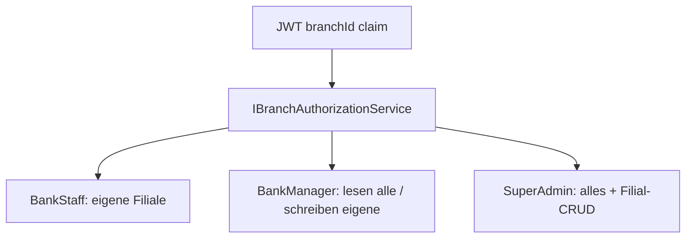
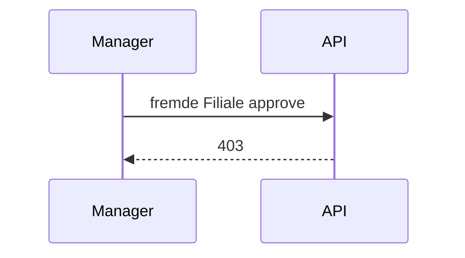

# 28 — Filial-RBAC + SuperAdmin

[← Zurück](27-branch-model.md) · [Inhalt](00-index.md) · [Weiter →](29-decision-letter-templates.md)

Verwandt: [06 JWT / RBAC](06-jwt-rbac.md) · [27 Filialmodell](27-branch-model.md)

## Was ist das?

**Filialbezogene Autorisierung**: Mitarbeiter sehen und ändern nur Kunden/Anträge der eigenen Filiale; Manager dürfen andere Filialen **lesen**, aber nicht schreiben; **SuperAdmin** hat volle Rechte in allen Filialen plus Filial-CRUD.



## Rolle in BankApp

| Rolle | Anzeigen | Ändern (approve/update…) | Filial-CRUD |
|-------|----------|---------------------------|-------------|
| BankStaff | Eigene Filiale | Eigene Filiale | Nein |
| BankManager | Alle Filialen (Liste standard: eigene) | Eigene Filiale | Nein |
| SuperAdmin | Alle + `?branchId=` | Alle | Ja |
| Customer | Eigener Datensatz | Eigener Datensatz | Nein |

### Personalverwaltung (StaffUsers)

| Akteur | Ziel | Berechtigung |
|--------|------|--------------|
| SuperAdmin | Alle | Aktualisieren / aktiv-inaktiv / Manager-Rolle |
| BankManager | Eigenes Konto | Profilfelder; **aktiv-inaktiv und IsManager nicht änderbar** |
| BankManager | Gleiche Filiale, kein Manager | Aktualisieren + aktiv-inaktiv; **IsManager nicht zuweisbar** |
| BankManager | Personal anderer Filiale | Liste **lesbar**; Edit / Deaktivieren **ausgeblendet** (API 403) |
| BankManager | Anderer BankManager / SuperAdmin | **Verboten** |

Beim Anlegen gilt `IsManager=true` nur für SuperAdmin. UI: `StaffPage`-Aktionen und Create-Checkbox folgen denselben Regeln; Filial-Select für Manager gesperrt. Navbar: Personal/Manager zeigen `branchCode · branchName`-Chip (`AppLayout`).

- `Customer.BranchId` / `CreditApplication.BranchId` (beim Create vom Kunden kopiert).
- JWT-Claim `branchId`; `IBranchAuthorizationService`.
- Seed: NYC-01, CHI-01; `superadmin@bank.local`; Demo-Dokumente bei Pending-Anträgen.

## Wann hinzugefügt?

Roadmap-Slice Filial-RBAC (2026-10-29 / 10-30).

## Grundbegriffe

| Begriff | Bedeutung |
|---------|-----------|
| **View vs modify** | Manager sieht andere Filiale; approve/reject nicht |
| **List filter** | Staff: Pflicht eigene Filiale; Manager: Default eigene; SuperAdmin: null = alle |
| **SuperAdmin bypass** | `AuthorizationBehavior` durchlässt alle `ISecuredRequest`-Rollen |
| **AccessDenied audit** | Filial-übergreifende Ablehnung wird nach Seq geschrieben |



## Befehle

Rebuild + Migrate + Seed (kein Wipe nötig; BranchId-Backfill kommt per Seed):

```powershell
cd infra
docker compose --env-file .env up -d --build webapi client
```

Verifikation — SuperAdmin-Login + Filialliste:

```powershell
# Login
curl.exe -s -X POST http://localhost:8080/api/Auth/Login -H "Content-Type: application/json" -d "{\"email\":\"superadmin@bank.local\",\"password\":\"Demo123!\"}"
# Mit Token: GET /api/Branches ; POST /api/Branches (CRUD)
```

Staff kann Antrag anderer Filiale nicht genehmigen → 403.

Lab-Passwort (alle Demo-Konten): `Demo123!` — Personal/Manager/Kunde × `tr` / `de` / `en` E-Mail-Suffixe.

## Klassen, Methoden, Pakete

- `GeneralOperationClaims.SuperAdmin`
- `IBranchAuthorizationService` / `BranchAuthorizationService`
- `ICurrentUserService.IsSuperAdmin` / `BranchId`
- `JwtHelper.CreateToken(..., branchId)`
- Filial-CRUD: `CreateBranchRequest` / `UpdateBranchRequest`
- Staff-RBAC: `StaffUserBusinessRules.EnsureBankManagerMayMutateTargetAsync`, `OnlySuperAdminMayAssignManagerRole`, `OnlySuperAdminMayCreateManager`
- Seed: `BranchSeed`, `CustomerBranchAssignmentSeed`, `ApplicationBranchAssignmentSeed`, `CreditApplicationDocumentSeed`

## Wo im Repo?

- `src/Application/Services/Auth/BranchAuthorizationService.cs`
- `src/WebApi/Services/CurrentUserService.cs`
- `src/WebApi/Modules/Identity/Controllers/BranchesController.cs`
- `src/Persistence/Seed/*Branch*`
- `client/src/pages/BranchesPage.tsx`, `BranchFilter.tsx`, `StaffPage.tsx`
- `StaffUserBusinessRules` / Update+Create StaffUser-Handler
- Migration: `AddCustomerAndApplicationBranchId`

## Mini-Ablauf

1. `staff.nyc@` Login → JWT mit NYC-`branchId` → nur NYC-Anträge.
2. `manager.nyc@` liest CHI-Liste mit `?branchId=` → Approve-Button in UI ausgeblendet; API 403.
3. `superadmin@` aktualisiert CHI-01 auf der Filialseite; genehmigt beliebigen Antrag.
4. `manager.nyc@` setzt Staff derselben Filiale inaktiv; bei anderem Manager keine Zeilen Bearbeiten/Inaktiv/Rolle; Create-Checkbox „Manager“ unsichtbar. SuperAdmin kann beides.

Bildschirm (403 — Filial-/Rollenverweigerung):


SuperAdmin Filialverwaltung:


Neue Filiale hinzufügen:


Manager Personal (eigene Filiale):


Galerie: [super-admin.en.md](../../screenshots/super-admin.en.md)

## Einstiegs-Lab

1. `staff.nyc@` — nur NYC-Anträge.
2. `manager.nyc@` — CHI lesen, Approve 403.
3. `superadmin@` — `/branches` CRUD.

## Häufige Fehler

- Manager darf **nicht** fremde Filiale schreiben — nur lesen.
- **IsManager** nur durch SuperAdmin.

## Wo hilft es?

### Gesundheits-Checkliste

- [ ] SuperAdmin-Login + `/branches` CRUD
- [ ] Staff NYC / CHI Isolation
- [ ] Manager filialübergreifend nur Lesen
- [ ] Manager kann anderen Manager nicht ändern / IsManager nicht setzen; SuperAdmin schon
- [ ] Demo-PDF/JPEG bei Pending-Antrag sichtbar
- [ ] Seq: `AccessDenied` (Schreibversuch falsche Filiale)

### Disaster / Recovery (weniger → mehr)

WebApi recreate → Seed-Backfill; bei Bedarf Volume-Wipe (**Datenverlust**).
