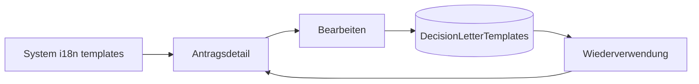
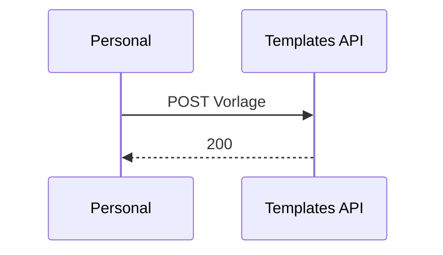

# 29 — Entscheidungsbrief-Vorlagen (Benutzer-CRUD)

[← Zurück](28-branch-rbac-superadmin.md) · [Inhalt](00-index.md) · [Weiter →](30-approve-gate-authority.md)

## Was ist das?

**Persönliche Vorlagen** für den Brief an den Kunden nach Genehmigung/Ablehnung. System-Standardvorlagen bleiben in der Client-i18n; Personal kann eigene Texte speichern und auswählen.



## Rolle in BankApp

Im Antragsdetail:

1. Systemvorlage wird automatisch nach UI-Sprache gefüllt
2. Auswahl TR / EN / DE Systemvorlagen möglich
3. Bearbeiteter Text per „Als Vorlage speichern“ im Benutzerkonto
4. Bei späteren Entscheidungen gespeicherte Vorlage erneut nutzen

## Wann hinzugefügt?

Direkt nach Filial-RBAC / SuperAdmin (Faz 6 UX).

## Grundbegriffe

| Begriff | Bedeutung |
|---------|-----------|
| Kind | `Approve` oder `Reject` |
| Locale | Vorlagensprache (`tr` / `en` / `de`) — unabhängig von UI-Sprache wählbar |
| System template | Client-i18n (`applications.templates.*`) |
| User template | DB-Tabelle `DecisionLetterTemplates`, benutzerspezifisch |
| Placeholders | `customerName`, `applicationNumber`, `amount`, `term`, `rate`, `reason` |



## Befehle

Nach Migration, API läuft — Vorlagenliste (JWT erforderlich):

```powershell
# Login (Lab-Passwort überall gleich)
curl.exe -s -X POST http://localhost:8080/api/Auth/Login `
  -H "Content-Type: application/json" `
  -d "{\"email\":\"staff.tr@bank.local\",\"password\":\"Demo123!\"}"
```

Verifikation: Antwort enthält `accessToken`. Danach:

```powershell
curl.exe -s http://localhost:8080/api/DecisionLetterTemplates `
  -H "Authorization: Bearer <token>"
```

Erwartet: JSON-Array (erste Nutzung kann leer sein).

## Klassen, Methoden, Pakete

- Entity: `DecisionLetterTemplate`
- Repo: `IDecisionLetterTemplateRepository` / `DecisionLetterTemplateRepository`
- MediatR: `Create` / `Update` / `Delete` / `GetList` DecisionLetterTemplate*
- Controller: `DecisionLetterTemplatesController`
- Client: `decisionTemplatesApi.ts`, Vorlagenauswahl in `ApplicationDetailPage`

## Wo im Repo?

- `src/Domain/Entities/DecisionLetterTemplate.cs`
- `src/Application/Modules/Identity/Features/DecisionLetterTemplates/`
- `src/WebApi/Modules/Identity/Controllers/DecisionLetterTemplatesController.cs`
- `client/src/api/decisionTemplatesApi.ts`
- `client/src/pages/ApplicationDetailPage.tsx`

## Mini-Ablauf

Personal öffnet Pending-Antrag → Systemvorlage in UI-Sprache → Text bearbeiten → „Als Vorlage speichern“ → beim nächsten Antrag eigene Vorlage im Select → Genehmigen/Ablehnen.

## Einstiegs-Lab

1. `staff.tr@bank.local` / `Demo123!` — Brief vorausgefüllt.
2. Als Vorlage speichern → im Select sichtbar.
3. `GET /api/DecisionLetterTemplates` — nur eigene Einträge.

## Häufige Fehler

- Vorlagen-**Locale** und UI-Sprache verwechseln.
- Fehlende Migration → API 500; WebApi neu bauen.

## Wo hilft es?

### Gesundheits-Checkliste

- [ ] Sprachwechsel im Detail erneuert Brief (wenn Text nicht „schmutzig“)
- [ ] Gelöschte Vorlage → Select zurück auf `system`
- [ ] Vorlagen anderer Benutzer nicht in der Liste

### Lab-Hinweis

Ohne Migration kann die API 500 liefern — Migrationen `AddDecisionLetterTemplates` / `AddDecisionTemplateNameAndDocAudit` anwenden (`docker compose up -d --build webapi` oder `dotnet ef database update`).

### Verwandte UX (gleicher Slice)

- Dokumenten-Freigabe-Tor: `CreditDocuments:ApproveGateMode` (`None` / `Soft` / `Hard`) — Details [30](30-approve-gate-authority.md)
- Genehmigungsbefugnis (DoA): `ApprovalAuthority` — Details [30](30-approve-gate-authority.md)
- Client: `GET /api/CreditDocuments/config` → `approveGateMode`, `maxApprovalAmount`
- Listen-Preset (Personal): „Pending + fehlende Dokumente“ → `Pending` + `missingRequiredDocumentsOnly`
- Entscheidungs-Audit: `DecisionBy` · `DecisionBranch*` · `DecisionTemplateName`
- Dokument-Upload → `CreditApplicationDocumentUploaded` SignalR-Toast + rotes Badge in Liste/Detail
