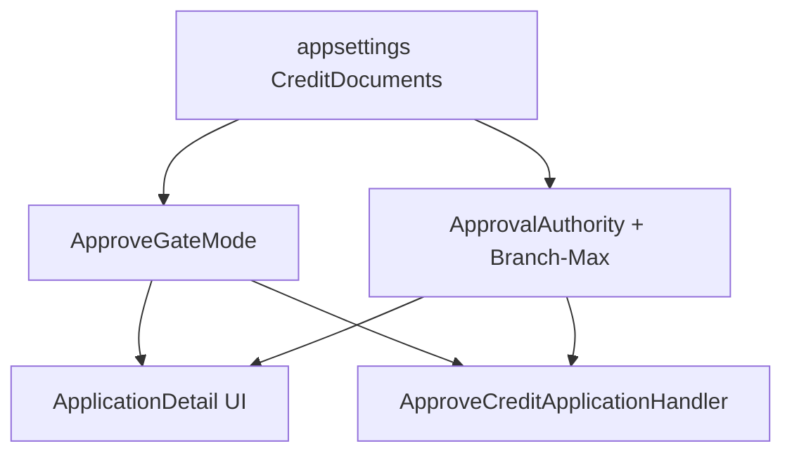
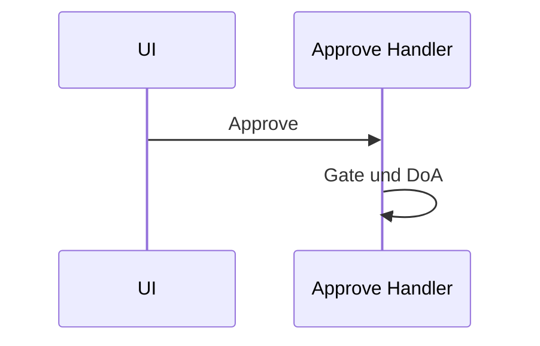

# 30 — Freigabe-Tor + Genehmigungsobergrenze (DoA)

[← Zurück](29-decision-letter-templates.md) · [Inhalt](00-index.md) · [Weiter →](31-elk-elasticsearch.md)

## Was ist das?

Zwei unabhängige Konfigurationen:

1. **ApproveGateMode** — für fehlende Ausweis/Einkommen: `None` / `Soft` / `Hard`
2. **ApprovalAuthority** — maximale Genehmigungssumme je Personalposition
3. **Branch.MaxApprovalAmount + MaxApprovalCurrencyCode** — optionales Filial-Limit (mit Währung); effektiv = `min(Position, Filiale)` nur bei **gleicher Währung**



## Rolle in BankApp

Im Lab: Development mit Soft + DoA aus; prod-ähnliche Basis Hard + DoA an. Code enthält immer beide Pfade; Umgebung wählt per `appsettings`. Filial-Limit verwaltet SuperAdmin auf der Filialseite; `UnlimitedRoles` umgeht beide Obergrenzen.

## Wann hinzugefügt?

Direkt nach dem Soft-Boolean-Tor (Faz 6 UX / Sicherheit).

## Grundbegriffe

| Begriff | Bedeutung |
|---------|-----------|
| Soft | Warnung + Bestätigung; API genehmigt |
| Hard | API + UI blockieren |
| DoA | Delegation of Authority — Position + Filial-Limit |
| AppliedMax | `min(PositionMax, BranchMax)` (gesetzt + passende Währung); kein Match → `0` |
| CurrencyCode | `ApprovalAuthority:CurrencyCode` (Position); Filiale eigene `MaxApprovalCurrencyCode` |
| UnlimitedRoles | BankManager / SuperAdmin — Position- und Filial-Limit bypass |



## Befehle

Config anzeigen (JWT Personal):

```powershell
# Nach Login mit Token
curl.exe -s http://localhost:8080/api/CreditDocuments/config `
  -H "Authorization: Bearer <token>"
```

Verifikation: `approveGateMode`, `approvalAuthorityEnabled`, `authorityCurrencyCode`, `maxApprovalAmount`, `positionMaxApprovalAmount` / `positionCurrencyCode`, `branchMaxApprovalAmount` / `branchCurrencyCode`. Optional `?currencyCode=EUR` filtert nach Antrags-Währung.

Soft in Development auf Hard: in `appsettings.Development.json` `ApproveGateMode` ändern und API neu starten.

## Klassen, Methoden, Pakete

- `ApproveDocumentGateMode`, `CreditDocumentsOptions`
- `ApprovalAuthorityOptions`, `ApprovalAuthorityEvaluator`
- `CreditApplicationBusinessRules.RequiredDocumentsShouldExistWhenHardGate`
- `CreditApplicationBusinessRules.ApprovedAmountShouldBeWithinApprovalAuthority`
- `ApproveCreditApplicationRequestHandler`
- `CreditDocumentsController.GetConfig`
- `Branch.MaxApprovalAmount` / `MaxApprovalCurrencyCode`, Filiale Create/Update/GetList

## Wo im Repo?

- `src/Application/.../CreditApplicationDocuments/`
- `src/Application/.../ApprovalAuthority/`
- `src/Domain/Entities/Branch.cs`
- `src/WebApi/appsettings.json` / `appsettings.Development.json`
- `client/src/api/creditDocumentsConfigApi.ts`
- `client/src/pages/ApplicationDetailPage.tsx`
- `client/src/pages/BranchesPage.tsx`
- BRD/FRD: `docs/requirements/`

## Mini-Ablauf

Personal öffnet Detail → `GET config` → bei Soft Confirm bei fehlenden Dokumenten; bei Hard gesperrter Button → bei DoA an: Betrag gegen `min(Position, Filiale)` (UI zeigt Aufschlüsselung) → Approve-Handler wendet dieselben Regeln serverseitig an.

Bildschirm (Pending-Detail — Genehmigen/Ablehnen + Dokumente):


Genehmigen/Ablehnen-Dialog:


## Einstiegs-Lab

1. `GET /api/CreditDocuments/config` — `approveGateMode`, Limits lesen.
2. Development Soft: genehmigen ohne Dokumente mit Confirm.
3. `Hard` in `appsettings.Development.json` → WebApi recreate.

## Häufige Fehler

- **ApproveGateMode** und **ApprovalAuthority** sind getrennte Configs.
- `min(Position, Filiale)` bei **unterschiedlicher Währung** — Lab: AppliedMax 0.

## Wo hilft es?

### Gesundheits-Checkliste

- [ ] Development Soft: Genehmigung ohne Dokumente nach Confirm
- [ ] Hard-Override: Approve ohne Dokumente → Geschäftsregel-Fehler
- [ ] DoA Enabled + CreditAnalyst niedriges Limit: hoher Betrag abgelehnt
- [ ] Filial-Limit unter Position: effektiv = Filiale; UI-Aufschlüsselung + Währungssymbol korrekt
- [ ] Währung in Filial-Formular/Tabelle wählbar/sichtbar
- [ ] Antrags-Währung ≠ Filial/Positions-Währung: Quelle „Nicht in dieser Währung“; AppliedMax=0
- [ ] Manager-Rolle: `maxApprovalAmount` null (Filial-Limit bypass)

Lab: kein FX; Limits mit einer Währung pro Quelle.
