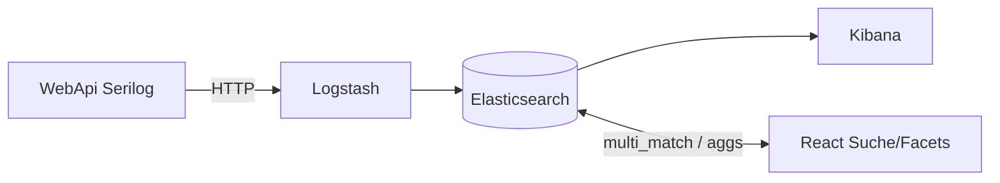

# 31 — ELK (Elasticsearch + Logstash + Kibana)

[← Zurück](30-approve-gate-authority.md) · [Inhalt](00-index.md) · [Weiter →](32-admin-tailwind-dashboard.md)

## Was ist das?

**ELK** ist ein dreiteiliges Observability- und Such-Stack:

| Teil | Rolle |
|------|-------|
| **Elasticsearch** | Indiziert JSON-Dokumente; Volltext- und Filterabfragen |
| **Logstash** | Nimmt Daten entgegen (HTTP/TCP/Beats), transformiert, schreibt nach ES |
| **Kibana** | Index-Exploration, Discover, Dashboard-UI |



Im BankApp-Lab nutzt ELK **fünf Aufgaben**:

1. **Kreditantrag-Suche** (Produkt-Read-Model → ES; React Live-Suche)
2. **Personalsuche** (`bankapp-staff`; Filiale / Text / Manager-Filter; SQL-Fallback)
3. **Kundenliste** (`bankapp-customers`; Filiale / Text; Facet-Filialzähler)
4. **Kreditarten** (`bankapp-credit-types`; Text / Locale / Kategorie / Währung / Risiko + Facets)
5. **Anwendungslogs** (Serilog → Logstash HTTP → `bankapp-logs-*`; in Kibana durchsuchbar)

**Seq wurde nicht entfernt.** Seq ist schnelles Lab-UX für strukturierte .NET-Logs; ELK ist Suchmaschine + Kibana. Beide laufen parallel.

## Rolle in BankApp

- Antragsliste: Suche beim Tippen (`searchText`, ~300 ms Debounce)
- **Personal-Seite:** `search` + `BranchFilter` + Manager/Aktiv-Chips; SuperAdmin alle Filialen
- Staff-Antragsliste: filialbezogen; Manager/SuperAdmin: breitere Filter
- **Manager/SuperAdmin Facet-Panel (Anträge):** Status / Filiale / Währung / fehlende Dokumente / Betragsbereich (`GET …/facets`)
- Listenfilter Betrag/Währung (`amountMin`/`amountMax`/`currencyCode`)
- ES aus: SQL `Contains` / `GroupBy`-Fallback
- Compose: `elasticsearch` :9200, `logstash` :8081/:50000, `kibana` :5601

## Wann hinzugefügt?

Faz 6 — nach Soft/Hard-Tor + DoA (Roadmap: Personal-GET-Suche).

## Grundbegriffe

| Begriff | Bedeutung |
|---------|-----------|
| Index | Tabellenähnliche Dokumentsammlung (`bankapp-credit-applications`, `bankapp-staff`, …, `bankapp-logs-YYYY.MM.dd`) |
| Document | Ein JSON-Datensatz (Antrag oder Log-Ereignis) |
| Mapping | Feldtypen (text / keyword / date…) — im Lab bei Index-Create keyword/boolean/number |
| Query | `multi_match`, `term`, `bool`-Filter, `range` (Betrag) |
| Aggregation | `terms` (Status/Filiale/Währung) + `range` (requestedAmount-Buckets) |
| Facet | Zähler mit Filter; Klick schreibt in Listen-Query |
| Pipeline | Logstash input → filter → output |
| Discover | Log-/Suche in Kibana per Index Pattern |

### Seq oder Elasticsearch? (Logs)

| | **Seq** | **Elasticsearch + Kibana** |
|--|---------|----------------------------|
| Zweck | Strukturierte .NET-Logs, schnelles Debug | Allgemeine Suche, Dashboards, viele Quellen |
| Setup | Leicht | Schwerer (RAM) |
| Tages-DX | Serilog-Sink, gute UI | Mächtig, höherer Ops-Aufwand |
| BankApp-Lab | **Primäres Log-UX** | Logs in Kibana **zusätzlich** durchsuchbar |

**Fazit:** Seq **nicht** durch ES ersetzen; Log-Suche mit Kibana **erweitern**. In Produktion nutzen manche Teams nur ELK — im Lab sind beide lehrreich.

## Befehle

### Stack starten

```powershell
cd infra
copy .env.example .env   # falls noch nicht vorhanden
docker compose --env-file .env up -d elasticsearch logstash kibana
```

Danach: `docker compose --env-file .env ps` → elasticsearch/kibana healthy.  
Bei wenig RAM in `.env`: `ELASTIC_JAVA_OPTS=-Xms256m -Xmx256m`.

### Elasticsearch-Gesundheit

```powershell
curl.exe -s http://localhost:9200
curl.exe -s http://localhost:9200/_cluster/health?pretty
```

Erwartet: `status` green/yellow (ein Knoten: yellow oft normal).

### Index-Liste

```powershell
curl.exe -s http://localhost:9200/_cat/indices?v
```

Nach WebApi-Start: `bankapp-credit-applications`, `bankapp-staff`, `bankapp-customers`, `bankapp-credit-types` und (mit Logs) `bankapp-logs-*`.

### Test an Logstash (TCP json_lines)

```powershell
echo '{"message":"lab-tcp-test","level":"Information"}' | curl.exe -s telnet://127.0.0.1:50000
```

Unter Windows alternativ: WebApi mit laufendem Logstash → Seq + Kibana Discover prüfen.

### Kibana

Browser: http://localhost:5601

1. Stack Management → Data Views → `bankapp-logs-*` (Timestamp-Feld)
2. Discover → Logs filtern
3. Zweite Data View: `bankapp-credit-applications`

### WebApi + Suche

```powershell
curl.exe -s "http://localhost:8080/api/CreditApplications?PageIndex=0&PageSize=10&searchText=APP" `
  -H "Authorization: Bearer <token>"
```

### Personal-ES-Filter (SuperAdmin / Manager)

```powershell
curl.exe -s "http://localhost:8080/api/StaffUsers?PageIndex=0&PageSize=10&search=manager&isManager=true&branchId=<guid>" `
  -H "Authorization: Bearer <superadmin-or-manager-token>"
```

Verifikation: Filiale / Text / `isManager` schränkt ein; ohne ES SQL-Fallback. UI: Suche + Filial-Select + Rollen-Chips; Bearbeiten-Modal.

### Manager-Facet-Aggregationen

Mit Manager-JWT. Liefert ES `terms`/`range`-Zähler im aktiven Filterkontext (`source: Elasticsearch` oder SQL-Fallback).

```powershell
curl.exe -s "http://localhost:8080/api/CreditApplications/facets" `
  -H "Authorization: Bearer <manager-or-superadmin-token>"
```

Verifikation: JSON mit `statuses`, `branches`, `currencies`, `missingRequiredDocuments`, `amountBuckets`. Liste einschränken: gleiche Parameter bei `GET /api/CreditApplications?amountMin=0&amountMax=50000&currencyCode=USD`.

## Klassen, Methoden, Pakete

- `ElasticsearchOptions`, `LogstashOptions`
- `ICreditApplicationSearchService` / `ElasticCreditApplicationSearchService` / `Null…`
- `IStaffUserSearchService` / `ElasticStaffUserSearchService` / `NullStaffUserSearchService` (`StaffIndex`)
- `ICustomerSearchService` / `ElasticCustomerSearchService` (`CustomersIndex`) + `GET /api/Customers/facets`
- `ICreditTypeSearchService` / `ElasticCreditTypeSearchService` (`CreditTypesIndex`) + `GET /api/CreditTypes/facets`
- `GetFacetsAsync`, `CreditApplicationAmountBuckets`, `GetCreditApplicationFacetsRequest`
- `GetListCreditApplicationRequest.SearchText` / `AmountMin` / `AmountMax` / `CurrencyCode`
- `GetListStaffUserRequest.Search` / `BranchId` / `IsManager`
- NuGet: `Elastic.Clients.Elasticsearch`, `Serilog.Sinks.Http`, `Serilog.Sinks.Elasticsearch`
- Client: `ApplicationsPage` / `StaffPage` / `CustomersPage` / `CreditTypesPage` Suche + Filter + Facets

## Wo im Repo?

- `infra/docker-compose.yml` — elasticsearch, logstash, kibana
- `infra/logstash/pipeline/logstash.conf`
- `infra/logstash/config/logstash.yml`
- `src/WebApi/Modules/Credit/Search/`
- `src/WebApi/Modules/Identity/Search/`
- `src/Application/Services/Search/`
- `src/Application/Modules/Credit/Features/CreditApplications/Queries/GetFacets/`
- `src/Core/Logging/SerilogHostBuilderExtensions.cs`
- `client/src/pages/ApplicationsPage.tsx`, `StaffPage.tsx`, `CustomersPage.tsx`, `CreditTypesPage.tsx`

## Mini-Ablauf

1. Compose ES+Logstash+Kibana
2. WebApi-Start → Reindex credit + staff + customers + credit-types
3. Antragsliste tippen → 300 ms → `searchText` → ES `multi_match` (sonst SQL)
4. Personal: Filiale / Suche / Manager → `bankapp-staff` (sonst SQL); Bearbeiten-Modal
5. Kunde: Suche + BranchFilter → `bankapp-customers`; Manager Facet Filiale
6. Kreditart: Suche + currency/risk → `bankapp-credit-types`; Manager Facets
7. Manager Facet-Chip → `GET /facets` → Liste schmaler
8. Serilog → Logstash HTTP → `bankapp-logs-*` → Kibana Discover

## Wo hilft es?

### Gesundheits-Checkliste

- [ ] `curl localhost:9200` antwortet
- [ ] Kibana öffnet; Log-Data-View anlegbar
- [ ] Antragssuche aktualisiert beim Tippen
- [ ] Personal: Filiale + Text + Manager; Modal zentriert
- [ ] Kunde / Kreditarten: Suche + Filter; Manager Facet-Zähler
- [ ] Manager Facet-Panel schränkt Liste ein
- [ ] ES aus: Liste + Facets + Personal/Kunde/Kreditarten per SQL-Fallback
- [ ] Staff sieht keine Anträge außerhalb der Filiale; kein Facet-Panel für Staff

### Disaster / Recovery (weniger → mehr)

1. `docker compose restart elasticsearch`
2. Index löschen / neu: WebApi-Restart (Reindex)
3. Volume löschen (**Daten weg**): `docker compose down`, dann `docker volume rm bankapp-elasticsearch-data` — `-v` betrifft alle Named Volumes; SQL-External-Volume beachten

Lab: ES startet unter Docker Desktop manchmal langsam (`start_period` 60s+).
