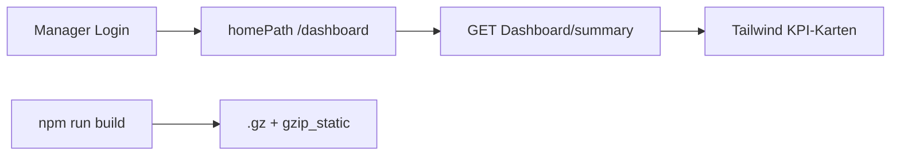

# 32 — Admin-Start-Dashboard (Tailwind + Bundle-Kompression)

[← Zurück](31-elk-elasticsearch.md) · [Inhalt](00-index.md) · [Weiter →](33-keycloak-lab.md)

Verwandt: [11 React + Vite](11-react-vite.md) · Dashboard-API (Credit-Modul)

## Was ist das?

**Tailwind CSS** ist eine Utility-first CSS-Bibliothek: fertige Klassen für Karten, Grid und Abstände (`rounded-xl`, `grid`, `px-4` …); der Build packt nur genutzte Klassen.

**Bundle-Kompression / Chunking** teilt JS in Vite-Produktionsbuilds (react, router, i18n …) und erzeugt **`.gz`** für nginx — kleinere erste HTTP-Antworten.



## Rolle in BankApp

- Manager / SuperAdmin landen auf **`/dashboard`** (Tailwind KPI + Schnelllinks)
- Bestehendes `GET /api/Dashboard/summary` wird wiederverwendet (kein neues Backend)
- Personal / Kunde nutzen weiter `/applications` als Start
- Compose-Client-Image: `manualChunks` + `gzip_static`

## Wann hinzugefügt?

Faz 6 — nach Manager-ES-Facet-Panel (Roadmap: Admin-Tailwind-Dashboard).

## Grundbegriffe

| Begriff | Bedeutung |
|---------|-----------|
| Utility class | Eine Aufgabe (`mt-3`, `flex`, `bg-amber-500`) |
| Preflight | Tailwind-Browser-Reset — in BankApp **aus** (bestehendes `index.css` bleibt) |
| manualChunks | Vendor-Pakete in separate JS-Dateien (Vite/Rollup) |
| gzip_static | nginx liefert vorgefertigte `.gz` ohne Laufzeit-Kompression |
| Admin home | Rollenbasierte Standardroute (`homePath`) |

## Befehle

### Abhängigkeiten (Client)

Bei TLS/Proxy: `$env:NODE_OPTIONS='--use-system-ca'`

```powershell
cd client
npm install
```

Verifikation: `package.json` enthält `tailwindcss`, `@tailwindcss/vite`, `vite-plugin-compression`.

### Dev-Server

```powershell
cd client
npm run dev
```

Browser: http://localhost:3000 — Manager-Login → `/dashboard`.

### Produktionsbuild + Chunk/Gzip

```powershell
cd client
npm run build
```

Unter `dist/assets/`: `react-vendor-*.js`, `i18n-*.js`, `*.gz`. Großes Single-Bundle wird aufgeteilt.

### Compose-Client neu bauen

```powershell
cd infra
docker compose --env-file .env up -d --build client
```

## Klassen, Methoden, Pakete

- `AdminDashboardPage`, `HomeRedirect`, `homePath()`
- `getDashboardSummary` / `DashboardSummary`
- npm: `tailwindcss`, `@tailwindcss/vite`, `vite-plugin-compression`
- Vite: `manualChunks` + Compression-Plugin; nginx: `gzip_static on`

## Wo im Repo?

- `client/src/pages/AdminDashboardPage.tsx`
- `client/src/styles/tailwind.css`
- `client/src/utils/homePath.ts`
- `client/src/components/HomeRedirect.tsx`
- `client/vite.config.ts`, `client/nginx.conf`
- `client/src/App.tsx`, `AppLayout.tsx`, `LoginPage.tsx`

## Mini-Ablauf

1. Manager-Login → `homePath(true)` → `/dashboard`
2. Seite lädt `getDashboardSummary` → KPI-Karten
3. Link „Ausstehend“ → `/applications?status=Pending`
4. `npm run build` → Vendor-Chunks + `.gz` → nginx `gzip_static`

## Wo hilft es?

### Gesundheits-Checkliste

- [ ] Manager-Login öffnet `/dashboard`
- [ ] KPI-Zahlen konsistent mit StatsStrip / alter Zusammenfassung
- [ ] Staff / Kunde sehen `/applications` als Start
- [ ] Nach `npm run build` existieren `dist/assets/*.gz`
- [ ] Compose-Client healthy; Tailwind-Karten sichtbar

### Disaster / Recovery (weniger → mehr)

1. Lokaler Build-Fehler → `NODE_OPTIONS=--use-system-ca` und `npm install`
2. Stile fehlen → Import-Reihenfolge `tailwind.css` (`main.tsx`: tailwind vor `index.css`)
3. Altes Client-Image → `docker compose up -d --build client`
